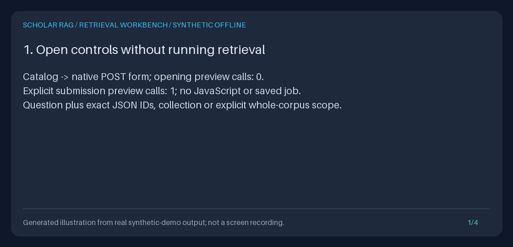

# Native retrieval-preview workbench

Open `/explore/retrieve`, explicitly submit a question and corpus selection, then
inspect the **actual prepared passages before deciding whether to generate**.
The browser now offers the same preparation as `POST /retrieve` and Python
`AgentRunner.preview`: no live or fake generation, grounding, ingestion, saved
run, or agent-event writes. GET only opens controls.



[Static preview](../assets/native-retrieval-workbench.png) and
[text transcript](../assets/native-retrieval-workbench.txt) are alternatives.
This reproducible Pillow illustration uses measured, executed TestClient
outcomes; it is **not browser footage**, a scientific result, or a search-quality
benchmark. All fixture text is original synthetic material.

## Why this integrated capability

Previously the browser could inspect documents, literal matches, collections,
question-by-paper worksheets and saved runs, but it had no **single question to
prepared-context** form. Researchers had to assemble JSON or Python calls to
check the merged context, policy effects and minimum-document diagnostic.
The workbench adds that interaction, not another connector, extractor or engine.

The original design references, verified during the **2026-10-30 maintainer
run**, are Haystack's [retriever documentation](https://docs.haystack.deepset.ai/docs/retrievers)
and RAGFlow's [retrieval-testing guide](https://github.com/infiniflow/ragflow/blob/main/docs/guides/dataset/retrieval_testing.md).
They motivate inspecting recalled chunks and ranking separately from answer
generation. This is inspiration, not a dependency, copied implementation,
feature-parity claim or performance comparison.

Scholar RAG still uses Python 3.11+, FastAPI, Pydantic, HTTPX and SQLite with a
hand-written Observe-Decide-Act state machine, **not LangGraph**. Default retrieval
uses deterministic HyDE expansion, lexical hash-vector cosine, BM25/RRF, bounded
entity co-mention graph traversal and lexical reranking. Hash vectors are **not
learned semantic embeddings**; scores are not probabilities of scientific truth.
No provider, model default, dependency or persistent schema changes here.

## Offline setup and browser workflow

Install the existing development extras once (`uv sync --extra dev`); dependency
installation needs package access. The actual demo and default preview runtime
need no provider keys, paid inference, external HTTP or model download.

For a reproducible offline workflow without a server or ambient credentials:

```bash
DEMO="$(mktemp -d)/native-retrieval-workbench"
uv run python -m scripts.demo_retrieval_workbench --output-dir "$DEMO"
uv run python -m scripts.create_retrieval_workbench_gif \
  --transcript "$DEMO/transcript.txt" --output "$DEMO/workbench.gif"
```

The demo initializes a temporary synthetic corpus, executes the native form,
compares its context with API/Python preparation, opens an exact current source,
checks failed/empty selections, and measures forbidden calls and unchanged
database bytes. It refuses to overwrite an existing output directory. Its
temporary database is removed, while HTML, JSON, checks and transcript remain
in the chosen output directory. Opening saved HTML is not a live app; its local
navigation and forms require the running service.

For interactive use, follow the [offline loopback Quickstart](../../QUICKSTART.md)
and ingest only permitted local material through the existing explicit ingestion
workflow. The workbench does not ingest for you. Then:

1. Open `http://127.0.0.1:8000/explore` and choose **Preview retrieval before
   generation**, or use **Preview retrieval in this paper** on a document.
   A collection page offers **Preview retrieval in all current collection members**.
2. Enter one nonblank question and choose **Whole corpus**, **Document IDs**, or
   **Saved collection (all members)**. Enter the matching selection only. Both
   selection fields must be blank for Whole corpus. Opening a prefilled link
   never runs retrieval; catalog filters are navigation, not retrieval scope.
3. Optionally enter a per-document quota, minimum distinct-document count, or
   near-duplicate threshold. Blank means unconfigured, not zero.
4. Click **Preview prepared evidence**. Inspect the resolved scope, selected
   policy, diagnostic, actual plan, effective limits, complete context/digest and
   ordered source cards. Follow an exact source-context link if needed.

The form submits UTF-8 URL-encoded POST with an exact same-origin `Origin`.
Same-origin referrer policy preserves native Chromium form behavior; no scripts,
cookies, hidden computation, polling, automatic submission or browser storage
are used. Under a mount or trusted proxy root path, all links and actions retain
the prefix. Do not copy bare `/explore` links when a deployment has a prefix.

### Scope and policy meaning

Explicit document scope accepts the API's 1-100 supplied IDs, each 1-128
characters after outer whitespace trimming. Duplicates keep first-seen order;
the submitted count is bounded before deduplication. Use exact JSON strings,
not paper titles. Quotes, slashes, Unicode, internal control characters and
escapes are preserved by JSON controls; decode quotes/escapes once for a raw ID.
The displayed resolved scope is the authority after shared normalization.
Unknown document IDs match nothing, never a fallback corpus.

Collection scope resolves **all current members once before retrieval**, not
the visible collection page or current human includes. Unknown, corrupt or
missing-member collections fail. An empty or ambiguous selection is rejected,
never silently widened. Revision-bound `screened_collection` remains available
through the existing JSON API, not this deliberately bounded form.

| Optional control | Existing shared behavior |
| --- | --- |
| `max_chunks_per_document` | Integer 1-50; caps passages per actual document ID after reranking and optional collapse |
| `min_evidence_documents` | Integer 1-50; counts distinct document IDs in the final prepared context |
| `near_duplicate_threshold` | Finite number greater than 0 and at most 1; lexical Jaccard collapse before quota and minimum assessment |

The native threshold control accepts ASCII decimal/exponent spellings such as
`.9`, `00.9` and `9e-1`, all interpreted as `0.9`. Shared request validation
still rejects nonfinite values, zero and values above one. The JSON API remains
strict: send a JSON number, not a quoted numeric string.

These policies do not refill the bounded candidate pool. The minimum may fail
after a quota or collapse. **Minimum not met** retains the actual evidence and
is a successful diagnostic, not an operational failure or empty success.
**Minimum met** proves only a count, not independence, relevance, answerability
or scientific support. Blank minimum displays "not requested," not a pass.
Paths retain the winning result's retrieval/transformation provenance, not every
candidate path, model reasoning or scientific causality.

## Equivalent JSON API and Python

The existing API is unchanged; it does not require the browser form's Origin or
accept its `scope`/navigation fields. For example, after explicitly ingesting:

```bash
curl --fail-with-body --silent --show-error http://127.0.0.1:8000/retrieve \
  -H 'Content-Type: application/json' \
  -d '{"query":"What are the local retrieval limitations?","document_ids":["synthetic-a","synthetic-b"],"max_chunks_per_document":1,"min_evidence_documents":2,"near_duplicate_threshold":0.9}'
```

Use your actual ingestion IDs. Omit scope fields for the whole corpus, or replace
`document_ids` with one `collection_id`. Null is not omission. The
[existing preview guide](RETRIEVAL_PREVIEW_GUIDE.md) documents the full response,
error codes and complete offline Python setup. With your existing container:

```python
preview = await container.runner.preview(
    "What are the local retrieval limitations?",
    document_ids=["synthetic-a", "synthetic-b"],
    max_chunks_per_document=1,
    min_evidence_documents=2,
    near_duplicate_threshold=0.9,
)
print(preview.evidence_assessment)
print(preview.context_sha256)
for source in preview.sources:
    print(source.rank, source.chunk.document_id, source.chunk.chunk_id)
    print(source.retriever, source.path, source.chunk.text)
```

For a collection in Python, resolve `container.paper_collections.resolve(id)`
once and pass its tuple as `document_ids`; do not convert an empty tuple to None.
The browser calls the existing `api.retrieval.retrieve` function in process:
`RetrievalRequest` validation -> `resolve_document_scope` -> `runner.preview`.
There is no internal HTTP call or second retrieval engine. API, Python and
browser submissions are separate computations, not one retained result.

## Bounded output and explicit errors

The browser has a 2,000-character question cap, 65,536-byte wire body and
form-opening query cap, at most eight unique fields, and 16,384 characters per
selection/return field. Strict parsing rejects duplicate/unknown fields,
malformed percent escapes, invalid ASCII/UTF-8 wire data, deeply nested/invalid
JSON, literal NUL in POST fields, invalid content lengths and POST query controls
before preview. A NUL inside an exact GET-prefilled ID is preserved as a JSON
escape in its native control, never emitted as a literal HTML NUL.
Numbers must obey the shared API types/bounds; booleans, null and nonfinite
values are not policy controls.

Existing configuration still caps final prepared passages at 1-50, graph hops
and cooperative phase deadlines. Shared capture limits remain 50 sources,
262,144 UTF-8 context bytes and 1,048,576 serialized internal snapshot bytes.
Complete escaped browser HTML has its own **1,048,576-byte cap**, including the
form, context, sources and metadata. No paging, text clipping or partial result
is introduced. Escaping/duplicate presentation can exceed HTML limits even when
JSON capture fits; narrow the scope or use the existing JSON/Python interface.
These limits do not preempt synchronous CPU/SQLite work or provide rate limiting.

| Status | Meaning and recovery |
| --- | --- |
| 200 | Complete preview, including honest no matches or a failed minimum count |
| 403 / 415 | Wrong/missing Origin or unsupported form encoding; use the local native form |
| 404 / 409 / 503 | Unknown/broken collection or unavailable storage; do not broaden scope to hide the failure |
| 409 | LLM-backed HyDE rejected without substitution, or text not faithfully representable as HTML |
| 413 / 422 | Wire/output cap or invalid input; correct/reduce it before submitting |
| 500 / 504 | Planning, retrieval, provenance/capture failure or existing phase timeout |
| 405 | Unsupported method; GET opens and POST explicitly computes |

Operational failures are **not empty successful previews**. Native error pages
show no partial sources or echoed private diagnostics; stable error codes are
logged. All native responses use no-store, CSP, nosniff and framing protection.
Source labels and metadata are escaped literal text, never external links.

## Current versus frozen evidence, privacy and portfolio

This view shows a detached preparation of the **current** indexes, not a saved
run or a transaction reserving corpus contents. Source-context links read current
stored chunks and can change, disappear or fail if source ordering metadata is
missing. Repeating a preview after edits/restart can differ. The exact context
and passage digests identify text, not its authenticity or scientific validity.
Only a separate explicit `/query` run uses generation and durable run events;
its [frozen evidence exports](EVIDENCE_EXPORT_GUIDE.md) describe what that run
actually used, not what an earlier preview promised.

No automatic external request, generation or ingestion is added. Normal app
startup still initializes schemas and indexes; arbitrary injected custom Python
components are not sandboxed. The service has no built-in authentication or
tenant isolation. Use loopback or your own access controls and trusted hosts/proxy.
Same-origin checks deter cross-origin browser posts, not direct clients, DNS
rebinding or malicious local processes. POST hides questions from the address
bar, not infrastructure logs or browser resubmission state. IDs can remain in
history; no-store cannot stop printing, saving or screenshots. Review all source
permissions and sensitive text before sharing.

For a portfolio demonstration, show a synthetic scoped question, the actual
ordered provenance, and a deliberately unmet minimum; follow an exact source
link and contrast a second explicit policy submission. Present the measured
zero generation/event/network calls and unchanged database bytes, not a
fabricated answer or an accuracy claim. The generated GIF/static/text alternatives
are reproducible illustrations of this workflow, not evidence of research quality.
