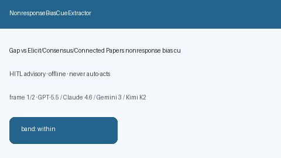

# NonresponseBiasCueExtractor Guide



Offline cue extractor for nonresponse bias signals.
Gap vs Elicit/Consensus/Connected Papers nonresponse bias cue extractors. Distinct from `SelectionBiasCueExtractor` / `VolunteerBiasCueExtractor`.

Optional narrative via **GPT-5.5 / Claude Sonnet 4.6 / Gemini 3.x / Kimi K2**.

## Usage

```python
from retrieval.nonresponse_bias_cues import NonresponseBiasCueExtractor

rows = NonresponseBiasCueExtractor().extract(
    [{"paper_id": "p1", "abstract": "Evidence of nonresponse bias in the cohort."}],
)
assert rows[0].flagged is True
```

## Safety

Advisory only. No network I/O. Never auto-acts.
