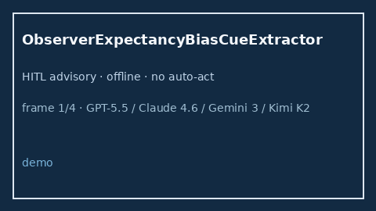

# ObserverExpectancyBiasCueExtractor Guide



Offline bias-cue extractor for literature triage.
Gap vs Elicit/Consensus/Connected Papers observer-expectancy bias cue extractors. Distinct from `DetectionBiasCueExtractor` / `RecallBiasCueExtractor`.

Stack: **GPT-5.5 / Claude Sonnet 4.6 / Gemini 3.x / Kimi K2**.

## Usage

```python
from retrieval.observer_expectancy_bias_cues import ObserverExpectancyBiasCueExtractor

rows = ObserverExpectancyBiasCueExtractor().extract(
    [{"paper_id": "p1", "abstract": "Risk of observer expectancy bias without blinding."}],
)
print(rows[0].flagged, rows[0].cues)
```

## Safety

Advisory cues only. No network I/O. Humans decide inclusion.
