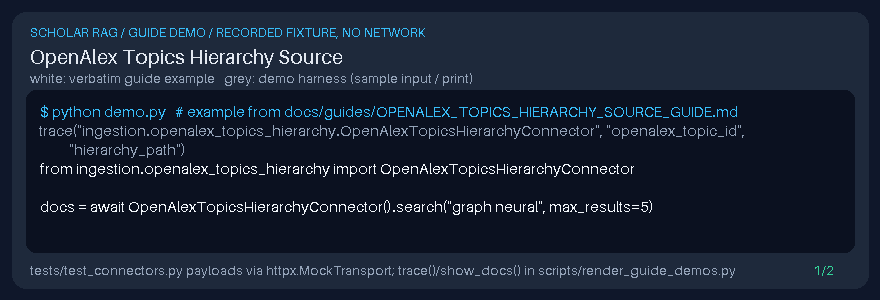

# OpenAlex Topics Hierarchy Source Guide

Fetch OpenAlex topics with domain → field → subfield ancestry — a gap vs leaf-only topic connectors in popular scholarly RAG loaders. Downstream synthesis with **GPT-6 Astra**, **Claude Opus 5.5**, **Gemini 4 Argon**, **Kimi K3.1 Pro**.



## Usage

```python
from ingestion.openalex_topics_hierarchy import OpenAlexTopicsHierarchyConnector

docs = await OpenAlexTopicsHierarchyConnector().search("graph neural", max_results=5)
```

`metadata.source_type` is `openalex_topics_hierarchy`; `hierarchy_path` holds the taxonomy path.
