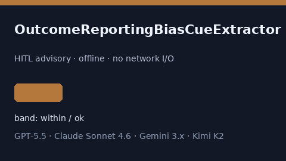

# OutcomeReportingBiasCueExtractor Guide



Offline HITL helper for `cues` bands.
Gap vs Elicit/Consensus/AJE outcome-reporting bias cue extractors. Distinct from `PublicationBiasCueExtractor` / `SpinPHackingCueExtractor`.

Optional polish via **GPT-5.5 / Claude Sonnet 4.6 / Gemini 3.x / Kimi K2**.

## Usage

```python
from retrieval.outcome_reporting_bias_cues import OutcomeReportingBiasCueExtractor

rows = OutcomeReportingBiasCueExtractor().extract(
    [
        {
            "paper_id": "p1",
            "abstract": "Authors note outcome reporting bias concerns.",
        }
    ],
)
print(rows[0].flagged, rows[0].cues)
```

## Safety

Advisory only. No network I/O. Never auto-acts. Humans decide.
