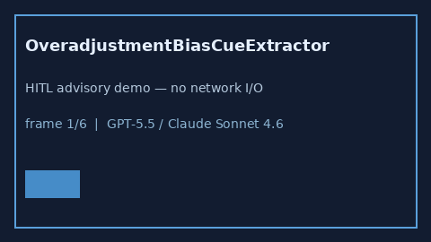

# OveradjustmentBiasCueExtractor Guide



Offline advisory bias cues.
Gap vs Elicit/Consensus/Connected Papers overadjustment bias cue extractors. Distinct from `ResidualConfoundingCueExtractor` / `ColliderStratificationCueExtractor`.

Optional narrative via **GPT-5.5 / Claude Sonnet 4.6 / Gemini 3.x / Kimi K2**.

## Usage

```python
from retrieval.overadjustment_bias_cues import OveradjustmentBiasCueExtractor

rows = OveradjustmentBiasCueExtractor().extract(
    [
        {
            "paper_id": "p1",
            "abstract": "Concern for overadjustment bias after adjusting for a mediator.",
        }
    ],
)
print(rows[0].flagged, rows[0].cues)
```

## Safety

Advisory only. No network I/O. Never auto-acts.
