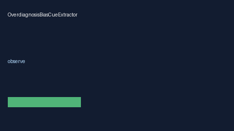

# OverdiagnosisBiasCueExtractor Guide



Offline deterministic cue extractor. Never network I/O. Gap vs Elicit/Consensus/AJE overdiagnosis-bias cue extractors.

Optional later narrative via **GPT-5.5 / Claude Sonnet 4.6 / Gemini 3.x / Kimi K2**.

## Usage

```python
from retrieval.overdiagnosis_bias_cues import OverdiagnosisBiasCueExtractor

cues = OverdiagnosisBiasCueExtractor().extract(
    [
        {
            "paper_id": "p1",
            "abstract": "Outcome rates may reflect overdiagnosis bias in screening cohorts.",
        }
    ]
)
print(cues[0].flagged, cues[0].cue_kind)
```
