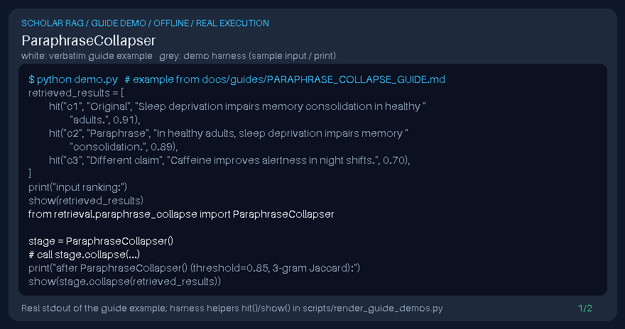

# ParaphraseCollapser Guide



Gap fill vs LlamaIndex/Haystack paraphrase-aware dedupe stages that word-Jaccard near-duplicate collapse misses.

Works with GPT-6 Astra / Claude Opus 5.5 / Gemini 4 Argon / Kimi K3.1 Pro scholarly RAG pipelines.
Not a DOI connector.

## Usage

```python
from retrieval.paraphrase_collapse import ParaphraseCollapser

stage = ParaphraseCollapser()
# call stage.collapse(...)
```

See unit tests for edge cases.
