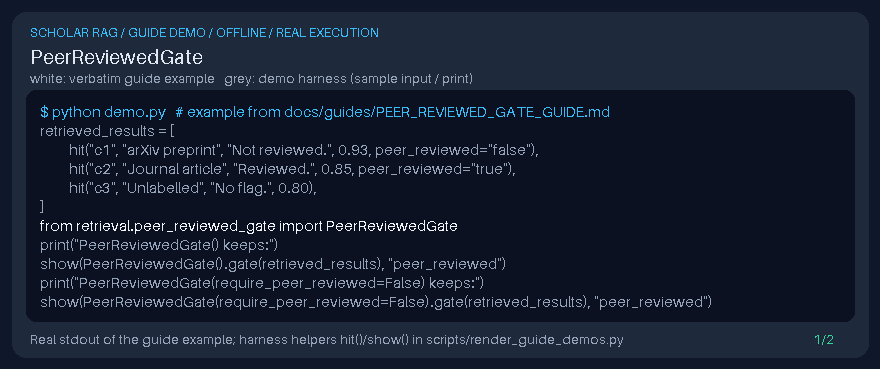

# PeerReviewedGate Guide



Local retrieval postprocessor for GPT-6 Astra / Claude Opus 5.5 / Gemini 4 Argon / Kimi K3.1 Pro pipelines (not a DOI connector).

Inspired by scholarly RAG stacks that prefer peer-reviewed sources over preprints when summarizing evidence.

## Usage

```python
from retrieval.peer_reviewed_gate import PeerReviewedGate
```

See unit tests for edge cases.
