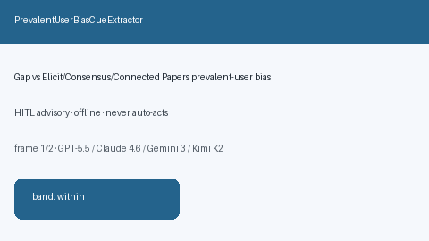

# PrevalentUserBiasCueExtractor Guide



Offline cue extractor for prevalent user bias signals.
Gap vs Elicit/Consensus/Connected Papers prevalent-user bias cue extractors. Distinct from `HealthyUserBiasCueExtractor` / `DepletionOfSusceptiblesCueExtractor`.

Optional narrative via **GPT-5.5 / Claude Sonnet 4.6 / Gemini 3.x / Kimi K2**.

## Usage

```python
from retrieval.prevalent_user_bias_cues import PrevalentUserBiasCueExtractor

rows = PrevalentUserBiasCueExtractor().extract(
    [{"paper_id": "p1", "abstract": "Evidence of prevalent user bias in the cohort."}],
)
assert rows[0].flagged is True
```

## Safety

Advisory only. No network I/O. Never auto-acts.
