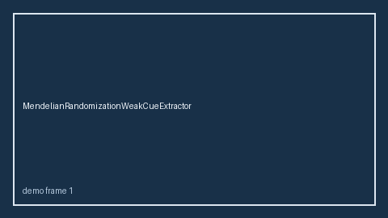

# ProtocolAmendmentCueExtractor Guide



Offline deterministic cue extractor.
Gap vs Elicit/Consensus/Connected Papers protocol-amendment cue extractors. Distinct from `OutcomeSwitchingCueExtractor` / `WinnerCurseCueExtractor`.

Optional narrative polish via **GPT-6 Astra / Claude Opus 5.5 / Gemini 4 Argon / Kimi K3.1 Pro**.

## Usage

```python
from retrieval.protocol_amendment_cues import ProtocolAmendmentCueExtractor

rows = ProtocolAmendmentCueExtractor().extract(
    [{"paper_id": "p1", "abstract": "We discuss protocol amendment."}]
)
print(rows[0].cues)
```

## Safety

Advisory only. No network I/O.
