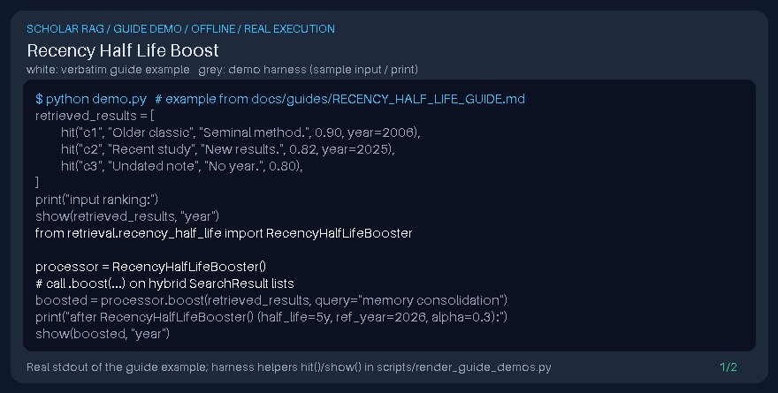

# Recency Half Life Boost Guide



Inspired by temporal decay ranking in Haystack/Elasticsearch; blends relevance with publication-year half-life decay from chunk metadata (not a DOI connector).

Works with GPT-6 Astra / Claude Opus 5.5 / Gemini 4 Argon / Kimi K3.1 Pro answer stacks.

## Usage

```python
from retrieval.recency_half_life import RecencyHalfLifeBooster

processor = RecencyHalfLifeBooster()
# call .boost(...) on hybrid SearchResult lists
```

## Safety

Local metadata only — no network calls and no DOI connector side effects.
