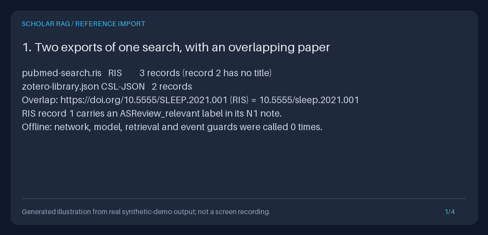

# Import a reference library into a paper collection

A systematic review starts from the search results you exported from PubMed, Embase,
Scopus or Web of Science, or from the library you keep in Zotero, Mendeley or EndNote.
This feature imports those files into a **paper collection that is ready for screening**,
fully offline:

1. **Upload** one to five RIS, PubMed MEDLINE/NBIB, CSL-JSON or CSV/TSV files.
2. **Preview** (a dry run): per file you see the format, records read, every skipped
   record with its reason and line number, duplicates within the import and against the
   target collection, and the papers that would be added. Nothing in the corpus,
   collections or screening changes.
3. **Commit** explicitly: only new papers are stored and added, through the same atomic
   collection store as the native collection builder and editor. Each paper records where
   it came from, and the collection keeps an import record with counts per file.

Existing papers and members are never deleted, overwritten or reordered. Re-importing the
same file reports duplicates instead of doubling the collection. Include/exclude labels in
the files (for example ASReview's `included` column) are **counted and ignored**: every
imported paper starts unscreened and only a human records decisions.

[](../assets/reference-import.gif)

The static preview links to an opt-in four-frame GIF. It is a **generated illustration of
actual offline execution** (the real browser routes and JSON API on synthetic files, with
measured numbers), not browser footage. The [measured transcript](../assets/reference-import.txt)
is the text alternative. All records are original synthetic fixtures.

## Contents

- [Why this closes a workflow gap](#why-this-closes-a-workflow-gap)
- [Prerequisites](#prerequisites)
- [Quickstart: offline demo](#quickstart-offline-demo)
- [Supported formats and field mapping](#supported-formats-and-field-mapping)
- [Exporting from common tools](#exporting-from-common-tools)
- [Browser walkthrough](#browser-walkthrough)
- [API reference](#api-reference)
- [Python](#python)
- [Duplicate detection rules](#duplicate-detection-rules)
- [Limits](#limits)
- [Provenance](#provenance)
- [How it feeds screening and other features](#how-it-feeds-screening-and-other-features)
- [Safety and privacy](#safety-and-privacy)
- [Troubleshooting](#troubleshooting)
- [FAQ](#faq)
- [Limitations and roadmap](#limitations-and-roadmap)

## Why this closes a workflow gap

Before this feature, collections could only be built from the repository's own API
connectors (PubMed, arXiv, OpenAlex and others) or `POST /ingest/text`. There was BibTeX
*export*, but no way to bring in the reference files a review actually starts from, and the
[screening progress report](SCREENING_REPORT_GUIDE.md) noted that it had no identified-record
totals or deduplication counts. Popular screening tools all start with an import step:

| Project | What it imports | Duplicates | Labels in the file |
| --- | --- | --- | --- |
| [ASReview LAB](https://github.com/asreview/asreview/blob/main/docs/source/lab/data_format.rst) | RIS (via rispy), CSV/TSV/XLSX with `title`, `abstract`, `authors`, `doi`, `keywords`, `url` and `included`-style columns | Separate deduplication tooling | Used as prior knowledge or simulation labels |
| [Rayyan](https://help.rayyan.ai/hc/en-us/articles/4406426903825-Supported-File-Formats-for-Importing-into-Rayyan) | RIS, EndNote, BibTeX, CSV, PubMed (NBIB and XML), Web of Science, PDFs | Duplicate detection inside the review | Not documented on that page |
| [Covidence](https://support.covidence.org/help/citation-imports) | EndNote XML, PubMed format (.txt/.nbib/.xml), RIS | Automatic de-duplication on import, counted on its PRISMA chart | Not documented on that page |
| [Zotero](https://www.zotero.org/support/kb/exporting) | Exports CSL JSON, RIS, BibTeX and more | Manual merge in the library | n/a |
| [rispy](https://github.com/MrTango/rispy) | The reference Python RIS parser and tag mapping that ASReview uses | n/a | n/a |
| **This repository (before)** | Only built-in API connectors and `POST /ingest/text`; BibTeX export only | Read-only duplicate *inspection* of a saved collection | n/a |
| **This repository (now)** | RIS, PubMed MEDLINE/NBIB, CSL-JSON, CSV/TSV (ASReview-style columns, Web of Science tags), with a dry-run preview that lists every skipped record by line | Exact DOI, PMID, identical content, then title + year, within the import and against the collection; existing papers are never removed | **Counted and ignored**: never stored, never screening decisions |

Deliberately left out for now (see [Limitations and roadmap](#limitations-and-roadmap)):
BibTeX, XLSX and EndNote XML import, fuzzy-title removal, and PRISMA diagrams.

The format references are the [RIS tag summary](https://en.wikipedia.org/wiki/RIS_(file_format)),
the [MEDLINE/PubMed element descriptions](https://www.nlm.nih.gov/bsd/mms/medlineelements.html)
and the [CSL-JSON schema](https://github.com/citation-style-language/schema).

## Prerequisites

- Python 3.11 or 3.12 and the development install from the [Quickstart](../../QUICKSTART.md).
- No model credentials, network access or extra packages: the parsers use only the
  standard library (`csv`, `json`, `re`) and the existing `python-multipart` dependency.
- Exported files in UTF-8 (a UTF-8 byte-order mark from Excel is fine) or BOM-marked UTF-16
  (Excel "Unicode text").

## Quickstart: offline demo

Run the executed demo. It writes two synthetic input files, previews and commits them
through the real browser routes, re-imports them through the JSON API and saves every
response next to a transcript:

```bash
PYTHONPATH=src:. python -m scripts.demo_reference_import --output-dir demo-output/import
PYTHONPATH=src:. python -m scripts.create_reference_import_gif \
  --transcript demo-output/import/transcript.txt \
  --output demo-output/import/import.gif --still demo-output/import/import.png
```

Both scripts refuse to overwrite existing paths. Actual transcript excerpt:

```text
2. Preview (dry run): everything reported, nothing written
Records read 5 | skipped 1 | duplicates within the import 1 | new papers 3
Skipped: file 1, record 2, line 11: missing_title
Duplicate: file 2, record 1 matches file 1, record 1 by doi
Labels in the files (ignored): 1 included, 0 excluded
Before commit: 0 documents, 0 collections (only a private 24-hour draft)
```

To try your own files, start the app (`scholar-rag-api`), open
`http://127.0.0.1:8000/explore/collections` and choose **Import references**, or use the
API:

```bash
curl -s -F "files=@pubmed-search.ris" -F "files=@zotero-library.json" \
  -F "new_collection_name=Sleep and caffeine review" \
  http://127.0.0.1:8000/collections/imports/preview > preview.json
curl -s -H "Content-Type: application/json" \
  -d "{\"draft_id\": \"$(python -c 'import json; print(json.load(open("preview.json"))["draft_id"])')\"}" \
  http://127.0.0.1:8000/collections/imports
```

## Supported formats and field mapping

With `format=auto` (the default) the format is detected from the content first: a leading
`[` or `{` is CSL-JSON, a `TY  - ` line is RIS, a `PMID- ` line is MEDLINE; otherwise the
extension or header row decides between CSV and TSV. Choose a format explicitly when
detection fails. Every format maps to the same paper fields; the first non-empty source
wins unless noted. Line breaks inside an abstract are kept; other whitespace is collapsed.

### RIS (`.ris`, `.txt`)

Records run from `TY  - ` to `ER  - `. Untagged lines continue the previous tag's value.
Tag lines with one or two spaces before the hyphen are accepted; CRLF, CR and LF line
endings and a UTF-8 BOM are handled. Header lines before the first `TY` are ignored.

| Paper field | RIS tags (priority order) | Notes |
| --- | --- | --- |
| Title | `TI`, `T1`, `CT`, `BT` | Only the first tag present is used, so a chapter's `T1` wins over its book title `BT` |
| Abstract | `AB`, `N2` | Repeated `AB` lines become paragraphs |
| Authors | `AU`, `A1` | Repeated tags keep their order; exact repeats are dropped |
| Year | `PY`, `Y1`, `DA` | First standalone four-digit year (`2021/03/14/` gives 2021) |
| DOI | `DO`, `DI` | Normalized (see [Duplicate detection rules](#duplicate-detection-rules)) |
| PMID | `PMID: n` in `AN`, `N1`, `M1`, `M2`; a PubMed `UR`; or a numeric `AN` when `DB`/`DP` names PubMed, MEDLINE or NLM | |
| Journal | `JO`, `JF`, `T2`, `JA`, `J2` | |
| Volume, issue, pages | `VL`, `IS`, `SP`-`EP` | |
| Keywords | `KW` | Repeated |
| URL | `UR` | First `http(s)` value |
| Type | `TY` | For example `JOUR` |
| Original identifiers | `ID`, `AN`, `DO`, `DI` | Kept verbatim as provenance |
| Label (ignored) | `ASReview_relevant` / `ASReview_irrelevant` in `N1` | Counted only |

A record without `ER` (for example a truncated export) is reported as
`unterminated_record` and skipped, as is an open record followed by another `TY`.

### PubMed MEDLINE / NBIB (`.nbib`, `.txt`)

In PubMed choose **Send to > Citation manager** (an `.nbib` file) or save results in
**PubMed** format. Tags are padded to four characters (`PMID- `, `TI  - `, `FAU - `);
six-space lines continue a value. Blank lines or a new `PMID` separate records.

| Paper field | MEDLINE tags | Notes |
| --- | --- | --- |
| PMID | `PMID` | |
| Title | `TI`, `BTI` | Continuation lines are joined |
| Abstract | `AB` | |
| Authors | `FAU` (full names), else `AU`, else `CN` | |
| Year | `DP`, `DEP`, `DA` | `2021 Mar 14` gives 2021 |
| DOI | `LID` or `AID` ending in `[doi]` | `[pii]` values are kept only as provenance |
| Journal | `JT`, `TA` | |
| Volume, issue, pages | `VI`, `IP`, `PG` | |
| Keywords | `MH` (MeSH), `OT` | |
| Type | All `PT` values joined with `; ` | For example `Journal Article; Randomized Controlled Trial` |
| Original identifiers | `PMID`, `PMC`, `LID`, `AID` | |

A line inside a record that is neither a tag nor an indented continuation marks that
record `malformed_line`.

### CSL-JSON (`.json`)

Accepted shapes: an array of items (Zotero's export), `{"items": [...]}`, an object keyed by
item ID, or one item object.

| Paper field | CSL-JSON field | Notes |
| --- | --- | --- |
| Title | `title` | |
| Abstract | `abstract` | |
| Authors | `author[]` | `literal`, else `family, given` |
| Year | `issued` | `date-parts[0][0]`, else `raw` or `literal` |
| DOI, PMID | `DOI`, `PMID` | |
| Journal | `container-title` | A list uses its first string |
| Volume, issue, pages | `volume`, `issue`, `page` | Numbers are accepted |
| Keywords | `keyword` | Split on `;` (or `,` when there is no `;`) |
| URL, type | `URL`, `type` | |
| Original identifiers | `id`, `DOI`, `PMID`, `PMCID` | |

Invalid JSON fails the whole file with its line and column; a non-object entry is skipped
as `not_an_object`.

### CSV and TSV (`.csv`, `.tsv`, `.tab`)

Column names are matched case-insensitively after trimming, in this priority order (the
names ASReview LAB documents, plus common Zotero, Scopus and Web of Science headers).
Comma, semicolon (when the header has more `;` than `,`) and tab delimiters are supported,
as are quoted multi-line cells and Excel's UTF-8 BOM.

| Paper field | Column names |
| --- | --- |
| Title (required column) | `title`, `primary_title`, `primary title`, `article title`, `document title`, `ti` |
| Abstract | `abstract`, `abstract note`, `abstract_note`, `notes_abstract`, `ab` |
| Authors (split on `;`) | `authors`, `author`, `author names`, `first_authors`, `first authors`, `author full names`, `af`, `au` |
| Year | `year`, `publication_year`, `publication year`, `py`, `date` |
| DOI, PMID | `doi`, `di`; `pmid`, `pubmed_id`, `pubmed id`, `pm` |
| Keywords (split on `;`) | `keywords`, `keyword`, `author keywords`, `manual tags`, `de` |
| URL, journal | `url`, `link`; `journal`, `journal_name`, `source title`, `publication title`, `secondary_title`, `container-title`, `so` |
| Volume, issue, pages | `volume`, `vl`; `issue`, `is`; `pages`, or `bp`-`ep` |
| Type | `type`, `item type`, `document type`, `type_of_reference` |
| Label (ignored) | `final_included`, `label`, `label_included`, `included_label`, `included_final`, `included`, `included_flag`, `include` |

Label values `1`, `true`, `yes`, `included`, `include` or `relevant` count as included;
`0`, `false`, `no`, `excluded`, `exclude` or `irrelevant` as excluded; anything else as
unlabelled. A row whose field count differs from the header is skipped as
`column_count_mismatch`; a missing title column or repeated header name fails the file.

## Exporting from common tools

| Source | Export | Format to expect |
| --- | --- | --- |
| PubMed | Select results, **Send to > Citation manager** | MEDLINE/NBIB |
| Embase, Ovid, Scopus, ScienceDirect, IEEE Xplore | Export as RIS | RIS |
| Web of Science | Export as RIS, or as a tab-delimited file with the full record and abstract | RIS, or TSV with its field-tag columns (`TI`, `AB`, `AF`/`AU`, `PY`, `DI`, `PM`, `SO`); its own plain-text format is not supported |
| Zotero | Select items, **Export Items...** and choose CSL JSON or RIS | CSL-JSON or RIS |
| Mendeley | **Export > RIS** | RIS |
| EndNote | **File > Export** with the RefMan (RIS) output style | RIS |
| ASReview LAB | Export the project data as CSV, TSV or RIS | CSV/TSV/RIS; its labels are ignored here |

Always include abstracts in the export: imported abstracts become the searchable,
screenable text of each paper.

## Browser walkthrough

1. Open **Saved collections** (`/explore/collections`) and choose **Import references
   (RIS, PubMed MEDLINE, CSL-JSON, CSV) into a new collection**, or open a saved
   collection and choose **Import more references into this collection**.
2. Enter a new collection name (or confirm the shown target and revision), choose one to
   five files and keep **Detect from content**. Choose **Preview import**.
3. Read the preview: the target, totals, notes, per-file counts with SHA-256, the papers
   that would be added, duplicates (with the match reason and the matched paper or
   record), and every skipped record with its reason and line. All file contents are
   escaped literal text; long lists show the first 100 entries and the JSON API lists all.
4. Choose **Import N new papers**. One explicit POST stores the new papers, saves the
   collection and its import record, then a 303 redirect opens the collection view, where
   every imported paper is unscreened.

The pages use no JavaScript, cookies or external resources. Browser writes need one exact
same-origin `Origin` header; the upload is `multipart/form-data` and the commit form is
URL-encoded.

## API reference

All JSON responses send `Cache-Control: no-store` and `X-Content-Type-Options: nosniff`.
Errors use the collections envelope `{"detail": {"code": "...", "message": "..."}}`;
messages never echo file contents.

| Method and path | Purpose | Success |
| --- | --- | --- |
| `POST /collections/imports/preview` | Parse, deduplicate and report; store a private 24-hour draft | `200` with a preview |
| `POST /collections/imports` | Commit a draft: `{"draft_id": "imd_..."}` | `201` with the import record and saved collection; `Location: /collections/{id}` |
| `GET /collections/{collection_id}/imports` | Up to 100 saved import records, newest first | `200` |
| `GET /explore/collections/import` | Browser upload form (`?collection_id=&collection_revision=` targets a saved collection) | `200` HTML |
| `POST /explore/collections/import` | Browser preview (multipart) | `200` HTML |
| `POST /explore/collections/import/commit` | Browser commit (`draft_id`, URL-encoded) | `303` to the collection view |

### Preview request

Send exactly one target: `collection_id` **with** `collection_revision` (an existing
collection at the revision you inspected), or `new_collection_name` (1-120 characters
after trimming, no control characters, not already used).

- `multipart/form-data`: repeat `files` for each file (exact bytes; the SHA-256 is computed
  over them), plus optional `format` (`auto`, `ris`, `medline`, `csl_json`, `csv`, `tsv`,
  applied to every file) and the target fields. Directory parts of file names are dropped.
- `application/json`: `{"files": [{"file_name": "...", "content": "<text>", "format":
  "auto"}], "new_collection_name": "..."}`. The SHA-256 is computed over the UTF-8
  encoding of `content`.

### Preview response

| Field | Meaning |
| --- | --- |
| `draft_id`, `expires_at` | Commit this exact draft within 24 hours |
| `target`, `collection_name`, `current_members`, `capacity` | The resolved target; capacity is 100 papers |
| `can_commit`, `blocking_reason` | `nothing_new` or `capacity_exceeded` when commit would be refused |
| `totals` | `files`, `records_read`, `records_skipped`, `duplicates_in_import`, `duplicates_in_collection`, `papers_to_add`, `existing_documents_reused`, `labels` |
| `files[]` | Per file: `file_name`, `format`, `format_detected`, `sha256`, `byte_count`, the same counts, `labels`, `previously_imported` (earlier import IDs with this SHA-256 in this collection), `skipped_reasons` and every `skipped` record (`record_index`, `line`, `reason`, `message`) |
| `candidates[]` | Every parsed record: `file_index`, `record_index`, `line`, `title`, `year`, `doi`, `pmid`, `authors`, `document_id`, `status` (`new`, `duplicate_in_import`, `duplicate_in_collection`), `match_reason` (`doi`, `pmid`, `document_id`, `title_year`), `matched_document_id` or `matched_record`, and `existing_document` (an identical paper already stored, reused without rewriting) |
| `notes` | Fixed disclosures about drafts, matching rules, labels, revisions and sharing |

Actual re-import response from the demo (abridged), where the second Zotero record is
already in the collection:

```json
{
  "can_commit": false,
  "blocking_reason": "nothing_new",
  "current_members": 3,
  "capacity": 100,
  "candidates": [
    {
      "file_index": 2,
      "record_index": 2,
      "line": null,
      "title": "Napping and declarative memory consolidation in older adults",
      "year": "2020",
      "doi": "",
      "pmid": "44556677",
      "authors": ["Okafor, Ada"],
      "document_id": "doc-ref-v1-d5263ab78c176997",
      "status": "duplicate_in_collection",
      "match_reason": "pmid",
      "matched_document_id": "doc-ref-v1-d5263ab78c176997",
      "matched_record": null,
      "existing_document": false
    }
  ]
}
```

### Commit response and import record

`record` holds `import_id`, `draft_id`, `collection_id`, `collection_revision` (after the
save), `created_at`, `totals`, `files` (counts and `skipped_reasons`; individual skipped
records stay in the preview) and `papers[]` (`document_id`, `file_index`, `record_index`,
`created`: false when an identical stored paper was reused). `collection` is the saved
collection. The same records are returned by `GET /collections/{collection_id}/imports`.

### Errors

| Status | Code | When |
| --- | --- | --- |
| 404 | `collection_not_found` | The target collection does not exist |
| 404 | `reference_import_draft_not_found` | Unknown draft, or older than 24 hours |
| 409 | `collection_revision_conflict` | The collection changed since you opened or previewed it |
| 409 | `collection_name_conflict` | The new collection name is already used |
| 409 | `reference_import_nothing_new` | Every record is a duplicate or was skipped; nothing was written |
| 409 | `reference_import_already_committed` | This draft was already imported |
| 409 | `reference_import_preview_stale` | The papers commit would add differ from the previewed ones (for example a member's DOI, title or year changed without a revision change); preview again |
| 409 | `reference_import_busy` | Other imports kept storing the same papers concurrently; retry the commit |
| 409 | `collection_documents_missing`, `invalid_reference_import_record` | Stored data is inconsistent; nothing is repaired |
| 413 | `reference_import_too_large` | The request body exceeds its bound |
| 413 | `reference_file_too_large`, `reference_file_too_many_records` | A file exceeds 2,097,152 bytes or 1,000 records |
| 415 | `reference_import_media_type` | Not multipart/form-data or application/json, or content-encoded |
| 422 | `invalid_reference_import` | Invalid preview target, field, format or file count (and a malformed draft ID in Python) |
| 422 | FastAPI validation list | A malformed `POST /collections/imports` body, as for `POST /collections` |
| 422 | `reference_file_not_utf8`, `reference_format_unknown`, `reference_file_empty`, `invalid_reference_file`, `reference_columns_invalid`, `invalid_reference_file_name` | A file cannot be read as a whole (the message names the file number) |
| 422 | `reference_import_capacity_exceeded` | Members plus new papers would exceed 100 |
| 503 | `reference_import_storage_error`, `collection_storage_error` | Storage is unavailable; no success is reported |

The browser pages show the same conditions as escaped HTML error pages (plus `403` for a
missing or cross-origin `Origin`, `405` for unsupported methods and `413` when a complete
escaped preview would exceed 1 MiB).

## Python

```python
from pathlib import Path

from api.dependencies import create_container
from ingestion.reference_import import ImportTarget, UploadedFile
from scripts.demo_evidence_export import offline_settings

container = create_container(offline_settings(Path("library.sqlite3")))
files = [
    UploadedFile("pubmed-search.ris", Path("pubmed-search.ris").read_bytes()),
    UploadedFile("zotero-library.json", Path("zotero-library.json").read_bytes(), "csl_json"),
]
preview = container.reference_imports.preview(
    files, ImportTarget(new_collection_name="Sleep and caffeine review")
)
for item in preview.candidates:
    print(item.file_index, item.record_index, item.status, item.match_reason, item.title)
if preview.can_commit:
    result = container.reference_imports.commit(preview.draft_id)
    print(result.collection.collection_id, result.record.totals.papers_to_add)
```

For parsing alone, `ingestion.reference_files.parse_reference_file(content, file_name=...,
format="auto")` returns the records and skipped records without touching storage.

## Duplicate detection rules

Each parsed record is compared first with the current members of the target collection,
then with the new records accepted earlier in the same import (file order, then record
order). The first matching rule decides, in this order:

1. **DOI**: exact match after normalization. The duplicate-candidate clusterer's rule
   (lowercase; strip `https://doi.org/`, `http://doi.org/`, `doi:` and trailing dots) is
   applied first, then `dx.doi.org` URLs and a `doi ` prefix are stripped, and the value
   must look like `10.<4-9 digits>/...`. `HTTPS://DOI.ORG/10.5555/ABC.` and
   `10.5555/abc` match; values that are not DOI-shaped are kept only as provenance.
   Existing members are read from `doi`, `paper_doi` or `work_doi` metadata in that order,
   exactly as [duplicate inspection](COLLECTION_DUPLICATES_GUIDE.md) does.
2. **PMID**: exact decimal match without leading zeros (`PMID: 00123` matches `123`).
3. **Identical content**: the content-derived document ID described under
   [Provenance](#provenance).
4. **Title + year**: the same title after casefolding, removing accents and punctuation
   and collapsing spaces, **and** the same four-digit year. Titles shorter than four words
   never match on title alone, so generic titles such as "Editorial" or "Correction" are
   not merged, and a record without a year never matches on title.

This is deliberately conservative: a false duplicate would silently drop a study from your
review, while a missed one is still visible. Near-duplicates with slightly different
titles stay in. After importing, open the collection and use **Inspect duplicate
candidates** ([guide](COLLECTION_DUPLICATES_GUIDE.md)) for the fuzzy title check (default
similarity 0.92), then remove members explicitly with the
[collection editor](NATIVE_COLLECTION_EDITOR_GUIDE.md) if you decide they are the same
work.

## Limits

| Limit | Value | Over the limit |
| --- | --- | --- |
| Files per import | 1-5 | 422 `invalid_reference_import` |
| Bytes per file | 2,097,152 | 413 `reference_file_too_large` |
| Records per file | 1,000 | 413 `reference_file_too_many_records` |
| Multipart request body | 5 x 2,097,152 + 65,536 bytes | 413 `reference_import_too_large` |
| JSON request body | 16,777,216 bytes | 413 `reference_import_too_large` |
| Papers per collection | 100 (the repository-wide bound shared by screening, prioritization, dual review and stopping rules) | Preview `capacity_exceeded`; commit 422 |
| Title | 512 characters | Record skipped: `field_too_long` |
| Abstract | 20,000 characters | Record skipped: `field_too_long` |
| Authors, keywords | 100 authors, 50 keywords, 200 characters each | Record skipped: `too_many_values` / `field_too_long` |
| Journal, type, DOI, original identifiers | 512 characters; URL 2,048; year, volume, issue, pages 64 | Record skipped: `field_too_long` |
| Stored paper metadata | 16,384 bytes of JSON | Record skipped: `metadata_too_large` |
| Control characters or lone surrogates in a record | Not allowed | Record skipped: `control_characters` |
| Draft lifetime | 24 hours | Commit 404 `reference_import_draft_not_found` |

Nothing is clipped: a record over a limit is skipped and reported; a file over a limit
fails as a whole.

## Provenance

Every imported paper is a normal corpus document:

- `title` and `text` (the abstract; empty abstracts create a paper without passages);
- `source`: `https://doi.org/<doi>`, else the PubMed URL for the PMID, else the record's
  URL, else `reference_import`;
- `document_id`: `doc-ref-v1-` plus a SHA-256 prefix of the title, abstract, source and
  bibliographic metadata. Provenance is excluded, so the same record from a renamed file
  maps to the same paper;
- string metadata: `source_type=reference_import`, `doi`, `pmid`, `year`, `authors` (joined
  with `; `), `journal`, `volume`, `issue`, `pages`, `keywords`, `url`,
  `publication_type`, and the provenance keys `import_file`, `import_format`,
  `import_record_index`, `import_line` (when known), `import_file_sha256` and
  `import_original_ids` (a JSON list of `[tag, original value]` pairs).

When an identical paper is already stored (for example imported into another
collection), it is **reused without being rewritten**: its first provenance stays, and the
new import record lists it with `created: false`. Each import record on the collection
keeps per-file counts (records read, skipped by reason, duplicates, new papers, labels)
and the file and record of every added paper.

## How it feeds screening and other features

- **Screening**: imported papers start `unscreened` in the
  [human screening workbench](HUMAN_SCREENING_WORKBENCH_GUIDE.md); their titles and
  abstracts are what you read.
- **Prioritization**: [screening prioritization](SCREENING_PRIORITIZATION_GUIDE.md) learns
  from your own decisions over the imported titles and abstracts; imported labels are not
  used as training data.
- **Dual review and stopping rules**: [dual-reviewer screening](DUAL_REVIEWER_SCREENING_GUIDE.md)
  and [stopping rules](SCREENING_STOPPING_RULES_GUIDE.md) work on the collection unchanged.
- **Revisions**: importing into an existing collection is a membership edit. Like any
  saved edit it increments the revision, so earlier decisions on that collection become
  stale and need confirming. Import everything before you start screening, or import later
  searches into a new collection.
- **Retrieval and BibTeX**: abstracts are chunked and indexed like other ingested text,
  so `collection_id` queries and previews can use them; `authors`, `year`, `journal`,
  `doi` and `url` metadata feed the [saved bibliography](SAVED_BIBLIOGRAPHY_GUIDE.md).
- **Reporting**: the import record's counts per file are honest identification numbers
  (records per source file and duplicates found). They are not a PRISMA flow diagram, and
  the [screening progress report](SCREENING_REPORT_GUIDE.md) does not merge them.

## Safety and privacy

- **Labels never decide.** ASReview label columns and `ASReview_relevant` /
  `ASReview_irrelevant` notes are counted in the preview and dropped. They are not stored
  in paper metadata, not written as screening decisions and not used for prioritization.
- **No deletion or overwrite.** Commit adds new papers at the end of the membership. It
  never deletes, rewrites or reorders papers or members; an identical stored paper is
  reused as is.
- **Explicit writes only.** Preview stores only a private draft of the uploaded bytes in
  the local database (purged after 24 hours by later previews). The browser needs an
  exact same-origin `Origin` for both POSTs; there is no authentication, so keep the app on
  loopback or behind your own access controls.
- **No network or models.** Parsing, matching and commit run locally. DOIs are never
  resolved; no metadata is fetched or enriched.
- **Escaped output.** Titles, names, file names and every other file value are rendered as
  escaped literal text, never HTML or links; the pages run no JavaScript.
- **Sensitive content.** Search exports can contain unpublished titles or reviewer notes.
  Drafts, documents and import records stay in your local database; review before sharing
  it or the JSON.
- **Exactly what you previewed.** Commit re-plans the stored draft and refuses with
  `reference_import_preview_stale` if the papers it would add differ from the preview, so
  a paper you never saw is never added.
- **Concurrent importers.** New papers are written insert-only inside the document store's
  write transaction: if another process stores the same content-addressed paper first,
  nothing is overwritten, that paper is reused (`created: false`) and the rest are
  inserted.
- **Partial failure.** New papers are stored before the collection save. If that save
  then fails (for example a stale revision or a name taken in the meantime), they remain
  in the corpus unassigned and a later import reuses them by content ID; no collection or
  import record changes.

## Troubleshooting

| Symptom | Cause and fix |
| --- | --- |
| `reference_format_unknown` | The content is not recognizable; choose the format explicitly or re-export as RIS |
| `reference_file_not_utf8` | Re-save or re-export as UTF-8 (Excel: **CSV UTF-8**) |
| Every RIS record is `unterminated_record` | The export lacks `ER  - ` lines; re-export, or check that it is really RIS |
| `missing_title` for many CSV rows | The title column has another name; rename it to `title` |
| `reference_columns_invalid` | No title column, or a repeated header name |
| `column_count_mismatch` | An unquoted delimiter inside a cell; re-export with quoting |
| `nothing_new` on re-import | Every record is already a member (see `previously_imported`); this is the idempotency guarantee |
| `capacity_exceeded` | Split the export, or import into several collections |
| `collection_revision_conflict` on commit | The collection changed after the preview; preview again |
| Two copies of the same paper after import | Their titles differ slightly or they lack DOI/PMID; use duplicate inspection and the editor |
| Browser shows 403 | Submit from the page served by the same host and port; proxies must keep `Origin` |

## FAQ

**Are my include/exclude labels kept?** No. They are counted so you can see them, then
ignored. Record decisions yourself in the screening workbench.

**Can I import the same file twice?** Yes; the second preview shows every record as
already in the collection and flags the file as previously imported, and commit refuses
with `reference_import_nothing_new`.

**Does import enrich records from Crossref or PubMed?** No. It is offline and stores what
your file contains. Use the existing connectors separately if you need enrichment.

**Can I undo an import?** Remove the members with the collection editor. Documents stay in
the corpus (as with every removal); the import record remains as history.

**Which models does this use?** None. Later answer generation over the collection uses
your configured model (for example GPT-6.2 Sol, Claude Opus 5.5, Gemini 4 Neon or
Kimi K3.1 Pro); import itself never calls one.

## Limitations and roadmap

- No BibTeX, XLSX or EndNote XML import yet (export RIS from your reference manager).
- Collections hold at most 100 papers, the bound shared by all screening features; larger
  searches must be split.
- Fuzzy-title duplicates are reported by duplicate inspection after import, not removed
  during import; DOI and PMID conflicts between records are not reconciled.
- Abstract text is stored as exported; HTML or JATS markup inside fields is not stripped.
- Import counts are not merged into the screening progress report or a PRISMA diagram.
- Web of Science plain-text and Endnote `.enw` formats are not parsed.
