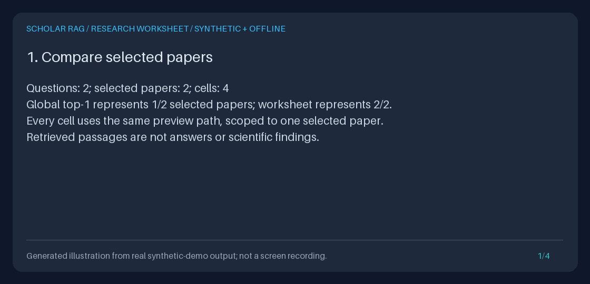
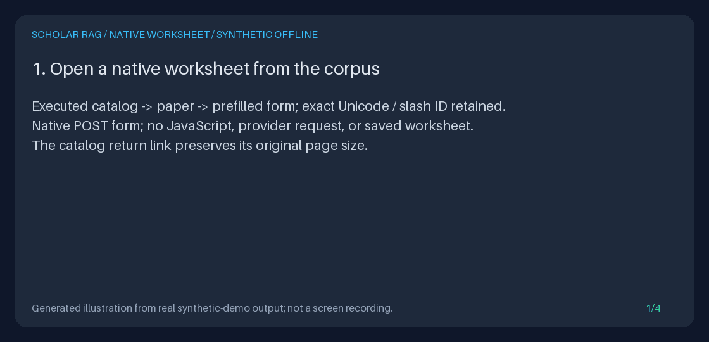

# Research evidence worksheets

Inspect the same questions against each selected ingested paper, without
generating answers. The native `/explore/worksheet` browser form and
`POST /research/worksheet` JSON API run the existing retrieval preview separately
for each question/paper pair. Inspect the browser grid and exact source links or
download JSON/Markdown or spreadsheet-safe CSV. This prevents a global top-k
result list from leaving a selected paper unrepresented merely because another
paper ranks higher.

**A cell contains retrieved passages, not a scientific conclusion.** Lexical
hash vectors, BM25, co-mention traversal, and lexical reranking can return weak
or zero-score matches. Neither passage counts nor scores establish support,
contradiction, answerability, study quality, or completeness.



This original four-frame illustration is rendered from executed demo output,
not a UI recording or real-model findings.

## Why this workflow

[PaperQA2](https://github.com/Future-House/paper-qa#paperqa2-algorithm) separates
gathering evidence from answer generation.
[kotaemon](https://github.com/Cinnamon/kotaemon#key-features) emphasizes
multi-document QA and inspectable citations with document previews. These
popular open-source projects motivated the evidence-inspection workflow; this
implementation does not copy their code or claim they provide this exact
worksheet.

Scholar RAG already had collection-scoped queries and a single retrieval
preview. The missing step was a bounded question-by-paper view before synthesis.
This feature composes the same preview path instead of adding another source
connector, retrieval algorithm, model dependency, or disconnected scoring helper.

Useful cases include inspecting methods and limitations across a small reading
list, checking whether selected papers appear in a comparison, and preparing
an auditable portfolio demonstration with synthetic notes.

The browser extension addresses the remaining usability gap: researchers no
longer need to construct a JSON API request just to inspect an existing reading
list. [RAGFlow](https://github.com/infiniflow/ragflow) emphasizes human chunk
inspection and traceable citations; its README and PaperQA2's evidence-gathering
workflow were reviewed on **2026-10-12**. They inform the use case, not a claim
that those projects implement this exact worksheet. No peer code was copied,
and this local lexical workflow does not claim their model quality or feature
parity.

### Why spreadsheet export

Primary sources checked on **2026-11-06 America/Los_Angeles**:
[ASReview LAB's workflow](https://github.com/asreview/asreview#the-asreview-lab-workflow)
includes exporting labeled datasets, and its v3 notes explicitly discuss retaining
duplicate records in exports. [PaperQA2](https://github.com/Future-House/paper-qa#paperqa2-algorithm)
separates evidence gathering from answer generation. These motivate a portable
table that does not silently omit selected papers, including cells with no
returned passages. They are inspiration, **not claims of CSV schema, formula
protection, active-learning, or model-quality parity**. No peer code was copied.
The gap here was taking an existing generation-free worksheet into a spreadsheet
without manually flattening JSON or losing provenance.

## Native browser workflow

Start the isolated loopback service from the [Quickstart](../../QUICKSTART.md)
and ingest permitted papers. Open `/explore` and choose **Build research
worksheet**, or choose **Inspect this paper in a worksheet** on a document page
to prefill its exact ID. Opening `/explore/worksheet` only renders controls;
it does not read the corpus or run retrieval.

1. Enter 1-5 questions, one nonblank line each, up to 500 characters per line.
   Spaces are retained; CRLF separates lines. Blank lines, including a trailing
   blank line, fail. Use the API/Python interface for a single multiline question.
2. Supply either a JSON array such as `["FIRST_DOCUMENT_ID", "SECOND_DOCUMENT_ID"]`
   or one saved collection ID, not both. Leave the unused selection entirely
   blank. The shared scope validator trims outer ID whitespace and retains
   first-seen order. Empty, unknown or invalid selections never mean all papers.
3. Choose 1-3 passages per cell (default 2), select **Browser HTML**, and submit.
   The grid links to every question/paper cell. Read status, shown/omitted counts,
   exact IDs, rank, score, path, full-text digest and explicit truncation flags.
4. Follow **Read current source context** or the paper link to inspect the exact
   stored IDs. These links read today's corpus; they do not freeze old passages.
   The catalog return selection and application mount prefix remain intact.
5. Select **CSV download**, JSON or Markdown and submit to download.
   CSV prepends one apostrophe to every text value, including ordinary titles
   and IDs; read the [CSV contract](#spreadsheet-safe-csv-contract) before importing.
   **Every submission reruns retrieval.** A later export is not guaranteed to
   equal an earlier HTML result if corpus/index contents change. No worksheet,
   run ID, answer, collection edit or event is saved.

No JavaScript, external assets, provider request, browser storage or new
retrieval algorithm is needed. Source labels are literal text, not external
links. `no_passages` is not a finding of no evidence, and a zero score or
`passages_returned` is not scientific support. Error pages clear inputs rather
than echoing private values; use the blank reset link to start again.

The native POST endpoint accepts `application/x-www-form-urlencoded`, optionally
with UTF-8 charset, and no content encoding or query fields. JSON clients should
continue using `POST /research/worksheet`. The six form fields are `questions`,
`document_ids`, `collection_id`, `passages_per_cell`, `format` and the generated
`navigation` JSON object containing validated catalog fields, never an arbitrary
return URL. Duplicate/unknown fields and malformed percent/UTF-8 encoding fail.
The streaming body limit is 65,536 bytes, URL limit 16,384 bytes and decoded
field limit 16,384 characters. Browser HTML must fit 1,048,576 UTF-8 bytes;
JSON/Markdown/CSV each have a 262,144-byte limit. No partial cells are
returned to fit a limit.

The error table below also applies to the browser. Additionally, an unsupported
method is 405, an unsupported form media type/encoding is 415, and unrepresentable
HTML text such as embedded NUL is 409; JSON remains available for exact text.
The browser returns sanitized HTML errors, not downloads or raw diagnostics.

### Reproduce the native-form demonstration

[](../assets/worksheet-csv.gif)

The still preview links to four panels rendered from executed output. This is an
original synthetic-output illustration, **not browser screenshots, a recording
or a scientific result**. [Text alternative](../assets/worksheet-csv.txt).
This CSV demonstration was executed on **2026-11-06 America/Los_Angeles**.

```bash
BROWSER_WORKSHEET_DIR="$(mktemp -d)/native-worksheet"
uv run python -m scripts.demo_browser_worksheet --output-dir "$BROWSER_WORKSHEET_DIR"
uv run python -m scripts.create_browser_worksheet_gif \
  --transcript "$BROWSER_WORKSHEET_DIR/transcript.txt" \
  --output "$BROWSER_WORKSHEET_DIR/worksheet-csv.gif"
```

The demo opens actual native controls, follows catalog/document prefill and
exact Unicode/slash source IDs, submits two questions against two selected
papers, and saves `catalog.html`, `form.html`, `worksheet.html`, `source.html`,
`worksheet.json`, `worksheet.md`, `worksheet.csv`, `no-passages.csv`, `checks.json`
and `transcript.txt`. The renderer
adds a GIF and same-name PNG. Opening the saved HTML shows the captured page,
but its local links/forms require the original service and are not a portable
offline evidence reader.

Measured checks require four cells, visible excerpt truncation, API/Python/browser
export parity (including CSV) on unchanged data, reversible escaping of a
formula-like title, exact CSV excerpts/digests/flags, two retained `no_passages`
rows from a separate metadata-only paper, identical HTML after restart, collection
parity, and rejection of empty scope. Generation, event, mutation and external
connection guards must remain at zero; database bytes must stay unchanged.
Explicit offline settings ignore ambient environment/dotenv keys, no public
listener is started, and the temporary synthetic corpus is removed. The demo
refuses an existing output directory; the renderer refuses existing GIF/PNG
destinations. These are correctness checks, not a retrieval-quality benchmark.

## Reproduce the offline demonstration

From the repository root, after the [Quickstart](../../QUICKSTART.md) install:

```bash
WORKSHEET_DIR="$(mktemp -d)/worksheet-demo"
uv run python -m scripts.demo_research_worksheet --output-dir "$WORKSHEET_DIR"
uv run python -m scripts.create_research_worksheet_gif \
  --transcript "$WORKSHEET_DIR/transcript.txt" \
  --output "$WORKSHEET_DIR/research-worksheet.gif"
```

The demo ingests three synthetic notes into a temporary database and selects
two. It deliberately sets the normal preview source cap to one, so a combined
preview represents one of the two papers while the worksheet inspects both.
Two questions produce four cells, each with one returned passage. It measures
zero live/fake generation calls, zero agent events, Python/HTTP parity, unchanged
database bytes, restart parity on an unchanged corpus, and rejection of unknown
or missing selections. The temporary database is removed.

| Artifact | Contents |
| --- | --- |
| `worksheet.json` | Actual versioned API worksheet |
| `worksheet.md` | Literal Markdown rendering of the same worksheet |
| `checks.json` | Measured counts, statuses, parity checks, and output byte sizes |
| `transcript.txt` | Actual output used to render the GIF |
| `research-worksheet.gif` | Optional generated illustration |

The scripts refuse to overwrite named artifacts. Settings come only from
validated explicit values and defaults: ambient environment, `.env`, provider
keys, and secret-file settings are ignored. No public listener is started.
GIF bytes are reproducible from the same transcript and Pillow environment;
they are not a promise of identical fonts across future dependency versions.

## API workflow

Start the isolated loopback API from the Quickstart and ingest your permitted
text through `/ingest/text`. Recover the returned IDs with `GET /documents`.
Replace `FIRST_DOCUMENT_ID` and `SECOND_DOCUMENT_ID` below with those actual IDs:

```bash
curl --fail-with-body --silent --show-error \
  http://127.0.0.1:8000/research/worksheet \
  -H 'Content-Type: application/json' \
  -d '{
    "questions": ["What retrieval method is described?", "What limitations are discussed?"],
    "document_ids": ["FIRST_DOCUMENT_ID", "SECOND_DOCUMENT_ID"],
    "passages_per_cell": 2
  }'
```

To reuse a saved selection, supply its `collection_id` **instead of**
`document_ids`. See [paper collections](PAPER_COLLECTIONS_GUIDE.md) for creation,
discovery, and revision-checked edits:

```bash
curl --fail-with-body --silent --show-error \
  'http://127.0.0.1:8000/research/worksheet?format=markdown' \
  -H 'Content-Type: application/json' \
  -d '{
    "questions": ["What methods are described?", "What evidence should I inspect?"],
    "collection_id": "REPLACE_WITH_SAVED_COLLECTION_ID",
    "passages_per_cell": 2
  }'
```

The default format is `json`; alternatives are `markdown` and `csv`. Successful
responses are attachments named `worksheet.json`, `worksheet.md` or `worksheet.csv`, with
`Cache-Control: no-store` and `X-Content-Type-Options: nosniff`. Save only a
successful response; HTTP error bodies are diagnostics, not partial worksheets.
The native browser described above is an alternative front end to the same
service; there is still no worksheet database table, run ID or `DONE` event.

### Read the result

`schema_version` is `"1.0"` and `kind` is `"retrieval_passages"`. `documents`
preserves normalized first-seen document order; `rows` preserves question order.
Every row has one cell per selected document, in that same order.

Each cell includes its document ID, effective preview configuration,
`preview_source_count`, `passages_omitted`, and the first requested number of
post-rerank passages. Each passage includes exact document/chunk IDs, rank,
score, retriever, path, full-text SHA-256 and character count, plus bounded title,
source, and excerpt prefixes with explicit truncation flags.

`passages_returned` means a preview returned passages. `no_passages` means that
preview returned none, **not** that the paper lacks evidence or the question is
unanswerable. Scores across different questions/papers are not calibrated
scientific confidence. A digest describes the full recorded passage, not its
possibly truncated excerpt, and is not a signature.

Use a document's `inspection_url` to page through current stored chunks and
match the exact chunk ID. Some path-normalizing identifiers have no safe
inspection URL and return `null`; use Python storage inspection for those.
These links read the current corpus, not frozen historical text.

## Spreadsheet-safe CSV contract

Use the browser's **CSV download** output or the same JSON request with
`POST /research/worksheet?format=csv`. The response is `text/csv; charset=utf-8`,
an attachment named `worksheet.csv`. For example, after replacing the IDs:

```bash
curl --fail --silent --show-error \
  'http://127.0.0.1:8000/research/worksheet?format=csv' \
  -H 'Content-Type: application/json' \
  -d '{
    "questions": ["What methods are described?", "What limitations are discussed?"],
    "document_ids": ["FIRST_DOCUMENT_ID", "SECOND_DOCUMENT_ID"],
    "passages_per_cell": 2
  }' > worksheet.csv
```

Check curl's exit status: a failed request is not a worksheet. Redirection may
leave an empty file. Never overwrite an artifact you need to retain. A collection
request uses `collection_id` instead of `document_ids`, exactly as with JSON.

The CSV uses UTF-8 **without a BOM**, comma separators, CRLF record endings,
double-quoted fields, and doubled embedded quotes. Embedded commas, CR/LF,
Unicode and control characters are retained, not stripped. Import explicitly
as UTF-8/comma-delimited text in Excel, LibreOffice Calc or another spreadsheet;
disable automatic formula/type conversion where available. Application-specific
import behavior may hide the apostrophe, display it, alter newlines or discard
control characters. No live spreadsheet application compatibility test is claimed.
Keep the original download and use a CSV parser or JSON when exact text matters.

There is **one row per returned passage**; a cell without passages still has
one row. Order is question order, normalized first-seen paper order, then passage
order. Questions may repeat: use the **1-based** `question_number` and
`document_number` together to identify a cell, not question text. `passage_number`
is 1-based within that cell; `rank` retains the actual preview rank. There are at
most 150 data rows (50 cells with three passages), subject to the byte limit.
Counts and scores remain retrieval diagnostics, never scientific findings.

| Columns | Meaning and CSV type |
| --- | --- |
| `schema_version`, `csv_text_encoding`, `kind` | Text: worksheet `1.0`, encoding `apostrophe-prefix-v1`, `retrieval_passages` |
| `collection_id` | Nullable text; absent for explicit ID selections |
| `passages_per_cell` | Integer requested limit |
| `limits_json`, `warnings_json` | Text containing complete JSON object/array |
| `question_number`, `question` | Integer position and exact question text |
| `document_number`, `document_id`, `inspection_url` | Integer position, exact cell ID, nullable current-source inspection URL |
| `status`, `preview_source_count`, `passages_omitted` | Text status and integer counts; not recomputed from CSV rows |
| `configuration_json` | Text containing the complete effective preview configuration |
| `passage_number`, `passage_document_id`, `chunk_id` | Nullable position and exact passage identities |
| `rank`, `score`, `retriever`, `path_json` | Nullable integer, finite number, text, and text containing a JSON array |
| `title`, `title_truncated`, `source`, `source_truncated` | Nullable bounded text prefixes and boolean flags |
| `excerpt`, `excerpt_truncated`, `text_characters`, `text_sha256` | Nullable excerpt/flag plus full-text character count/digest |

Worksheet metadata and cell configuration are repeated on each row so a copied
row retains its interpretation and provenance. All passage columns are blank
for `no_passages`; cell status, metadata and diagnostics are still present.
An unavailable inspection URL is blank, not an invented link. Existing excerpt,
title and source prefix limits and omission counts remain explicit: CSV performs
**no additional clipping or omission**.

### Formula safety and exact roundtripping

CSV quoting alone does not prevent spreadsheet formulas. The shared screening
export rule prepends **exactly one ASCII apostrophe to every string**, even an
empty string, strings already starting with an apostrophe, and strings starting
with whitespace/control characters before `=`, `+`, `-` or `@`. For example,
`=1+1` is stored as `'=1+1`, and `'literal` as `''literal`. Headers are fixed,
not user-provided. Numbers are unprefixed; booleans are unprefixed `true`/`false`.
Null is an empty field; the empty string is a field containing one apostrophe.

Thus CSV values are **not identical to unprefixed JSON text**. To recover a
text column, parse the CSV first, distinguish blank/null from apostrophe/empty
text, then remove exactly one leading apostrophe, never `lstrip("'")`.
Decode `*_json` columns only after removing that prefix. Do not remove prefixes
and re-export to a spreadsheet: that would restore formula risk.

```python
import csv
import json

with open("worksheet.csv", encoding="utf-8", newline="") as stream:
    for row in csv.DictReader(stream):
        question = row["question"][1:]  # Required text, always prefixed.
        excerpt = None if row["excerpt"] == "" else row["excerpt"][1:]
        configuration = json.loads(row["configuration_json"][1:])
        print(int(row["question_number"]), question, excerpt, configuration["max_source_docs"])
```

The complete encoded CSV, including headers, quotes, prefixes and CRLF, must fit
262,144 bytes or fail with `worksheet_too_large` (HTTP 413 / Python `WorksheetError`).
Repeated metadata can make CSV exceed its cap even when JSON/Markdown fit;
those existing formats still work unchanged. The service retains its existing
JSON-and-Markdown build validation; CSV is additionally checked **only when
requested**. Reduce questions, papers or passages rather than expecting partial
success. Use JSON for canonical structured storage. There is no CSV import,
saved worksheet, new model/connector/dependency, automatic screening, or
retrieval-policy comparison workbench in this feature.

## Complete offline Python example

This standalone example ignores ambient settings and does not require the API
server. It writes three artifacts into the current directory and refuses existing
filenames. Run it in a fresh working directory with the package installed:

```bash
uv run python - <<'PY'
import asyncio
from pathlib import Path
from tempfile import TemporaryDirectory

from fastapi.testclient import TestClient
from agent.research_worksheet import WorksheetRequest
from api.application import create_app
from scripts.demo_retrieval_preview import offline_settings

async def main():
    for name in ("worksheet.json", "worksheet.md", "worksheet.csv"):
        if Path(name).exists():
            raise FileExistsError(f"Refusing to overwrite {name}")
    with TemporaryDirectory(prefix="worksheet-example-") as temporary:
        app = create_app(offline_settings(Path(temporary) / "corpus.sqlite3"))
        with TestClient(app) as client:
            ids = []
            for title, text in (
                ("Synthetic lexical note", "Synthetic retrieval note: lexical search uses terms."),
                ("Synthetic graph note", "Synthetic retrieval note: graphs connect co-mentions."),
            ):
                response = client.post("/ingest/text", json={
                    "title": title, "text": text, "source": "synthetic:worksheet-guide"
                })
                response.raise_for_status()
                ids.append(response.json()["document_id"])
            worksheet = await app.state.container.worksheets.build(WorksheetRequest(
                questions=("retrieval methods", "graph evidence"),
                document_ids=tuple(ids),
                passages_per_cell=1,
            ))
            print("Cells:", sum(len(row.cells) for row in worksheet.rows))
            print("Events:", len(app.state.container.event_log.list_events()))
            for name, content in (
                ("worksheet.json", worksheet.to_json()),
                ("worksheet.md", worksheet.to_markdown()),
                ("worksheet.csv", worksheet.to_csv()),
            ):
                with Path(name).open("x", encoding="utf-8", newline="") as output:
                    output.write(content)

asyncio.run(main())
PY
```

For an existing `AppContainer`, reuse `container.worksheets.build(...)`.
`WorksheetRequest` also accepts `collection_id`; omit `document_ids` then.
Python input validation raises `ValueError`/Pydantic validation errors.
Operational failures raise `WorksheetError` or the existing `CollectionError`;
external task cancellation propagates instead of producing an empty worksheet.

## Bounds, errors, and consistency

| Bound | Contract |
| --- | --- |
| Questions | 1-5 nonblank strings, at most 500 characters each; order and text retained |
| Selection | Exactly one of `document_ids` or `collection_id`; no whole-corpus default |
| Explicit IDs | 1-10 supplied IDs before deduplication, using the existing scope validator |
| Resolved papers | At most 10, with at most 50 question/paper cells |
| Returned passages | 1-3 per cell, default 2, within the existing preview source cap |
| Excerpts | At most 800 characters each; truncation is explicit |
| Downloads | JSON and Markdown must each fit 262,144 UTF-8 bytes during build; requested CSV must also fit |
| Deadline | 30 seconds for construction, including selection, cell previews and JSON/Markdown validation |

The deadline is cooperative, not CPU/process preemption; the existing per-phase
preview timeouts still apply. Requested CSV serialization follows construction
synchronously with its own byte check, not an additional timed retrieval phase.
No shared runner setting is mutated. Every cell
uses the existing planner, scope enforcement, retrieval, reranking, and evidence
capture. Generative HyDE is rejected rather than silently replaced.

| HTTP status | Meaning |
| --- | --- |
| 422 | Invalid/ambiguous/missing selection, unknown explicit document IDs, invalid format or bounds |
| 404 | Unknown saved collection |
| 409 | Invalid/stale collection, selected documents disappeared, or generative retrieval configured |
| 413 | A required serialized rendering is too large; reduce papers, questions, or passages |
| 500 | A cell failed or its provenance was inconsistent; no partial worksheet returned |
| 503 | Selection storage unavailable |
| 504 | Overall or preview phase timeout |

An invalid cell rejects the entire request. Errors expose stable categories and,
where available, zero-based question/document indices, not raw provider or
SQLite diagnostics. Validation errors do not echo request values. Failure never
widens scope or returns an empty success.

Collection membership is resolved once before asynchronous preview work.
All selected IDs must exist; existence is rechecked at completion. This freezes
membership, **not** document contents or indexes. Concurrent corpus updates can
change later cells, and replacing text does not create a corpus snapshot.
Unchanged-corpus restart parity is an offline-demo check, not a guarantee under
mutation. No retrieval model, event log, collection membership, or corpus data is
modified by worksheet construction.

## Privacy, model stack, and portfolio use

This local/trusted API has no authentication or tenant isolation. Questions,
paper identities, excerpts, and labels may be sensitive even without generation.
Protect saved artifacts and the source database. Markdown fences keep untrusted
source text literal; they do not anonymize it. The worksheet is not a systematic
review, medical-decision tool, quality benchmark, or scientific finding.

No live **or fake** model is called. The actual stack is the custom
Observe-Decide-Act planner/preview path, FastAPI, Pydantic, HTTPX, and SQLite,
with deterministic lexical hash vectors, BM25, and co-mention traversal.
It does not require LangGraph, a learned embedding model, or a new provider SDK.

For this CSV addition, **indexed primary-source documentation was checked on
2026-11-06 America/Los_Angeles**, not live inference or authenticated catalog
APIs. Direct OpenAI page retrieval failed DNS resolution; the official indexed
catalog supplied the following current context:

| Provider primary source | Current catalog context checked |
| --- | --- |
| [OpenAI](https://developers.openai.com/api/docs/models) | Recommends GPT-6 Astra for complex reasoning/coding; GPT-6.1 Sol, GPT-6.1 Terra and GPT-6 Luna alternatives |
| [Anthropic](https://platform.claude.com/docs/en/models/overview) | Recommends Claude Opus 5.5 for most workloads and Fable 5.1 for demanding long-horizon work; also lists Sonnet 5.5 and Haiku 5.5 |
| [Google](https://aistudio.google.com/docs/models) | Lists Gemini 4 Argon as flagship and Gemini 3.8 Flash |
| [Kimi](https://platform.kimi.ai/docs/models) | Lists K3.1 Pro and K3.1 Pro Highspeed; K3 is previous-generation. K2.7 Code/K2.6 are restricted to users registered before November 1, with retirement expected late December 2026 |

These are documentation observations, not compatibility, entitlement, model
quality or benchmark claims. This PR changes **no configured model defaults**.
Models concern optional subsequent generation, not worksheet execution.
See the source-linked
[provider guide](PROVIDER_MODELS_GUIDE.md) for configured defaults, endpoint and
thinking-budget limits, and the difference between catalog checks and live API
entitlement.

Browser POST keeps questions out of the address bar, not out of browser
resubmission state or infrastructure logs. Source/return URLs may retain filters
and identifiers. CSP, no-store, nosniff and no-referrer cannot prevent saving,
printing, screenshots or unauthorized access to an exposed local service.

For a portfolio demonstration, retain the synthetic HTML, JSON, Markdown,
CSV, checks, transcript and reproduced GIF together. Show the actual form and grid,
follow an exact source, and explain why separate export submissions may differ.
The original API demo also illustrates global-top-1 versus per-paper retrieval.
State what a human must verify next; do not present the generated illustration
as a screenshot or report synthetic correctness checks as research-quality evidence.
