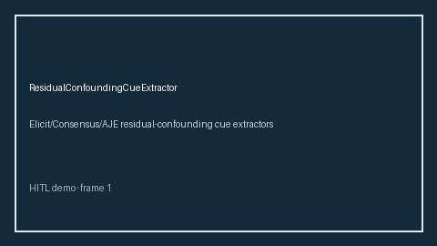

# ResidualConfoundingCueExtractor Guide



Offline cue extractor. Never network I/O. Gap vs Elicit/Consensus/AJE residual-confounding cue extractors.

Optional narrative via **GPT-5.5 / Claude Sonnet 4.6 / Gemini 3.x / Kimi K2**.

Distinct from `ConfoundingByIndicationCueExtractor` / `TimeVaryingConfoundingCueExtractor`.

## Usage

```python
from retrieval.residual_confounding_cues import ResidualConfoundingCueExtractor

rows = [{"paper_id": "p1", "abstract": "We discuss residual confounding after adjustment."}]
print(ResidualConfoundingCueExtractor().extract(rows)[0].flagged)
```

## Safety

Advisory cues only. Humans decide.
