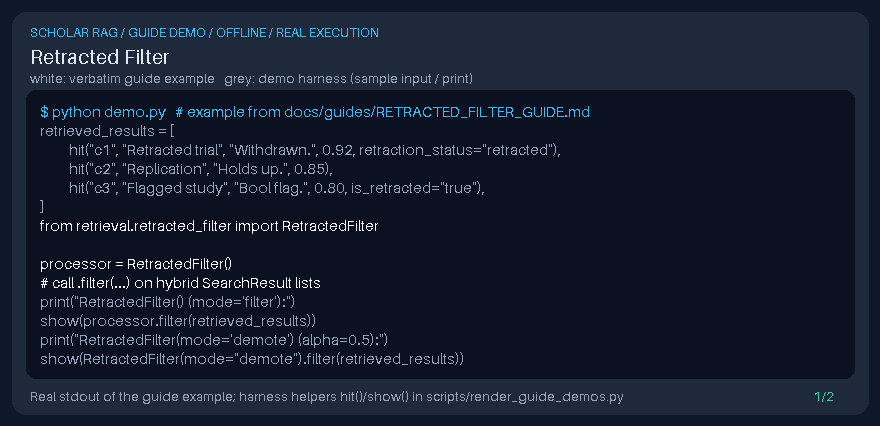

# Retracted Filter Guide



Inspired by Retraction Watch / OpenAlex retraction flags used in scholarly search stacks; drops or soft-demotes retracted works via local metadata (not a DOI connector).

Works with GPT-6 Astra / Claude Opus 5.5 / Gemini 4 Argon / Kimi K3.1 Pro answer stacks.

## Usage

```python
from retrieval.retracted_filter import RetractedFilter

processor = RetractedFilter()
# call .filter(...) on hybrid SearchResult lists
```

## Safety

Local metadata only — no network calls and no DOI connector side effects.
