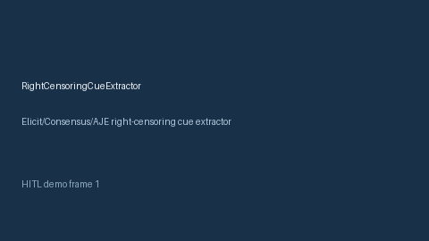

# RightCensoringCueExtractor Guide



Offline cue extractor. Gap vs Elicit/Consensus/AJE right-censoring cue extractors. Distinct from `IntervalCensoringCueExtractor` / `AttritionInformativeCensoringCueExtractor`.

Optional narrative via **GPT-5.5 / Claude Sonnet 4.6 / Gemini 3.x / Kimi K2**.

## Usage

```python
from retrieval.right_censoring_cues import RightCensoringCueExtractor

out = RightCensoringCueExtractor().extract(
    [
        {
            "paper_id": "p1",
            "abstract": "We discuss right censoring from end-of-study administrative cuts.",
        }
    ]
)
print(out[0].flagged, out[0].cue_kind)
```

## Safety

Advisory cues only. No network I/O.
