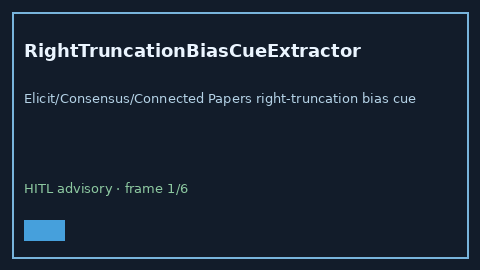

# RightTruncationBiasCueExtractor Guide



Offline advisory cue extractor.
Gap vs Elicit/Consensus/Connected Papers right-truncation bias cue extractors. Distinct from `RightCensoringCueExtractor` / `AttritionInformativeCensoringCueExtractor`.

Optional narrative via **GPT-6 Astra / Claude Opus 5.5 / Gemini 4 Argon / Kimi K3.1 Pro**.

## Usage

```python
from retrieval.right_truncation_bias_cues import RightTruncationBiasCueExtractor

rows = RightTruncationBiasCueExtractor().extract(
    [{"paper_id": "p1", "abstract": "Evidence of right truncation in the cohort."}],
)
assert rows[0].flagged is True
```

## Safety

Advisory only. No network I/O. Never auto-acts. Humans decide.
