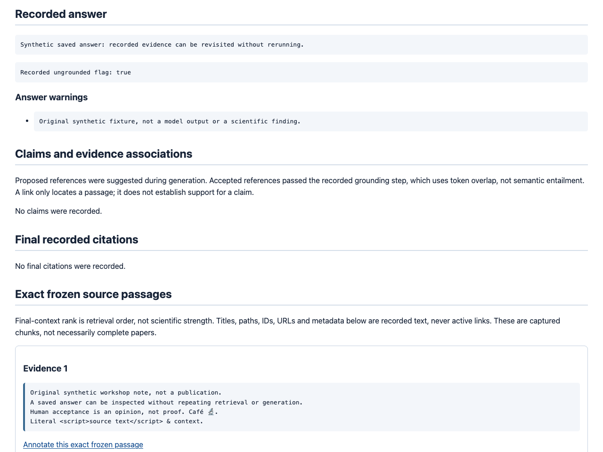

# Review a saved answer in a normal browser

Inspect the saved answer, both warning sets and complete frozen passages.
Explicitly choose `accepted`, `needs_revision` or `rejected`, write your own
comment, optionally select actual frozen chunk IDs, preview without writing,
then save and reopen the precise persisted opinion. No default verdict, inferred
approval or regenerated answer is involved.

[](../assets/saved-answer-review-workbench.gif)

The still makes animation opt-in. The GIF contains **four actual local browser
screenshots**: isolated headless Chrome renderings of guarded, already-executed
HTTP responses, not a recorded/live-click browser workflow. HTTP form submission
and persistence are verified separately. These are unscaled 1280x960 crops of
real rendered pages, not fabricated UI. This is not a continuous recording,
benchmark or scientific result.
[Text alternative and executed measurements](../assets/saved-answer-review-workbench.txt).
The fixture is original synthetic text, not third-party screenshots or papers.

## Native browser workflow

Start the [loopback Quickstart](../../QUICKSTART.md) with the database containing
your saved run. Use only material you own or are authorized to process.

1. Follow **Browse saved runs**, then **Inspect saved evidence** or **Human-review
   notebook**. Choose **Review this saved answer**. The notebook itself remains
   read-only, with independent review and annotation pagination.
2. Read the original question, saved answer, recorded ungrounded flag, answer
   warnings, bundle warnings, claims/citations and full captured passages.
   Expand frozen metadata when needed. Source labels are inert text, never
   external links. Captured chunks are not necessarily complete papers.
3. Choose a verdict explicitly and enter your nonblank comment. Optional checkboxes
   identify real frozen chunk IDs in rank order; none is selected automatically.
   You may review an exportable zero-source run without citations. A legacy chunk
   ID outside the existing review contract stays visible but has a disabled
   checkbox with an explanation; it is never normalized or silently substituted.
4. Press **Preview review**. This POST validates and renders but never writes.
   Inspect the exact verdict, comment, chosen IDs and retry UUID. **Edit and preview
   again** preserves that UUID. Only the separate **Save review** button sends the
   hidden, exact preview payload to persistence.
5. Saving returns **303** to an exact UUID-addressed GET. It rereads that opinion,
   with its original sequence and UTC timestamp, beside frozen evidence. Refresh
   does not resubmit. **Back to this notebook page** preserves both history
   cursors/limits, saved-run filters, catalog return state and mount prefix.
   Existing notebook reviews also have **Reopen this exact saved opinion** links.

This closes the gap between the existing API-only answer-verdict submission and
the native notebook/quote-annotation authoring workflow. A quote annotation is
not a whole-answer verdict; a paper's include/exclude label is also different.
All three remain independent, append-only human records where applicable.

### Exact comments and retries

The server neither trims nor normalizes comments. Limits count Python Unicode
code points, not UTF-8 bytes, UTF-16 units or visible glyphs; combining marks
count separately. The textarea intentionally has no UTF-16 `maxlength`.
Browsers serialize textarea line breaks as CRLF, so inspect the submitted
preview. Hidden **ASCII JSON** then preserves its exact Unicode and whitespace
through Save, including leading newlines, emoji and combining sequences.

Opening/previewing creates no draft row. After a network failure, inspect the
notebook or resend the **unchanged preview**: the same run/UUID/verdict/comment/
ordered citation list returns the original record. Different valid content
under that UUID returns 409 without overwriting. Invalid content fails validation
first. Reopening the composer generates a new UUID and can create another opinion;
it is not a retry. Different reviewers/opinions may disagree; no latest verdict,
consensus, authenticated person or scientific approval is inferred.

## API contract

| Route | Behavior |
| --- | --- |
| `GET /explore/run/review` | Read-only composer; one `selection` JSON query field. |
| `POST /explore/run/review` | Preview only; `selection`, `review_id`, `decision`, `comment`, optional `cite_N` fields. |
| `POST /explore/run/review/save` | Explicit append; `selection` and `submission` JSON. New and identical retry both return a local 303. |
| `GET /explore/run/review/saved` | Precise persisted opinion; `selection` and `review_id`, never a moving history position. |
| `POST /runs/{run_id}/reviews` | Unchanged JSON API: 201 new / 200 identical retry, original Origin behavior. |
| `GET /runs/{run_id}/reviews` | Unchanged newest-first bounded JSON history and exclusive sequence cursor. |

Use generated links/forms. `selection` contains the exact run ID and existing
notebook/history/catalog return fields, not an arbitrary redirect URL or an
authorization token. `cite_N` names the displayed frozen rank and contains its
actual JSON-string chunk ID; mismatched IDs, nonexistent ranks or duplicate
fields fail. Preview constructs the existing `ReviewSubmission`, retaining
selected IDs in frozen-rank order. Save validates it again, including exact
membership in the completed frozen bundle, then calls the existing
`notebook_reviews.create` / `AnswerReviewService` / `SQLiteAnswerReviews`.

Run IDs and cited chunk IDs keep the existing review contract: 1-256 Unicode
code points, no outer whitespace, ASCII controls, DEL or NUL. Slashes, dot
segments, punctuation, internal spaces and valid Unicode are opaque values in
encoded queries/JSON, not path segments. No new alias or identity repair is
introduced. Native query addressing or Python avoids the original path API's
slash/dot-segment limitations. Return filters can retain controls via JSON;
invalid Unicode and unknown/duplicate JSON properties fail.

For an already inspected JSON payload, the original API remains available:

```bash
curl --fail-with-body --silent --show-error -i \
  http://127.0.0.1:8000/runs/REPLACE_WITH_PATH_SAFE_RUN_ID/reviews \
  -H 'Content-Type: application/json' \
  --data-binary @/absolute/path/reviewed-opinion.json
```

Keep the file and UUID unchanged for retries. See the
[original review API guide](ANSWER_REVIEWS_GUIDE.md) for the JSON shape.
Native POSTs additionally require exactly one `Origin` matching the actual
scheme/host/port; `Sec-Fetch-Site`, if present, must be one `same-origin` value.
Missing, null, ambiguous, same-site or different origins fail closed with 403.
Referer and arbitrary forwarded-host headers are not substitutes.

### Fixed bounds and failures

| Boundary | Limit / behavior |
| --- | --- |
| Query / streamed body | 65,536 / 524,288 bytes respectively; a declared length must be one numeric value matching actual bytes. |
| Field counts | Open: one; saved GET: two; preview: four plus up to 50 distinct frozen-rank checkboxes; save: two. |
| Encoding | Only UTF-8 URL-encoded POSTs, optional UTF-8 charset, no content encoding. ASCII wire, valid percent escapes and decoded UTF-8 are required. GET bodies, POST queries and unknown/duplicate fields fail. |
| Decoded values | Names at most 32 characters; selection at most 16,384; save submission at most 262,144 characters. Excess nesting and duplicate JSON keys fail. |
| Comment / references | Nonblank 1-4000 code points, no NUL; existing unique, ordered reference contract remains authoritative. Frozen bundles have at most 50 sources. |
| Escaped HTML | Complete composer, preview and persisted page each at most 1 MiB, including full sources/metadata and controls. No clipping, dropped warnings or partial success. |
| Return URLs | Generated notebook/precise-opinion navigation must fit the existing 16,384-byte query bound before a write. |
| Frozen reads | Existing 100-event, 1-MiB-per-payload and 8-MiB-total UTF-8 event limits; incomplete/failed/legacy/corrupt runs are not regenerated. |
| Exact review read | One run/UUID row, 262,144 UTF-8 text bytes; type/stored-byte preflight before hydration, exact UTF-8 accounting afterward, including UTF-16 databases. |

404 means no exact run/opinion; 405 unsupported method; 409 includes UUID conflict,
unexportable/corrupt evidence or opinion, and unrepresentable saved text; 413 a
byte/output bound; 415 unsupported encoding; 422 invalid fields or references;
503 unavailable storage. Errors log only sanitized codes, not comments,
SQLite details or submitted values.

Save preflights **both** the complete preview and exact persisted reader before
its one service call. Until the database assigns sequence/time, the reader uses
their maximum valid rendered widths. This conservative bound can reject an
edge-of-limit submission that would happen to fit with a shorter actual timestamp;
it does not save successfully and then redirect to an oversized page.
Text containing NUL that cannot be represented faithfully in HTML fails before a
native write; use the existing JSON/Python interfaces, not an edited substitute.

## Python

The same bounded frozen reader and review service work without providers,
retrieval or the web app. This example previews before requiring explicit
confirmation. Inspect your actual run/chunk IDs, choose your own opinion, and
retain the submission JSON if retrying in another process.

```python
from pathlib import Path
from uuid import uuid4

from agent.answer_reviews import AnswerReviewService
from agent.review_models import ReviewDecision, ReviewSubmission
from storage.answer_reviews import SQLiteAnswerReviews
from storage.evidence_export import SQLiteEvidenceReader

database = Path("/absolute/path/existing-evidence.sqlite3")
if not database.is_file():
    raise FileNotFoundError(database)
run_id = "COPY_EXACT_RUN_ID"
chunk_id = "COPY_EXACT_CHUNK_ID"
reader = SQLiteEvidenceReader(database)
bundle = reader.export(run_id)
assert any(source.chunk.chunk_id == chunk_id for source in bundle.snapshot.sources)
submission = ReviewSubmission(
    review_id=uuid4(),
    decision=ReviewDecision.NEEDS_REVISION,
    comment="Synthetic human opinion: distinguish recorded grounding from scientific support.",
    cited_chunk_ids=(chunk_id,),
)
print(bundle.answer.model_dump_json(indent=2))
print(submission.model_dump_json(indent=2))
if input("Type SAVE to persist this exact preview: ") != "SAVE":
    raise SystemExit("Not saved.")
service = AnswerReviewService(reader, SQLiteAnswerReviews(database))
saved, created = service.create(run_id, submission)
retried, created_again = service.create(run_id, submission)
assert created and not created_again and retried == saved
reopened = AnswerReviewService(reader, SQLiteAnswerReviews(database)).get_review(
    run_id, submission.review_id
)
assert reopened == saved
print(saved.model_dump_json())
```

The existing store constructor initializes its existing table/index, as before;
no new schema is added. Exact `get_review` uses an existing-database `mode=ro`
transaction and the same record/reference validators. Evidence and opinion
are separate reads, not one shared transaction or a tamper-proof audit trail.
Use the [portable notebook](PORTABLE_REVIEW_NOTEBOOK_GUIDE.md) when you need
both complete histories and frozen evidence in one read snapshot.

## Local/trusted use only

There is **no authentication**, reviewer allocation, tenant isolation or identity
verification. Keep loopback binding or deployment-owned access controls with
trusted host/proxy configuration. Origin checks are browser form protections,
not protection against direct clients, malicious local processes or **DNS rebinding**.
A proxy mismatch fails closed; configure the correct external scheme/authority
and root path instead of weakening checks.

No scripts, external resources, cookies or browser storage are added. Native
authoring pages, redirects and errors reuse no-store/nosniff, frame denial,
hash-only static CSS CSP and same-origin form actions. Their `same-origin`
referrer policy preserves native Chromium POST Origin (instead of `null`).
The exact persisted GET and existing read-only pages retain `no-referrer`.
Local IDs/return state can still be in history, bookmarks or same-server logs.
POST does not erase comments from resubmission state or infrastructure logs;
no-store does not prevent screenshots or saved pages. Review before sharing,
and never enter credentials or personal data.

No retrieval, current-corpus reads, provider calls, event changes, automatic
acceptance, active learning, consensus, source rewriting or annotation/screening
changes occur in this workflow. Normal application startup still initializes
stores and indexes. Deleting the corpus does not erase saved evidence or opinions.

## Reproduce the offline demonstration

From your repository checkout, with the existing development dependencies:

```bash
uv run python -m scripts.demo_saved_answer_review \
  --output-dir /tmp/scholar-answer-review-demo
uv run python -m scripts.demo_saved_answer_review \
  --serve /tmp/scholar-answer-review-demo --port 8777
```

Choose a **new** output directory. The script refuses existing paths/symlinks,
ignores ambient dotenv/provider credentials, and seeds eight clearly labeled
events directly through the real contracts: not even a fake model is invoked.
It saves measured HTML, exact JSON history, page URLs, checks and a text transcript.
Guards fail on model/network/retrieval, current-corpus and unrelated writes during
authoring. It proves no-write preview, original UUID/sequence/time retry,
cross-origin 403, unknown-source 422, changed-payload 409, API/Python parity,
and identical frozen preview/opinion after corpus edits, deletion and restart.

The optional loopback-only server verifies the fixture marker and database hash
before serving under `/review`. Open the `source` URL from its generated
`pages.json` at `http://127.0.0.1:8777` to try the controls yourself. An extra
browser save creates another human opinion; it does not overwrite the script's
measured record. Stop the server when done.

The committed captures instead render the four **already-executed HTML responses**
in isolated headless Chrome. No successful live browser interaction is claimed:
browser automation stalled locally, so the existing guarded HTTP execution and
its restart/rejection assertions supply the workflow evidence. The screenshots
show actual browser pixels from those responses, including the persisted record.
On macOS with Chrome installed, a simple reproducible capture command is:

```bash
mkdir -p /tmp/scholar-answer-review-frames
for name in saved-answer compose preview saved-review; do
  "/Applications/Google Chrome.app/Contents/MacOS/Google Chrome" \
    --headless=new --no-first-run --no-default-browser-check \
    --disable-background-networking --disable-component-update --disable-sync \
    --metrics-recording-only --disable-extensions --force-device-scale-factor=1 \
    --window-size=1280,3600 \
    --user-data-dir="/tmp/scholar-review-chrome-$name" \
    --screenshot="/tmp/scholar-answer-review-frames/raw-$name.png" \
    "file:///tmp/scholar-answer-review-demo/$name.html"
done
```

Use fresh task-specific profile/output paths, never your normal browser profile.
No source pixels or DOM content are changed. Crop the relevant sections from
the taller screenshots using the existing Pillow development dependency:

```python
from pathlib import Path
from PIL import Image

frames = Path("/tmp/scholar-answer-review-frames")
for name, top in (
    ("saved-answer", 1750),
    ("compose", 880),
    ("preview", 900),
    ("saved-review", 300),
):
    with Image.open(frames / f"raw-{name}.png") as image:
        assert image.size == (1280, 3600)
        image.crop((0, top, 1280, top + 960)).save(frames / f"{name}.png")
```

These crop positions match the captured fixture and font/layout; inspect your
own rendering if your browser differs. Assemble the four distinct 1280x960 PNG
crops without inventing UI pixels:

```bash
uv run python -m scripts.create_saved_answer_review_gif \
  --frames-dir /tmp/scholar-answer-review-frames \
  --output /tmp/scholar-answer-review.gif \
  --still /tmp/scholar-answer-review.png
```

The existing renderer requires four distinct full-size PNGs; each GIF frame lasts
three seconds. Both outputs refuse overwrites. The GIF is a browser-rendered
HTTP-response illustration, not a claim that TestClient requests are live browser
footage. It adds no browser dependency to the application or demo runner.

## Portfolio and public workflow context

Present the original gap first: answer-review persistence existed, but users
could not author a whole-answer verdict from the native saved-run notebook.
Show the unchanged frozen answer/warnings, a blank verdict control, exact
comment/citation preview, deliberate Save, and the UUID-addressed persisted
opinion. Demonstrate a rejected cross-origin or conflicting retry and reopen
after restart. Explain append-only disagreement separately from model grounding.
The engineering result is safe, inspectable human authoring, not measured
scientific validity, improved retrieval quality or an authenticated review system.

Public sources checked **2026-10-27 America/Los_Angeles**:

- The open-source [ASReview project](https://github.com/asreview/asreview) documents
  a [native Reviewer interface with decisions and notes](https://asreview.readthedocs.io/en/latest/lab/screening.html).
  It inspired keeping context and explicit decisions together. ASReview uses
  active-learning ranking and autosave; this workbench deliberately does neither,
  does not allocate reviewers and is not an ASReview implementation or parity claim.
- [Zotero notes](https://www.zotero.org/support/notes) demonstrate notes attached to
  a specific item. Here opinions attach to immutable saved runs and selected frozen
  IDs, not editable/synced bibliographic notes.
- [LangSmith annotation queues](https://docs.langchain.com/langsmith/annotation-queues)
  provide comparative context for feedback attached to saved runs. This is not
  an open-source dependency, an integration, a queue/rubric engine or a parity claim.

All implementation, prose, fixture text and screenshots here are original.
No competitor code, assets or paper text were copied.

### Current catalog versus configured defaults

Checked **2026-10-27 America/Los_Angeles**; no runtime defaults changed:
[OpenAI's catalog](https://developers.openai.com/api/docs/models.md) highlights
GPT-6 Astra (`gpt-6-astra`), GPT-6.1 Sol/Terra and GPT-6 Luna.
The [Astra model page](https://developers.openai.com/api/docs/models/gpt-6-astra)
explicitly supports Chat Completions.
[Anthropic's catalog](https://platform.claude.com/docs/en/models/overview)
lists Claude Fable 5.1 (`claude-fable-5-1`), Opus 5.5 (`claude-opus-5-5`),
Sonnet 5.5 (`claude-sonnet-5-5`) and Haiku 5.5 (`claude-haiku-5-5`).
Google documents [Gemini 4 Argon](https://ai.google.dev/gemini-api/docs/models/gemini-4-argon)
as flagship and [Gemini 3.8 Flash](https://ai.google.dev/gemini-api/docs/models/gemini-3.8-flash)
as its current Flash model.
[Kimi recommends Kimi K3.1 Pro](https://platform.kimi.ai/docs/get-your-api-key.md)
(`kimi-k3.1-pro`).

Repository defaults stay `gpt-6-astra`, `claude-sonnet-5-5`, `gemini-3.8-flash`
for SPEED, and `kimi-k3.1-pro`, all configurable. Catalog descriptions are not
account-entitlement checks or live-call compatibility tests. This workbench
calls none of them. The real stack remains Python 3.11+, FastAPI/Pydantic,
HTTPX, SQLite, lexical hybrid/graph retrieval and a hand-written state machine,
with fake offline mode available elsewhere. See the
[provider guide](PROVIDER_MODELS_GUIDE.md) for existing adapter limitations.
