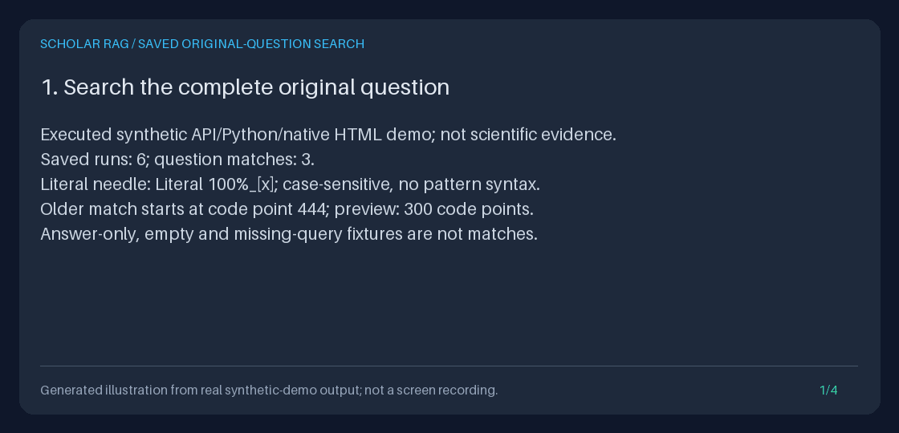

# Find saved runs by their original questions

Use **Original question contains (literal)** in `/explore/runs`, or pass
`question` to `GET /runs` or `SQLiteRunHistory.list_runs`. It searches the
**complete first recorded PLANNING question**, including text after the
300-code-point preview. It never searches answers, evidence passages, review
comments, annotations or later reformulations.

This is a bounded-input, generation-free **lexical discovery filter**, not
scientific relevance scoring, fuzzy matching, a new paper index, or a request
to rerun research. It opens the existing event database read-only: no new table,
index, migration, backfill, model, retrieval or current-corpus access is needed.
Omitting the filter preserves the original response shape and listing behavior.

[](../assets/saved-question-search.gif)

[Play the measured-output GIF](../assets/saved-question-search.gif) or read the
[exact text alternative](../assets/saved-question-search.txt). Animation is
opt-in. These are **illustrations of actual executed synthetic measurements,
not browser footage**, live provider output, performance benchmarks or
scientific validation.

## Native browser workflow

1. Start the local API against the database containing your saved runs, using
   the [Quickstart](../../QUICKSTART.md). Open `/explore`, then **Browse saved
   runs**, or open `/explore/runs` directly.
2. Enter a remembered literal fragment in **Original question contains
   (literal)**. Choose an exact recorded state if useful and a page size from
   1 to 100. **Apply run filters** removes the old cursor and starts a fresh
   traversal. The browser's empty question field means no question filter;
   whitespace-only text is invalid, not a request for all runs.
3. Inspect the returned question previews. The selected literal is shown as a
   JSON string so meaningful spaces and escapes remain explicit. A separate
   notice identifies a match that is not wholly visible in the preview: it
   may occur after character 300 or cross the preview boundary. The preview
   itself is not replaced, expanded, highlighted speculatively or scored.
4. **Next page** keeps the question, recorded state, page size and catalog
   return selection. **Start again with the same selection** removes only
   the history cursor. **Show all states** removes state and cursor, keeping
   the question. **Clear question filter** removes question and cursor,
   keeping the state and catalog return fields.
5. **Inspect saved evidence** opens that exact run, when a valid complete
   capture exists. **Back to saved runs** restores the same search page.
   Missing, failed, interrupted and legacy captures keep their existing honest
   errors; a text match or recorded `DONE` is not proof of exportability.
6. Follow **Compare saved runs**, **Human-review notebook**, **Review saved
   answer**, or a source's annotation link. Their validated return state keeps
   the question through pagination, exact-ID readers, preview forms and saved
   human-opinion redirects. Search itself never submits an opinion.

Comparison has its own independent chooser page/cursor. The history question
is **return context**, not a restriction on which baseline or candidate can
be explicitly chosen. Likewise, a reader/notebook/composer always addresses
its exact selected run, even if it is outside the saved search selection.
Catalog source/title filters remain return context, not question filters.

All generated paths preserve ASGI root paths and nested mounts. Existing opaque
run-ID handling, including slashes and dot segments, is unchanged. The reader's
query-addressed exact ID is not inferred from the question. See the
[saved-run browser](SAVED_RUN_BROWSER_GUIDE.md),
[comparison workbench](SAVED_RUN_COMPARISON_WORKBENCH_GUIDE.md),
[human-review notebook](HUMAN_REVIEW_NOTEBOOK_GUIDE.md),
[answer-review composer](SAVED_ANSWER_REVIEW_WORKBENCH_GUIDE.md) and
[annotation composer](FROZEN_ANNOTATION_WORKBENCH_GUIDE.md).

## Literal matching contract

| Input / stored text | Meaning |
| --- | --- |
| `question="GraphRAG"` | Case-sensitive substring; does not match `graphrag` |
| `%`, `_`, `*`, `?`, `[x]`, `.*`, quotes or backslashes | Ordinary literal characters, never SQL wildcards, regular expressions or executable input |
| `question=" exact "` | Both spaces are significant; no trimming |
| Precomposed versus combining Unicode | Different code-point sequences; no normalization or accent folding |
| Non-ASCII text and emoji | Exact Unicode substrings; bounds count code points, not UTF-8 bytes or UTF-16 code units |
| Search omitted / Python `None` | Original unfiltered-by-question behavior |
| Empty API/Python string or whitespace-only string | Invalid; fail before database reads |
| Empty native question field | Explicitly omits this filter, consistently with native state/source/title controls |
| Missing/null first PLANNING query, or no PLANNING event | No search match; still discoverable without question filtering |
| Empty or whitespace-only saved query | Preserved as saved; cannot match a valid nonblank search literal |
| Later PLANNING/reasoning/answer payload | Not substituted for the original question |

The original question belongs to the **lowest-event-ID PLANNING transition**.
If that transition has no question, a later nonempty question is not promoted.
The current state still comes from the **highest-event-ID state transition**.
These are independent facts.

Valid NUL, CR and LF characters remain literal in Python/JSON searches, including
matches after an embedded NUL. Native single-line inputs cannot preserve NUL/CR/LF;
such existing selections disable the form with an explanation, while exact
encoded page/return links and **Clear question filter** remain available.
If the saved preview itself contains text the HTML renderer cannot faithfully
display (such as NUL), the existing `409` applies, not replacement characters.
JSON-string comparison/review/annotation return state retains those controls.

## HTTP API

```bash
BASE_URL=http://127.0.0.1:8000
curl --fail-with-body --silent --show-error --get "$BASE_URL/runs" \
  --data-urlencode 'question=Literal 100%_[x]' \
  --data-urlencode 'state=DONE' \
  --data-urlencode 'limit=2'
```

Always use proper URL encoding; a literal `+`, `%` or `&` must not become a
space, escape or parameter separator. This example does not create a run.

| Parameter | Contract |
| --- | --- |
| `question` | Optional strict, nonblank valid-Unicode string, **1..200 code points**, kept exactly |
| `state` | Existing optional exact uppercase `AgentState`; e.g. `DONE`, `ERROR`, `REASONING` |
| `limit` | Existing default **20**, inclusive **1..100** |
| `cursor` | Existing positive signed-64-bit first-event ID; exclusive, not a page number |

The response remains `{"runs": [...], "next_cursor": ...}`. Each run retains
the existing fields, including `query_summary` (at most **300** code points),
`query_truncated`, exact IDs, timestamps, state, count and navigation URLs.
There is no full-question field, match offset, relevance score or additional
response envelope. Omission does not add fields to default responses.

When `question` is supplied, the API accepts only these four query fields,
once each, in at most **16,384 raw URL-encoded query bytes**. Invalid percent
encoding/UTF-8, unknown or duplicate fields, blank/oversized questions and
invalid limit/state/cursor values return sanitized
`422 detail.code="invalid_run_search_request"` before reading history.
Omitted-question API requests retain their existing validation behavior.
Native history/reader requests keep their existing strict field allowlists,
16-KiB query bound and protected HTML error pages.

GET query strings are text, not JSON types: `question=null` searches for the
four literal characters `null`; it does not omit the filter.

## Python API and restart

```python
from pathlib import Path

from agent.models import AgentState
from storage.run_history import SQLiteRunHistory

database = Path("/absolute/path/existing-research.sqlite3")
history = SQLiteRunHistory(database)
cursor = None
while True:
    page = history.list_runs(
        question="Literal 100%_[x]",
        state=AgentState.DONE,
        limit=2,
        cursor=cursor,
    )
    for run in page.runs:
        print(repr(run.run_id), repr(run.query_summary), run.query_truncated)
    if page.next_cursor is None:
        break
    cursor = page.next_cursor
```

The keyword-only signature is
`list_runs(*, limit=20, cursor=None, state=None, question=None) -> RunHistoryPage`.
Non-string questions (including booleans, bytes, numbers, containers), blank,
over-200-code-point or unencodable strings raise Pydantic `ValidationError`
**before connecting**. It does not coerce values or create a missing database.

Restart with the **same database path** and recreate `SQLiteRunHistory`, or
restart the API using the same `SCHOLAR_RAG_DATABASE_PATH`. No process-local
question index or cached run ID is required. A different/empty database is not
recovery of the original records. No events means no discoverable run.
This feature does not resume a worker, replay a query or repair stored data.

Standalone history reads use `mode=ro` and close each connection. Normal
application construction still initializes existing stores and retrieval indexes;
the no-model/no-corpus-read guarantee concerns search requests, not all startup
work. Provider defaults are unchanged and irrelevant to this filter; see the
[current provider guide](PROVIDER_MODELS_GUIDE.md) only when explicitly generating
a new answer.

## Pagination, malformed records and limits

Question and latest-state filtering occur **before** descending first-event-ID
ordering, `limit + 1` lookahead and response pagination. The continuation is
`first_event_id < cursor`. A matching old run is not missed just because many
newer nonmatching runs fill an unfiltered page.

Keep the same question and state when following `next_cursor`. Submitting the
native form starts over automatically. An integer cursor is not signed or bound
to a filter: manually reusing it with another valid question selects that new
question below the same boundary. Refresh without a cursor for newly created
runs. Appended events do not move creation keys; unchanged matching records do
not repeat across pages. Each page is one SQLite snapshot, **not a frozen
multi-page view**: later state changes, or a first PLANNING event added to an
event-only run, can change membership.

| Boundary / failure | Behavior |
| --- | --- |
| Result rows | At most 100 summaries, plus one validated lookahead |
| Displayed question | Original 300-code-point prefix; matching checks the complete question |
| Stored encodings | Existing UTF-8 and UTF-16 databases supported, without schema changes |
| Malformed transition / mixed-agent run | Existing `RunHistoryError` / API `409 invalid_run_record`; not hidden by either filter |
| Invalid full-question Unicode during search | Same explicit error, even beyond the preview or when the literal would not match |
| Invalid selected identity/timestamp or lookahead | No partial page, clipped identity, guessed timestamp or fabricated continuation |
| No match / exhausted cursor | 200 with empty runs and null cursor; distinct native explanation |
| Database unavailable / missing table | Existing SQLite exception/API server failure; native 503, never an empty success |
| Native HTML | Existing 1-MiB history and 4-MiB evidence caps; total escaped navigation is included |

The SQL statement binds values and uses a read-only scalar predicate to decode
the complete original question and perform exact substring matching. Invalid
Unicode is retained as an error sentinel rather than silently filtered out.
Only bounded previews/scalars are materialized as result rows; the predicate
does decode full stored questions. No evidence snapshot, generation record,
source body or review text is deserialized for search.

**Bounded input/results are not a bounded scan-time or stored-text guarantee.**
Grouping and transition checks scale with the event log, and full question
decoding scales with stored question size. There is no new scan deadline,
full-text index, result-count calculation or arbitrary stored-question
truncation. Existing SQLite busy timeouts are not latency guarantees.
This is summary validation, not a complete event-log integrity audit or
state-machine replay.

## Execute the synthetic demo

With the existing development extra installed, from the repository root:

```bash
DEMO_DIR="$(mktemp -d)/saved-question-search"
PYTHONPATH=src:. .venv/bin/python -m scripts.demo_saved_question_search \
  --output-dir "$DEMO_DIR" --illustrate
cat "$DEMO_DIR/transcript.txt"
.venv/bin/python -m json.tool "$DEMO_DIR/checks.json"
```

The command refuses an existing output directory. Pillow is already in the
development extra; production search needs no new dependency. Remove
`--illustrate` to generate only measurements, native HTML, JSON and the
synthetic database. Use the same command with a **new** directory to repeat.

The script uses the real API through in-process `TestClient`, mounted at `/lab`.
It creates two real fake-adapter runs, then four explicitly synthetic traces:
partial, missing-query, empty-query and answer-only. It submits the actual native
form, follows generated pagination/reader/comparison/notebook/composer links,
restarts against the same SQLite file, and checks byte-identical results.
No browser was recorded and no human-review save was submitted.

| Artifact | Evidence |
| --- | --- |
| `history.sqlite3` | New isolated synthetic fixture, not the deployment database |
| `matches.json`, `done-next.json` | Measured complete-question match and filtered pagination responses |
| `history-first.html`, `history-next.html` | Actual rendered native pages, including the beyond-preview notice |
| `reader.html`, `comparison.html`, `notebook.html`, `review.html`, `annotation.html` | Actual followed return-navigation consumers |
| `restarted.html` | Byte-identical filtered page after application recreation |
| `checks.json` | Observed counts, match start, guards, schema/database stability and restart checks |
| `transcript.txt` | Four measured panels used for the illustration and text alternative |
| `saved-question-search.gif`, `saved-question-search.png` | Optional measured-output animation and still, not screenshots |

Offline settings ignore ambient environment/dotenv/provider overrides. Network
calls are blocked during the demo. Search reads are measured with generation,
retrieval, event writes and corpus-access guards; event sequences, schema and
database bytes are compared before/after. Fake generation is permitted **only
during explicit fixture setup**. The renderer reuses the repository's existing
Pillow helper and rejects text overflow rather than clipping measurements.

## Privacy, portfolio and inspiration

Search literals appear in API/browser URLs, browser history, copied links,
comparison/authoring return tokens and potentially server/proxy logs. They
are not added to agent events, but **no-store does not erase URL history or
logs**. Native read pages retain no-referrer; explicit authoring forms keep
their existing same-origin referrer policy. Protect local logs and links.
The service remains unauthenticated and is not tenant-isolated. Do not search
for secrets on a shared deployment. Saved questions/answers remain sensitive
even after current-corpus deletion.

For a portfolio, show a long synthetic original question whose remembered
literal is beyond the preview, a deliberately nonmatching case variant,
one-item filtered pages, and the same exact selection after evidence reading
and restart. Use the saved responses and measured checks to explain the
filter-before-pagination and no-work guarantees. Do not market a match as
scientific support, answer correctness, semantic similarity, a speed result,
or parity with a larger literature platform.

Inspiration checked **2026-10-31 America/Los_Angeles**:
[Future-House/paper-qa](https://github.com/Future-House/paper-qa)
(9,523 stars observed that day) documents persisted answers and an answers-index
search in its [CLI Usage](https://github.com/Future-House/paper-qa#cli-usage).
That recoverability workflow motivates this much narrower feature. Scholar RAG
Agent only filters already-saved **original questions** using bounded literal
input, without generation or a new answer index. It does not implement PaperQA's
answer search, ranking, contextual summarization, embeddings or broader agent
workflow; no code or prose was copied and no feature parity is claimed.
