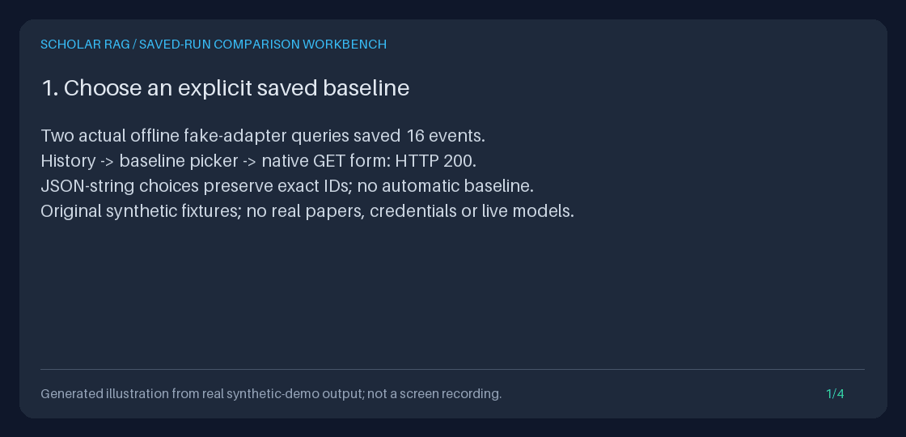

# Native saved-run comparison workbench

Open `http://127.0.0.1:8000/explore/runs`, then **Compare saved runs** or
**Use as comparison baseline**. The script-free `GET /explore/runs/compare`
workbench inspects two saved completed captures, without retrieval, generation,
provider calls, corpus reads, writes, migrations or new dependencies.
It is a browser workflow over the existing [exact comparison semantics](RUN_COMPARISON_GUIDE.md),
not a new evaluation engine.

[](../assets/saved-run-comparison-workbench.gif)

The still makes animation opt-in. Read the [exact text transcript](../assets/saved-run-comparison-workbench.txt)
without animation. The GIF is a **Pillow illustration of executed synthetic
output, not screenshots, a screen recording, research findings or a benchmark**.

<details>
<summary>Show the four-panel measured-output GIF</summary>



</details>

## Browser workflow

1. Start the local API against your existing event database using the
   [Quickstart](../../QUICKSTART.md). Saved-run history preserves its recorded-state
   filter, exclusive first-event cursor and original corpus-return selection.
2. Choose baseline and candidate explicitly. Neither is guessed. The chooser
   pages through all recorded states, independently of the return-history filter;
   `DONE` alone is not an exportability guarantee. Pin a choice as either side
   before following **Next saved choices** to select runs on different pages.
   Pinned IDs remain selectable even outside the current page.
3. Submit **Compare saved runs**. Both captures must validate before any result
   appears. One missing selection opens only the chooser, never a partial comparison.
   Compare query, ordered document scope, evidence policy, recorded configuration,
   provider/configured model/task, answer previews, exact digests and change flags.
4. Read shared evidence in baseline order, additions in candidate order, and
   removals in baseline order. Identity is the exact `(chunk_id, document_id)`
   pair. Positive rank delta means a later position in the candidate. Reassigned
   chunk IDs with different document owners are additions/removals, not shared.
5. **Swap baseline and candidate** explicitly reverses direction. **Compare
   baseline to itself** is a valid no-change control and reads that ID once.
   Distinct runs with identical compared fields also report no changes.
6. **Open exact frozen source** addresses that side's saved run and `#source-N`
   frozen rank, never a title match or today's corpus. Complete answers,
   passages, paths, metadata, citations and trace details remain in the existing
   frozen reader. **Back to saved runs** restores the original history page from
   either the workbench or source reader. Mount/root-path prefixes are preserved.
   Use browser Back to return directly from a reader to the comparison.

Query/answer/title/retriever text previews preserve up to 240 Unicode characters,
with original character/UTF-8 byte counts, explicit truncation and full-text
SHA-256. Comparisons use complete saved values, not these previews. IDs are
displayed as JSON strings; decode quotes/escapes before using a raw ID.
Text is escaped literally, never rendered as Markdown or activated source URLs.

## GET contract and bounds

```bash
curl --get 'http://127.0.0.1:8000/explore/runs/compare' \
  --data-urlencode 'baseline="exact-baseline-id"' \
  --data-urlencode 'candidate="exact-candidate-id"' \
  --data-urlencode 'history={"limit":1,"state":"DONE","catalog_limit":20}'
```

| Parameter | Meaning and bound |
| --- | --- |
| `baseline`, `candidate` | Optional JSON strings, each decoding to an exact 1-256-character Unicode run ID. Omission or an empty field opens the chooser; JSON `null`, numbers, arrays and empty decoded IDs fail. Maximum encoded field length 3,074 characters. |
| `limit` | Choice-page size, 1-100, default 20; not the history-return page size. |
| `cursor` | Optional exclusive positive first-event-ID cursor through 9,223,372,036,854,775,807; controls only chooser paging. |
| `history` | Optional JSON object, default `{}`, at most 12,000 characters; only existing `limit`, `cursor`, `state`, `catalog_limit`, `source`, `title`, `catalog_cursor` return fields, with their [existing bounds](SAVED_RUN_BROWSER_GUIDE.md). Never an arbitrary URL. |

JSON values in native select controls preserve slashes, dot segments, quotes,
combining Unicode, bidi characters, NUL and CR/LF without path interpretation or
input normalization. Percent-encode the complete query as usual. Return state
is also JSON, so catalog filters that ordinary hidden inputs cannot preserve
round-trip exactly. Blank source/title filters retain the existing omission rule.

Whole request query strings are capped at **16,384 bytes** before parsing.
Duplicate/unknown fields, duplicate JSON history keys, invalid Unicode/JSON/
percent encoding, empty cursors and invalid bounds fail before database reads.
Methods other than GET return 405. OpenAPI advertises this HTML route separately.

The browser uses `SavedRunComparator(SQLiteEvidenceReader(...))`, not the legacy
unbounded event exporter. Each side opens an existing database read-only and
validates at most **100 events, 1,048,576 bytes per payload, and 8,388,608 total
UTF-8 event-text bytes**, including later events. The baseline is checked first;
the same exact ID is read once. Distinct IDs use separate read transactions,
not one cross-run snapshot or a reproducibility claim. Chooser summaries retain
the existing bounded history projection; SQL grouping still scales with stored
events, so these are output/read limits, not a hard wall-clock guarantee.

Complete escaped comparison HTML, including controls and navigation, must fit
**1,048,576 bytes**. No rows or saved comparison fields are silently dropped.
The existing frozen reader retains its independent 4-MiB HTML cap and rejects
unrepresentable literal NUL text; comparison can represent NUL identities as
JSON, but does not change that reader's contract. Use Python for those records.

| HTTP outcome | Meaning / recovery |
| --- | --- |
| 200 | Chooser for an incomplete selection, or complete validated comparison for two selected IDs. |
| 404 | Exact baseline/candidate ID missing. The error names the side, not its sensitive ID. |
| 409 | Side incomplete/failed/legacy, malformed/inconsistent evidence, exceeded event-read limits, or unrepresentable displayed text. No partial comparison; inspect trusted local records. |
| 413 | Complete escaped HTML exceeds 1 MiB. Narrow chooser pages; large recorded fields require Python. Nothing was truncated to succeed. |
| 422 | Invalid request or return state. Reset selection; no invalid field is ignored. |
| 503 | Event storage unavailable, not an empty result. Restore local availability. |

The existing JSON endpoint
`GET /runs/{baseline_run_id}/compare/{candidate_run_id}` and its documented
schema/error behavior are **unchanged**, including its path-ID restrictions.
This workbench is not a JSON alias and adds no export, batch, replay or live job.

## Python without application startup

```python
from pathlib import Path
from storage.evidence_export import SQLiteEvidenceReader
from storage.run_comparison import RunComparisonError, SavedRunComparator

reader = SQLiteEvidenceReader(Path("/absolute/path/existing-runs.sqlite3"))
comparator = SavedRunComparator(reader)
try:
    result = comparator.compare("copy-baseline-id", "copy-candidate-id")
except RunComparisonError as error:
    print(error.side, error.status_code, error.code)
    raise
print(result.model_dump_json(indent=2))
```

Use raw exact IDs here, not the form's JSON-string encoding. This path neither
creates missing databases nor constructs providers/retrieval indexes.
`compare_bundles(baseline, candidate)` remains the pure in-memory alternative.
Normal FastAPI startup still initializes stores and loads indexes.

## Reproduce the measured demo and GIF

Use the existing Python 3.11+ dev environment; Pillow is already a dev dependency.
Choose a new directory; these scripts refuse existing outputs and symlinks.

```bash
DEMO_DIR="$(mktemp -d)/comparison-workbench"
uv run --no-sync python -m scripts.demo_run_comparison_workbench --output-dir "$DEMO_DIR"
uv run --no-sync python -m scripts.create_run_comparison_workbench_gif \
  --transcript "$DEMO_DIR/transcript.txt" \
  --output "$DEMO_DIR/comparison.gif" --still "$DEMO_DIR/comparison.png"
```

The demo ignores ambient credentials, dotenv and database settings, blocks
external HTTP/sockets, and creates three original synthetic notes and two real
fake-adapter queries in a temporary database. Native selection, form submission,
swap, same-run control, exact source navigation and history return are exercised
through actual TestClient requests. Guarded reads reject generation, retrieval,
reranking, writes and use of the legacy unbounded exporter.

It saves actual `history.html`, `chooser.html`, `comparison.html`, `same.html`,
`swapped.html`, `source.html`, `missing.html`, both evidence JSON bundles, the
existing API's `comparison.json`, measured `checks.json` and `transcript.txt`.
It deletes only its synthetic current corpus, restarts, requires byte-identical
comparison/source HTML and unchanged saved events/SQLite bytes during reads,
then removes the temporary database. The HTML responses retain application-local
links; they are inspection artifacts, not a portable offline browsing website.

The checked-in transcript reports **16 events, two sources per side,
one shared/added/removed pair, 13 changed fields, same-run `False`, missing
candidate 404, zero guarded calls, and zero remaining corpus chunks**.
Original run UUIDs/timestamps are retained in response artifacts, not fabricated
into a deterministic recording. Tests compare decoded GIF/PNG pixels, not PNG
compression bytes, and require the exact executed transcript to match.

## Portfolio, provenance and limitations

Demonstrate the history-to-comparison flow, swap it, show the same-run control,
then open the exact frozen source and return to history. Explain how bounded
read-only SQLite, existing pure comparisons, JSON-safe native controls and
fail-closed HTML deliver a usable workflow without a JavaScript application.
Show the saved transcript/checks rather than calling the GIF real browser footage.

The public design reference, reviewed **2026-10-22 America/Los_Angeles**, is
[Langfuse](https://github.com/langfuse/langfuse) and its
[compare-experiments workflow](https://langfuse.com/docs/evaluation/experiments/compare-experiments):
explicit baseline choice, side-by-side recorded outputs and trace inspection.
This is an original local implementation; no Langfuse code or package is copied
or integrated. It is distinct from the existing comparison API and from
retrieval-policy comparison, which executes new local retrieval previews.
The stack remains Python 3.11+, FastAPI, Pydantic, HTTPX, SQLite and the custom
state machine, with no LangGraph/Langfuse integration.

No-change means equality of selected saved fields, **not** full trace equality,
answer quality, scientific support, safe release or a fair A/B experiment.
Queries, scopes, evidence policies and contexts can differ. Configured model
names are not resolved revisions; digests are not signatures. The provider
[catalog-only check](PROVIDER_MODELS_GUIDE.md) adds no live entitlement test.

The unauthenticated service belongs on loopback or behind your access controls.
Hashed-style CSP, no scripts, no-store, nosniff and no-referrer do not make data
private: IDs/return filters can enter history/server logs; answers and sources
may be sensitive, and users can save/screenshoot them. Corpus deletion does
not erase saved evidence. Review artifacts before sharing.
