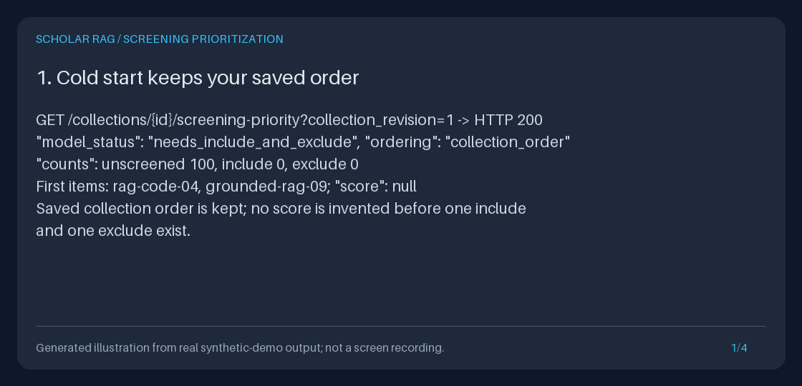

# Screen the most likely relevant papers first

Order the papers that still need your screening decision so the ones most likely to
be relevant come first. A small, deterministic, offline **TF-IDF + multinomial Naive
Bayes** model learns from your *current* human `include` and `exclude` decisions in a
saved collection and re-ranks the remaining `unscreened` and `stale` members on every
read. Each ranked paper shows its score and the terms that pushed it up, so the order
is auditable.

**The ordering never decides.** It records, changes and suggests no include, exclude
or unsure label, never alters collection membership, retrieval selection, the default
collection order or decision history, and never runs a language model. Every paper
still needs your own explicit decision through the existing
[human screening workbench](HUMAN_SCREENING_WORKBENCH_GUIDE.md) or
[screening API](PAPER_SCREENING_GUIDE.md). Human-in-the-loop screening remains the
repository's core safety rule.

[](../assets/screening-priority.gif)

The static preview links to an opt-in four-frame GIF. It is a **generated illustration
of actual offline synthetic execution** (real API JSON fields, the rendered rank-1
browser card and measured simulation numbers), not browser footage or a benchmark on
real literature. The [measured transcript](../assets/screening-priority.txt) is the
text alternative. All papers and labels are original synthetic fixtures.

## Why this closes a workflow gap

Collections already supported explicit human screening: revisioned
include/exclude/unsure decisions with reasons and history, a JSON API, a native
browser workbench, complete exports, progress reports and screened retrieval scope.
But the screening queue always used saved membership order, **ignoring everything
the reviewer had already decided**. With 20 relevant papers among 100, a reviewer
working in that order typically meets most of the relevant papers only near the end.

Active-learning screening tools re-rank unscreened records after human decisions so
relevant papers surface early. References checked on **2026-11-07
America/Los_Angeles**:

| Reference | What it does | What this feature deliberately differs on |
| --- | --- | --- |
| [ASReview LAB models](https://asreview.readthedocs.io/en/latest/_modules/asreview/models/models.html) | Open-source active learning for systematic reviews. Its default "ultra" models combine TF-IDF (unigrams and bigrams, sublinear tf) with a linear SVM, a class balancer and the `max` querier (show the most likely relevant record next). Its `ELAS u3` configuration "mimics the performance of ASReview LAB version 1": multinomial Naive Bayes (alpha 3.822) on TF-IDF with English stop words. | Closest in spirit to `ELAS u3`, re-implemented in pure Python with no scikit-learn, NumPy or model download. No ASReview code, project format or results are reused. |
| [Covidence "Most relevant" sorting](https://support.covidence.org/help/ai-feature-most-relevant-sorting) | Sorts title/abstract screening by an EPPI-Centre active-learning model once at least 25 studies are included/excluded, with at least 2 of each. It "will not work as expected" for reviews with fewer than 100 studies, which fall back to import order. Its guidance warns about automation bias. | Works for this repository's 1-100-paper collections from the first include plus first exclude, locally, with per-paper term explanations. |
| [Rayyan relevance ranking](https://help.rayyan.ai/hc/en-us/articles/45819983751569-How-to-Use-Ratings-and-Relevance-Ranking-in-Rayyan) | An SVM over stemmed unigrams, bigrams and MeSH terms computes five-level ratings on demand after at least 50 decisions with at least 5 includes and 5 excludes; ratings "are never recorded as decisions". Its cited validation reports WSS@95 of 0.49 ± 0.18 across 15 review datasets. | Recomputed on every read, no minimum beyond one include and one exclude, exact scores and contributing terms instead of coarse levels. |

## Quickstart: offline, synthetic data, no credentials

From the repository root with Python 3.11+ and [uv](https://docs.astral.sh/uv/):

```bash
uv sync --extra dev
OUTPUT_PARENT="$(mktemp -d)"
OUTPUT="$OUTPUT_PARENT/screening-priority"
uv run --no-sync python -m scripts.demo_screening_priority --output-dir "$OUTPUT"
uv run --no-sync python -m scripts.create_screening_priority_gif \
  --transcript "$OUTPUT/transcript.txt" \
  --output "$OUTPUT/preview.gif" --still "$OUTPUT/preview.png"
printf 'Actual artifacts: %s\n' "$OUTPUT"
```

The demo (about one second) creates 100 original synthetic papers in a temporary
database, reads the cold-start ordering, lets a **simulated reviewer** record twelve
fixture labels through the real `PUT` screening API (plus one `unsure`), then reads
the learned ordering as JSON, the default collection page, the opt-in browser queue
and the existing decision form. It saves `cold.json`, `ready.json`,
`collection.html`, `priority.html`, `form.html`, `simulation.json`, `checks.json`
and the four-panel `transcript.txt`. It refuses existing output paths, ignores
ambient keys/dotenv/database settings, and guards sockets, HTTP clients,
retrieval, generation, event writes and collection mutation during the reads.
Measured checks include: the API-driven queue equals the pure simulation for all
twelve recorded steps, browser order equals JSON order, reads leave the database
bytes unchanged, and a restarted app returns byte-identical JSON.

### Python: complete standalone example

This example writes only its own temporary database. It needs no server, model or
network access, and is executed by the test suite.

```python
from pathlib import Path
from tempfile import TemporaryDirectory

from retrieval.models import Document
from storage.document_store import SQLiteDocumentStore
from storage.paper_screening import ScreeningSubmission, SQLitePaperScreening
from storage.screening_priority import SimulatedPaper, prioritize_screening, simulate_screening

papers = {
    "seed-exclude": ("Cathode coatings for lithium-ion cells", "Capacity fade over charge cycles."),
    "seed-include": (
        "Citation-grounded answers to scientific questions",
        "Answers cite retrieved evidence passages.",
    ),
    "candidate-battery": (
        "Electrolyte additives for fast-charging batteries",
        "Cathode degradation and capacity fade.",
    ),
    "candidate-grounded": (
        "Evidence-linked retrieval for literature questions",
        "Generated answers cite the passages that support them.",
    ),
}
with TemporaryDirectory(prefix="screening-priority-example-") as temporary:
    database = Path(temporary) / "synthetic.sqlite3"
    SQLiteDocumentStore(database).add_documents(
        [
            Document(document_id=key, title=title, text=text, source="synthetic:guide")
            for key, (title, text) in papers.items()
        ],
        [],
    )
    screening = SQLitePaperScreening(database)
    collection = screening.collections.create(
        name="Synthetic guide review", document_ids=list(papers)
    )
    cold = prioritize_screening(screening, collection.collection_id, collection_revision=1)
    print(cold.model_status)
    # Explicit human decisions; prioritization itself never writes one.
    for document_id, decision in (("seed-include", "include"), ("seed-exclude", "exclude")):
        screening.submit(
            collection.collection_id,
            document_id,
            ScreeningSubmission(
                collection_revision=1,
                expected_decision_revision=0,
                decision=decision,
                reason="Synthetic human opinion for this example.",
            ),
        )
    ordered = prioritize_screening(screening, collection.collection_id, collection_revision=1)

# The ordering is a plain Pydantic model; it outlives the temporary database.
print(ordered.model_status, [item.document_id for item in ordered.items])
top = ordered.items[0]
print(top.document_id, f"{top.score:.3f}:", ", ".join(term.term for term in top.top_terms))

# Offline replay with known labels, like ASReview's simulation mode.
labelled = [
    SimulatedPaper(
        document_id=key,
        title=title,
        text=text,
        relevant=key in {"seed-include", "candidate-grounded"},
    )
    for key, (title, text) in papers.items()
]
slow = simulate_screening(labelled, strategy="collection_order")
fast = simulate_screening(labelled, strategy="most_likely_relevant_first")
print(slow.strategy, slow.papers_to_recall_target, fast.strategy, fast.papers_to_recall_target)
```

Expected output:

```text
needs_include_and_exclude
ready ['candidate-grounded', 'candidate-battery']
candidate-grounded 0.593: answers, cite, evidence, passages, questions
collection_order 4 most_likely_relevant_first 3
```

For an existing application, pass its `container.paper_screening`, an actual
collection ID and that collection's current revision. Constructing
`SQLitePaperScreening` separately keeps its existing startup schema
initialization; prioritization reads themselves never write.

## Browser walkthrough

1. Start the isolated loopback API using the [Quickstart](../../QUICKSTART.md),
   ingest papers you may process and save a
   [collection](NATIVE_COLLECTION_BUILDER_GUIDE.md).
2. Open `http://127.0.0.1:8000/explore`, choose **Browse saved collections**, then
   **Inspect membership and human screening**. The member list keeps its saved
   membership order; nothing about this page changes by default.
3. Under the status shortcuts, choose **Most likely relevant first (opt-in order of
   papers still needing your decision)**. The read-only page
   `/explore/screening-priority` shows the model status, all-member counts, then a
   card per unscreened/stale paper with its rank, title, status, relevance score,
   log-odds and up to five top terms with their contributions. Unsure papers are
   listed separately, ranked by the same model but never used as labels.
4. On a card, choose **Read this exact paper / choose source context**, then **Open
   explicit human screening form**. This is the unchanged workbench form: the
   decision and reason start blank, and only your explicit POST writes.
5. After the 303 confirmation, choose **Most likely relevant first: reopen the
   prioritized queue** in the form's navigation. The queue is recomputed from your
   current decisions, so the next card reflects what you just decided.

Before the model has at least one current include and one current exclude, the page
says `needs_include_and_exclude`, keeps saved collection order and shows no score.
The page is GET-only (other methods get 405 with `Allow: GET`), script-free, uses the
shared escaping, no-store, nosniff, `Referrer-Policy: no-referrer`, frame denial and
hash-only-CSS Content-Security-Policy, preserves a mounted `root_path`, and validates
`collection_return` state against the exact collection revision. Titles and terms are
escaped literal text; a title such as `<script>` renders as text, never markup.

## API reference

`GET /collections/{collection_id}/screening-priority?collection_revision=N`

Use the actual collection ID and its current revision; a placeholder is not valid.

```bash
BASE_URL='http://127.0.0.1:8000'
COLLECTION_ID='replace-with-your-col_id'
curl --fail-with-body --silent --show-error --get \
  "$BASE_URL/collections/$COLLECTION_ID/screening-priority" \
  --data-urlencode "collection_revision=1"
```

Response captured from the demo's real `ready.json` (12 decisions plus one unsure;
`items` shortened to its first entry; the collection ID differs on every run):

```json
{
  "schema_version": "1.0",
  "collection_id": "col_5b4a2d4b70b94105844569f62bd3104d",
  "collection_name": "Synthetic grounded-answer review",
  "collection_revision": 1,
  "model_status": "ready",
  "ordering": "most_likely_relevant_first",
  "total_documents": 100,
  "counts": {"unscreened": 87, "include": 11, "exclude": 1, "unsure": 1, "stale": 0},
  "training_documents": 12,
  "training_relevant": 11,
  "training_irrelevant": 1,
  "feature_terms": 128,
  "items": [
    {
      "rank": 1,
      "document_id": "synthetic-closed-book-qa-09",
      "status": "unscreened",
      "title": "Scaling language models for question answering",
      "title_truncated": false,
      "score": 0.539647,
      "log_odds": 0.15892,
      "top_terms": [
        {"term": "linked", "contribution": 0.013134},
        {"term": "questions", "contribution": 0.013107},
        {"term": "directions", "contribution": 0.010697},
        {"term": "discussed", "contribution": 0.010697},
        {"term": "limitations", "contribution": 0.010697}
      ]
    }
  ],
  "unsure_items": ["... 1 item, same shape ..."],
  "method": {"name": "tfidf-multinomial-naive-bayes-v1", "alpha": 1.0, "...": "..."},
  "notes": ["Ordering only: no decision is recorded, changed or suggested. ...", "..."]
}
```

That rank-1 paper is a synthetic **near miss** (a closed-book QA paper): with only one
exclude, words it shares with the eleven includes push it up. Its explanation even
shows `linked` from "Answers are not linked to any source documents": bag-of-words
features ignore negation. Recording your exclude retrains the next read. This is the
expected active-learning behaviour, and the reason a score is never a label.

| Field | Meaning |
| --- | --- |
| `model_status` | `ready`, `needs_include_and_exclude` (cold start) or `no_training_terms` (labeled papers contain no usable terms) |
| `ordering` | `most_likely_relevant_first` only when `ready`; otherwise `collection_order` |
| `counts`, `total_documents` | Current status of every member in this one snapshot (same definitions as the queue) |
| `training_documents`, `training_relevant`, `training_irrelevant` | Current includes plus excludes; includes; excludes |
| `feature_terms` | Vocabulary size: distinct terms occurring in at least one labeled paper (0 without a model) |
| `items` | Every `unscreened` and `stale` member: `rank` (1-based), exact `document_id`, `status`, title prefix (300 characters) and `title_truncated`, `score` = P(relevant), `log_odds`, up to 5 `top_terms` with positive `contribution`. `score`, `log_odds` are `null` and `top_terms` empty when not `ready`. Values are rounded to 6 decimal places. |
| `unsure_items` | Current `unsure` members in the same shape, ranked separately |
| `method` | Exact, versioned description of features, weighting, classifier, prior, score, ties and explanation |
| `notes` | Fixed statements: ordering only, training-label policy, uncalibrated scores, no stopping signal and why, one-snapshot semantics |

The only query parameter is `collection_revision`: an ASCII unsigned decimal integer
of at most 19 digits from 1 to 9,223,372,036,854,775,807. Unknown, duplicate,
signed, decimal, non-ASCII, NUL-containing or over-16,384-byte queries fail. There is
no pagination: the complete ordering of at most 100 members must fit 524,288 UTF-8
bytes. Successes and failures use `Cache-Control: no-store` and
`X-Content-Type-Options: nosniff`; failures use the collection error envelope
`{"detail": {"code": ..., "message": ...}}`.

| HTTP | Stable code | Meaning |
| --- | --- | --- |
| 404 | `collection_not_found` | Exact collection is absent |
| 405 | `screening_priority_method_not_allowed` | Only GET; nothing was recorded (`Allow: GET`) |
| 409 | `collection_revision_conflict` | The collection changed; reread its current revision |
| 409 | `collection_documents_missing`, `invalid_collection_record`, `invalid_screening_record`, `invalid_document_record`, `invalid_screening_priority` | Saved data is missing, invalid or inconsistent; nothing is repaired |
| 413 | `screening_priority_too_large` | The complete ordering exceeds its byte limit; no partial ordering |
| 422 | `invalid_screening_priority_request` | Invalid collection ID, revision or query parameters |
| 503 | `collection_storage_error` | Existing storage unavailable, not an empty result |

The route sits **outside** the `/screening/{document_id:path}` PUT wildcard (like the
progress report), so `PUT .../screening-priority` returns 405 and can never record a
decision for a paper whose ID happens to be `priority`. Python callers get the same
`ScreeningPriority` model from `storage.screening_priority.prioritize_screening`;
invalid Python selectors raise Pydantic `ValidationError`, storage and consistency
failures raise `CollectionError` with the codes above.

## How the model works

Everything below runs in pure Python on at most 100 members per request; there is no
training state, cache or file. The exact strings are also returned in `method`.

**Text.** Each member contributes its stored title (first 300 characters) plus the
first 4,000 characters of its stored text. For metadata sources such as PubMed or
arXiv the stored text is the abstract; for PDFs it is the start of the extracted
paper. Text is NFKC-normalized and casefolded, then split into runs of Unicode
letters/digits. Tokens shorter than 2 or longer than 64 characters, all-digit tokens
and a fixed list of English function words are dropped. There is no stemming.

**TF-IDF** over all N current members (labeled or not):

```text
tf(t, d)  = 1 + ln(count of t in d)
idf(t)    = ln((1 + N) / (1 + df(t))) + 1
x(d, t)   = tf(t, d) * idf(t) / || tf(., d) * idf(.) ||_2
```

**Multinomial Naive Bayes** with Laplace smoothing alpha = 1 over the vocabulary V of
terms occurring in at least one labeled paper. Class `rel` is the current includes,
class `irr` the current excludes. Term mass is the **mean** TF-IDF weight over the
class's labeled papers, so both classes carry equal total weight (class-balanced,
the same purpose as ASReview's balancer):

```text
mass(c, t)  = (1 / n_c) * sum over labeled papers d in c of x(d, t)
theta(c, t) = (mass(c, t) + alpha) / (sum over t' in V of mass(c, t') + alpha * |V|)
w(t)        = ln theta(rel, t) - ln theta(irr, t)
log_odds(d) = ln(prior_rel / prior_irr) + sum over t in d and V of x(d, t) * w(t)
score(d)    = P(relevant | d) = 1 / (1 + exp(-log_odds(d)))
```

**Class prior.** Uniform (1/2 each), so `ln(prior_rel / prior_irr) = 0`. A prior adds
the same constant to every paper's log-odds, so it changes displayed probabilities
but never the ranking. Laplace smoothing on class-mean masses keeps scores
conservative (often between 0.4 and 0.7): they are **not calibrated probabilities**.
Only their order, the log-odds and the term contributions are meaningful.

**Ranking and ties.** Pending papers sort by descending log-odds rounded to 12 decimal
places, then ascending document ID (Python code-point order), so duplicates and
exact ties are deterministic across runs, restarts and platforms. Terms outside V
contribute zero.

**Explanations.** A paper's contributions `x(d, t) * w(t)` sum exactly to its
log-odds. `top_terms` lists up to five terms with the largest positive contribution
(ties by term), rounded to 6 decimal places. A paper with no positive term shows
none rather than an invented reason.

## Cold start

Until the collection has **at least one current include and one current exclude**,
`model_status` is `needs_include_and_exclude`: items keep saved collection order,
`score`/`log_odds` are `null`, `top_terms` is empty and `feature_terms` is 0. No score
is fabricated from a single class. If the labeled papers contain no usable terms
(for example empty titles/text or only stop words), the status is
`no_training_terms` with the same fallback. Any collection revision change, including
a rename, makes earlier decisions `stale`; stale opinions are never labels, so a
revised collection may return to cold start until you re-screen.

## Stopping signal: deliberately not computed

ASReview LAB lets a reviewer set a
[stopping threshold](https://asreview.readthedocs.io/en/latest/lab/progress.html)
on "the number of not relevant records since the last relevant record"; it is not
set by default and "the ideal threshold is still actively researched". The
[SAFE procedure](https://doi.org/10.1186/s13643-024-02502-7) (Boetje and van de
Schoot, 2024) combines several heuristics and still requires human judgment.

This feature **reports no stopping signal**. Such a count needs a reliable global
order of decisions. The stored screening data has a per-paper decision revision and
a server wall-clock `updated_at`, but no global decision sequence: revisions only
order one paper's decisions, and wall-clock times can repeat or move backwards and
have never been part of the history contract (history pages order by revision, not
time). Reconstructing "consecutive excludes since the last include" from them would
look precise without being reliable, so it is omitted rather than approximated.

The offline simulation below, where the order is known, shows why even an exact count
is only a signal. In shuffles 7 and 9 the first 9 and 10 papers in saved order were
all irrelevant, so a rule such as "stop after 10 consecutive excludes" would have
ended shuffle 9 **before the first include, before prioritization could even start**.
Once the model was ready, runs of excludes before the last relevant paper were at
most 4 in this easy synthetic set; real collections with differently worded relevant
subtopics can produce much longer runs. Decide when to stop yourself; prioritization
gives no recall guarantee.

## Simulation: prioritized vs saved order

`simulate_screening(papers, strategy=..., recall_target=0.95)` replays a reviewer who
screens every paper with known labels, retraining after each decision, exactly like
the API: `collection_order` follows the given order; `most_likely_relevant_first`
follows the given order until one relevant and one irrelevant paper are labeled, then
always screens the current top-ranked paper. It reports the screened order, the
cumulative recall curve, papers screened to reach the recall target and to find every
relevant paper, the longest run of irrelevant papers before the last relevant one,
and work saved over sampling (Cohen et al., 2006,
[doi:10.1197/jamia.M1929](https://doi.org/10.1197/jamia.M1929)):

```text
WSS@R = (N - n_R) / N - (1 - R)
```

where `n_R` papers were screened to reach recall `R`. A random order has expected
WSS of about 0. With 20 relevant papers, 95% recall means 19 of 20.

**Synthetic set.** `scripts/screening_priority_fixtures.py` generates 100 original
templated titles/abstracts for the review question "Which papers ground generated
answers to scientific questions in cited, retrieved evidence?": 20 relevant papers in
three differently worded subtopics and 80 irrelevant papers, mostly **near misses**
that share query words (retrieval-augmented code completion and customer support,
citation recommendation, closed-book science QA, translation hallucination, music
retrieval, table QA) plus a few off-topic papers. Shared field-background and
related-work sentences put relevant vocabulary into irrelevant abstracts. Ten
deterministic shuffles stand in for unranked search-export orders. Numbers below are
computed by the demo and re-checked against a fresh simulation by the test suite.

| Shuffle | Prioritized: papers to 19/20 | Saved order: papers to 19/20 | Prioritized: all 20 | Saved order: all 20 | WSS@95 prioritized | WSS@95 saved order | Longest exclude run before last relevant (prioritized) | Same (saved order) |
| --- | ---: | ---: | ---: | ---: | ---: | ---: | ---: | ---: |
| 0 | 26 | 86 | 27 | 97 | 0.69 | 0.09 | 3 | 15 |
| 1 | 24 | 97 | 26 | 100 | 0.71 | -0.02 | 4 | 12 |
| 2 | 25 | 99 | 26 | 100 | 0.70 | -0.04 | 3 | 21 |
| 3 | 24 | 91 | 25 | 97 | 0.71 | 0.04 | 3 | 13 |
| 4 | 27 | 94 | 28 | 98 | 0.68 | 0.01 | 4 | 13 |
| 5 | 24 | 88 | 27 | 92 | 0.71 | 0.07 | 3 | 11 |
| 6 | 25 | 96 | 26 | 99 | 0.70 | -0.01 | 3 | 14 |
| 7 | 32 | 96 | 34 | 99 | 0.63 | -0.01 | 9 | 17 |
| 8 | 27 | 94 | 28 | 97 | 0.68 | 0.01 | 4 | 18 |
| 9 | 31 | 93 | 32 | 96 | 0.64 | 0.02 | 10 | 13 |
| Median | 25.5 | 94 | 27 | 97.5 | 0.695 | 0.01 | 3.5 | 13.5 |

Recall curve for shuffle 0 (relevant papers found after screening the first *k*):

| k screened | Prioritized | Saved order |
| ---: | ---: | ---: |
| 5 | 4 | 3 |
| 10 | 9 | 5 |
| 15 | 12 | 6 |
| 20 | 16 | 7 |
| 25 | 18 | 10 |
| 30 | 20 | 10 |
| 40 | 20 | 11 |
| 50 | 20 | 13 |
| 75 | 20 | 16 |
| 100 | 20 | 20 |

**Read these numbers honestly.** Templated synthetic abstracts are far easier to
separate than real literature, so this WSS@95 (median 0.695) is an upper-end
illustration, not an expected result. For context, Rayyan's cited validation on 15
real review datasets reports WSS@95 of 0.49 ± 0.18 for its own classifier. Run
`simulate_screening` on a collection you have already screened completely to see how
the method behaves on your own topic.

## Safety and human-in-the-loop guarantees

- **No automatic decision.** The JSON route and browser page are GET-only and call
  no write method; tests and the demo patch `submit` to fail and measure unchanged
  database bytes and decision records. The response `notes` and the page notice say
  so explicitly.
- **Only current human labels train the model.** Unsure, stale and unscreened members
  are never labels. Nothing is learned across collections or stored between reads.
- **Every pending paper stays visible.** Low-ranked papers are listed, not hidden or
  auto-excluded; unsure papers are listed separately. The default collection order,
  queue, exports, report, history and retrieval selection are unchanged.
- **No models, network or LLMs.** Ranking is local pure-Python arithmetic; no
  embedding/LLM provider, download, retrieval, generation or event write runs.
- **Automation bias is real.** As Covidence's own guidance notes, early ranks can
  sway judgment. Screen each paper against your criteria, and consider screening
  everything when the review requires complete recall.
- **Local/trusted only.** There is no authentication or tenant isolation; keep the
  service on loopback or behind your own access controls. Top terms are normalized
  words from stored titles and text prefixes and can reveal fragments of paper text.

## Limitations

- Bag-of-words: no phrases, stemming, synonyms or negation ("not linked" still
  contributes `linked`); differently worded relevant papers can rank low until you
  include one like them.
- Few labels mean noisy rankings: near misses that share query words can lead until
  you exclude some, as the demo's rank-1 card shows.
- Scores are uncalibrated and compressed by smoothing; compare ranks, not absolute
  probabilities, and never treat a score as an include or exclude.
- Tokenization assumes space-delimited scripts; unsegmented Chinese or Japanese text
  becomes long tokens that are dropped beyond 64 characters.
- Only the title and the first 4,000 characters of stored text are read; for full
  PDFs this is usually the title, authors and abstract region, not the whole paper.
- Collection revisions do not version paper contents; editing stored text changes the
  next ordering without changing the revision.
- One read is one snapshot. The order can change between reads as decisions change;
  reread before choosing the next paper. There is no stopping signal (see above).
- Collections hold at most 100 papers, and `simulate_screening` accepts 2-100.

## Comparison: scholar-rag-agent vs ASReview vs Covidence vs Rayyan

Facts about other tools come only from the documentation linked above, checked on
2026-11-07; "not documented" means the cited pages do not describe it.

| | scholar-rag-agent | ASReview LAB | Covidence | Rayyan |
| --- | --- | --- | --- | --- |
| Deployment | Local-first FastAPI + SQLite, offline, Apache-2.0 | Local open-source app, Apache-2.0 | Hosted commercial service | Hosted service, free and paid plans |
| Model | TF-IDF + class-balanced multinomial Naive Bayes, pure Python | TF-IDF + linear SVM by default; Naive Bayes in `ELAS u3` | EPPI-Centre active-learning model | SVM on stemmed unigrams, bigrams and MeSH terms |
| Starts ranking | After 1 current include and 1 current exclude | [Prior-knowledge](https://asreview.readthedocs.io/en/latest/lab/project_create.html) relevant/irrelevant labels generate its initial ranking | After 25 decisions with at least 2 includes and 2 excludes; reviews under 100 studies use import order | On demand after 50 decisions with at least 5 includes and 5 excludes |
| Updates | Recomputed on every read | After labeling, in the active-learning loop | As more studies are screened | When ratings are recomputed |
| Output | Rank, score, log-odds, top contributing terms per paper | Next record to screen | "Most relevant" sort order | Five rating levels; sort by internal score |
| Stopping support | None; omitted because no reliable global decision order is stored | Optional threshold of irrelevant records since the last relevant | Not documented | Not documented |
| Simulation | `simulate_screening` and the offline demo | [`asreview simulate`](https://asreview.readthedocs.io/en/latest/lab/simulation_cli.html) on fully labeled data | Not documented | Published validation figures |
| Decisions | Never written or suggested by the ordering | Human labels | Human votes | "Ratings are suggestions only and are never recorded as decisions" |

## Reproduce and present

The quickstart commands regenerate every artifact; the committed GIF/still are
rendered from [the committed transcript](../assets/screening-priority.txt) with the
existing Pillow panel renderer, and tests compare a fresh demo transcript to it.

```bash
uv run --no-sync pytest tests/test_screening_priority.py \
  tests/test_screening_priority_api.py tests/test_screening_priority_explorer.py \
  tests/test_screening_priority_demo.py
```

**Portfolio use case:** show the cold-start response, record one include and one
exclude, then reload the queue and explain each card's top terms from the formulas.
Point out the near-miss rank-1 card, why the score is not a label, and why no
stopping signal is shown. Present the simulation table as synthetic evidence of the
mechanism, not as a recall claim for real reviews.

Related guides: [paper screening](PAPER_SCREENING_GUIDE.md),
[human screening workbench](HUMAN_SCREENING_WORKBENCH_GUIDE.md),
[screening history](SCREENING_HISTORY_GUIDE.md),
[screening progress report](SCREENING_REPORT_GUIDE.md) and
[screened collection scope](SCREENED_COLLECTION_GUIDE.md).
