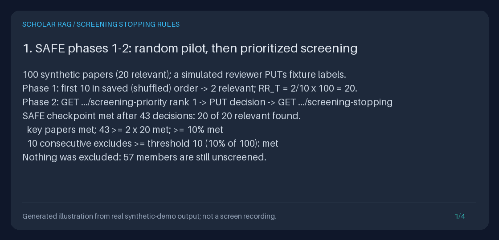

# Decide when to stop screening, with evidence

When you screen titles and abstracts in prioritized order (most likely relevant first),
relevant papers surface early and the rest of the queue becomes mostly irrelevant. The
hard question is **when it is reasonably safe to stop**. This feature evaluates three
published stopping rules over a saved collection's recorded human decisions and reports
the evidence for *your* decision:

1. **Consecutive irrelevant records** (the ASReview LAB heuristic): how many excludes in a
   row since the last include or unsure, against a threshold of N records or a
   percentage of the collection.
2. **A SAFE-style checkpoint** (Boetje & van de Schoot, 2024): the four phase-2
   conditions of the SAFE procedure (key papers found, at least twice the estimated
   number of relevant records screened, a minimum percentage screened, and a run of
   irrelevant records).
3. **buscar's statistical test** (Callaghan & Mueller-Hansen, 2020): screen a seeded,
   reproducible random sample of the records still unscreened, then get an exact
   hypergeometric p-value for the null hypothesis "recall is below the target", a recall
   estimate and a recall lower bound at your confidence level.

**It is strictly advisory.** Nothing here records, changes or suggests a decision,
excludes or hides a member, marks anything screened or stops screening. Unscreened and
stale members still need your explicit decision through the
[human screening workbench](HUMAN_SCREENING_WORKBENCH_GUIDE.md) or the
[screening API](PAPER_SCREENING_GUIDE.md). Every response lists its assumptions and
limitations next to the numbers.

[](../assets/screening-stopping-rules.gif)

The static preview links to an opt-in four-frame GIF. It is a **generated illustration of
actual offline synthetic execution** (real API JSON fields and measured numbers), not
browser footage or a benchmark on real literature. The
[measured transcript](../assets/screening-stopping-rules.txt) is the text alternative.
All papers and labels are original synthetic fixtures.

## Contents

- [Why this closes a workflow gap](#why-this-closes-a-workflow-gap)
- [Prerequisites](#prerequisites)
- [Quickstart: offline demo](#quickstart-offline-demo)
- [Python: complete standalone example](#python-complete-standalone-example)
- [Browser walkthrough](#browser-walkthrough)
- [API reference](#api-reference)
- [How the recorded order is built](#how-the-recorded-order-is-built)
- [Rule 1: consecutive irrelevant records](#rule-1-consecutive-irrelevant-records)
- [Rule 2: SAFE-style checkpoint](#rule-2-safe-style-checkpoint)
- [Rule 3: buscar random-sample recall test](#rule-3-buscar-random-sample-recall-test)
- [Worked example with the demo's numbers](#worked-example-with-the-demos-numbers)
- [Choosing parameters for small collections](#choosing-parameters-for-small-collections)
- [How it interacts with existing features](#how-it-interacts-with-existing-features)
- [Safety and limitations](#safety-and-limitations)
- [Troubleshooting](#troubleshooting)
- [FAQ](#faq)
- [Limitations and roadmap](#limitations-and-roadmap)
- [Reproduce and present](#reproduce-and-present)

## Why this closes a workflow gap

The repository already ordered pending papers most likely relevant first
([screening prioritization](SCREENING_PRIORITIZATION_GUIDE.md)) and supported blind
[dual-reviewer screening](DUAL_REVIEWER_SCREENING_GUIDE.md), but nothing answered "may I
stop now?". The [progress report](SCREENING_REPORT_GUIDE.md) states that it has no recall
estimates or stopping recommendations, and the prioritization guide explains why the
ordering itself reports no stopping signal: stored decisions have per-paper revisions and
server wall-clock times, not a guaranteed global sequence. This feature closes the gap
without pretending otherwise: it **uses the recorded times explicitly, says so, checks
them for detectable inconsistencies**, and offers a test (buscar) whose validity rests on
random sampling rather than on the order of earlier decisions.

References checked on 2026-11-24 and re-verified on **2026-11-26** (America/Los_Angeles;
buscar's formula against `calculate_h0` in the
[buscarpy source](https://github.com/mcallaghan/buscarpy/blob/main/buscarpy/__init__.py),
SAFE's phase-2 conditions against the PMC full text):

| Reference | What it offers | What this repository lacked | What this feature does |
| --- | --- | --- | --- |
| [ASReview LAB](https://github.com/asreview/asreview) ([`NConsecutiveIrrelevant`](https://github.com/asreview/asreview/blob/main/asreview/models/stoppers.py), [progress docs](https://asreview.readthedocs.io/en/latest/lab/progress.html)) | Stop after N consecutive irrelevant records; LAB's `/stopping` endpoint reports the records since the last relevant one, with a default threshold of 50 | Any stopping signal | The same count over recorded decisions, N as records or a percentage, with a conservative placement and inconsistency checks |
| [SAFE procedure](https://doi.org/10.1186/s13643-024-02502-7) ([PMC full text](https://pmc.ncbi.nlm.nih.gov/articles/PMC10908130/)) | Phase 2 stops when key papers are found, at least 2 x RR_T records are screened (RR_T extrapolated from a random training set), at least 10% is screened and no relevant record appeared in the last, for example, 50 | A combined checkpoint | All four conditions with per-condition status; RR_T and key papers are your inputs |
| [buscar](https://github.com/mcallaghan/buscarpy) ([Callaghan & Mueller-Hansen 2020](https://doi.org/10.1186/s13643-020-01521-4)) | Hypergeometric test of H0 "recall < target" from a random sample of the unscreened remainder | Recall estimates, a statistical stopping criterion, a reproducible sample | A seeded SHA-256 sample queue, exact rational p-values, a recall estimate, the inverted-test lower bound and a projection of records still needed |
| [ASReview Insights](https://github.com/asreview/asreview-insights) | Recall curves, WSS and ERF for simulations on fully labeled data | A discovery curve over real decisions | `includes_so_far` per recorded position (a discovery curve); WSS/ERF need ground truth, so they stay in the [simulation](SCREENING_PRIORITIZATION_GUIDE.md#simulation-prioritized-vs-saved-order) |

Deliberately left out: automatic stopping or exclusion (the human decides), SAFE phases 3
and 4, buscar's biased-urn variant (which treats the last screened records as a sample
under an assumed ranking bias), persisted sample plans and multi-reviewer pooling. See
[Limitations and roadmap](#limitations-and-roadmap).

## Prerequisites

- Python 3.11+ and [uv](https://docs.astral.sh/uv/) (`uv sync --extra dev`).
- A saved [paper collection](PAPER_COLLECTIONS_GUIDE.md) with human screening decisions
  recorded at its current revision. No API keys, models or network access are used.
- For buscar: a seed you choose before seeing the sample, and the patience to screen the
  sample in the listed order.
- For the SAFE checkpoint (optional): your list of key papers chosen in advance and an
  estimate RR_T of the relevant records in the whole collection, for example from a
  random pilot sample.

## Quickstart: offline demo

From the repository root:

```bash
uv sync --extra dev
OUTPUT_PARENT="$(mktemp -d)"
OUTPUT="$OUTPUT_PARENT/screening-stopping"
uv run --no-sync python -m scripts.demo_screening_stopping --output-dir "$OUTPUT"
uv run --no-sync python -m scripts.create_screening_stopping_gif \
  --transcript "$OUTPUT/transcript.txt" \
  --output "$OUTPUT/preview.gif" --still "$OUTPUT/preview.png"
printf 'Actual artifacts: %s\n' "$OUTPUT"
```

The demo (about one second) loads the 100 synthetic papers of the prioritization demo
(20 relevant) into a temporary database and lets a **simulated reviewer** record fixture
labels through the real `PUT` screening API:

1. SAFE phase 1: the first 10 papers in saved (shuffled) order are screened as a random
   pilot; 2 are relevant, so RR_T = 2/10 x 100 = 20.
2. SAFE phase 2: the reviewer repeatedly takes rank 1 from `GET .../screening-priority`,
   records it and reads `GET .../screening-stopping`, until the SAFE checkpoint is met
   after 43 decisions (all 20 relevant papers found, 10 consecutive excludes).
3. buscar: with seed 20261124 the reviewer screens the 57 unscreened papers in sample
   order; after 44 sampled records p = 13/266 = 0.049 < 0.05.

It saves `checkpoint.json`, `sample-start.json`, `sample-final.json`, `stopping.html`,
`checks.json` and the four-panel `transcript.txt`. It refuses existing output paths,
ignores ambient keys and database settings, and guards sockets, HTTP clients, retrieval,
generation, event writes and collection mutation. Measured checks include: browser
statuses and the exact p-value equal the JSON, assessment reads leave the database bytes
unchanged, `POST` returns 405, and a restarted app returns byte-identical JSON. The
collection ID is fixed in the demo only, because the sample order hashes it.

## Python: complete standalone example

Run from `src/` (or with the package installed) using `uv run --no-sync python`. Twelve
synthetic papers, four relevant; prioritized screening found the four includes first.
This example asks for 80% recall at 90% confidence:

```python
from pathlib import Path
from tempfile import TemporaryDirectory

from retrieval.models import Document
from storage.document_store import SQLiteDocumentStore
from storage.paper_screening import ScreeningSubmission, SQLitePaperScreening
from storage.screening_stopping import ScreeningStoppingAssessment, assess_screening_stopping

papers = [f"paper-{index:02d}" for index in range(1, 13)]
relevant = {"paper-01", "paper-02", "paper-03", "paper-04"}  # synthetic fixture labels
with TemporaryDirectory(prefix="stopping-example-") as temporary:
    database = Path(temporary) / "synthetic.sqlite3"
    SQLiteDocumentStore(database).add_documents(
        [
            Document(
                document_id=key, title=f"Synthetic {key}", text="Abstract.", source="synthetic"
            )
            for key in papers
        ],
        [],
    )
    screening = SQLitePaperScreening(database)
    collection = screening.collections.create(name="Synthetic review", document_ids=papers)

    def decide(key: str) -> None:
        screening.submit(
            collection.collection_id,
            key,
            ScreeningSubmission(
                collection_revision=1,
                expected_decision_revision=0,
                decision="include" if key in relevant else "exclude",
                reason="Synthetic example decision.",
            ),
        )

    def assess(**parameters: object) -> ScreeningStoppingAssessment:
        return assess_screening_stopping(
            screening,
            collection.collection_id,
            collection_revision=1,
            target_recall=0.8,
            confidence=0.9,
            **parameters,
        )

    for key in papers[:6]:  # prioritized screening found 4 includes, then 2 excludes
        decide(key)
    checkpoint = assess(irrelevant_run=2, estimated_relevant=3, key_document_ids=["paper-01"])
    rule = checkpoint.consecutive_irrelevant
    print("consecutive excludes:", rule.current_run, "of", rule.threshold, "->", rule.status)
    print("SAFE checkpoint:", checkpoint.safe_checkpoint.status)
    start = checkpoint.recall_test
    print(
        "recall test:", start.status, "| sample_after", start.sample_after, "| urn", start.urn_size
    )
    sample = {
        "sample_seed": 20261124,
        "sample_after": start.sample_after,
        "sample_urn_sha256": start.urn_sha256,
    }
    test = assess(**sample).recall_test
    print(
        "K_hat",
        test.h0_min_relevant_in_urn,
        "| needed if irrelevant",
        test.additional_irrelevant_needed,
    )
    for key in test.next_document_ids:  # screen the seeded sample in its listed order
        decide(key)
        test = assess(**sample).recall_test
        print(f"sampled {test.sample_size}: p = {test.p_value_exact} -> {test.status}")
        if test.status == "met":
            break
    print("recall lower bound at 90% confidence:", test.recall_lower_bound)
    print("unscreened members left:", len(test.next_document_ids))
```

Expected output:

```text
consecutive excludes: 2 of 2 -> met
SAFE checkpoint: met
recall test: not_started | sample_after 6 | urn 6
K_hat 2 | needed if irrelevant 4
sampled 1: p = 2/3 -> not_met
sampled 2: p = 2/5 -> not_met
sampled 3: p = 1/5 -> not_met
sampled 4: p = 1/15 -> met
recall lower bound at 90% confidence: 0.8
unscreened members left: 2
```

Every number can be checked by hand: K_hat = floor(4 / 0.8 - 4) + 1 = 2, and with no
relevant record among n sampled of the 6-member urn, p = C(6 - n, 2) / C(6, 2) =
(6 - n)(5 - n) / 30, which is 20/30, 12/30, 6/30 and 2/30. The test is met at n = 4
because 1/15 < alpha = 0.1, and the lower bound 4 / (4 + 1) = 0.8 reaches the target
exactly when the test rejects. Two members remain unscreened: **the assessment did not
exclude them**; recording their decisions, or documenting why you stop, is up to you.

## Browser walkthrough

1. Start the app (`uv run uvicorn api.main:app --host 127.0.0.1 --port 8000`) and open
   `/explore/collections`. Open a saved collection.
2. Next to **Most likely relevant first**, choose **When could you stop screening?
   Advisory stopping rules and a recall test**. The same link appears on the
   prioritized queue and on every member's screening form.
3. The page (`/explore/screening-stopping`, read-only, no scripts) shows:
   - current counts for all members and whether every member is already screened (if
     some decisions are still unsure, the notice asks you to resolve them first);
   - **1. Consecutive irrelevant records**: status, run, threshold and the excludes in
     the run;
   - **2. SAFE-style checkpoint**: overall status and a table of the four conditions;
   - **3. Random-sample recall test**: before a sample exists, a form asks for a seed;
     after you submit it, the page lists the sample in order with links to each
     member's explicit screening form, the exact p-value, K_hat, recall estimate, lower
     bound and how many pending sample records would still be needed;
   - the recorded decision order (a discovery curve in `Includes so far`) with any order
     warnings, a GET form to change parameters, and the assumptions and limitations.
4. Screen the sample in the listed order: open each form, record your own decision, then
   return with Back or the bookmarked page URL. The URL (seed, `sample_after`,
   `sample_urn_sha256`) is the complete identity of your sample.

The page is a GET form round trip: reading or reassessing never writes. Key papers are
entered one exact ID per line; IDs that themselves contain line breaks need the JSON API.

## API reference

`GET /collections/{collection_id}/screening-stopping` returns a
`ScreeningStoppingAssessment` (`schema_version` "1.0", `advisory_only: true`). Every
response carries `Cache-Control: no-store` and `X-Content-Type-Options: nosniff`.

```bash
curl -s "http://127.0.0.1:8000/collections/$COLLECTION/screening-stopping?collection_revision=3"
curl -s "http://127.0.0.1:8000/collections/$COLLECTION/screening-stopping?collection_revision=3\
&target_recall=0.95&confidence=0.95&irrelevant_run_percent=10&estimated_relevant=20\
&key_document_id=paper-a&key_document_id=paper-b\
&sample_seed=20261124&sample_after=43&sample_urn_sha256=$URN"
```

### Query parameters

| Parameter | Type | Default | Limits | Meaning |
| --- | --- | --- | --- | --- |
| `collection_revision` | integer | required | 1 to 2^63 - 1 | Exact collection revision; a stale revision is a 409 |
| `target_recall` | decimal | 0.95 | above 0, at most 1, at most 6 decimal places | buscar target recall (tau) |
| `confidence` | decimal | 0.95 | above 0, below 1, at most 6 places | 1 - alpha for the test and the lower bound |
| `irrelevant_run` | integer | none | 1 to the member count | Run threshold N in records |
| `irrelevant_run_percent` | integer | 10 when neither is given | 1 to 100 | N = ceil(percent x members / 100), at least 1 |
| `min_screened_percent` | integer | 10 | 1 to 100 | SAFE minimum share of members screened |
| `estimated_relevant` | integer | none (condition not evaluable) | 0 to the member count | SAFE RR_T |
| `key_document_id` | string, repeatable | none (condition not evaluable) | up to 100 unique exact member IDs | SAFE key papers |
| `sample_seed` | integer | none (test not started) | 0 to 2^63 - 1; requires `sample_after` | Seed of the random sample |
| `sample_after` | integer | none | 0 to the members with a current decision | Recorded decisions before the sample was drawn |
| `sample_urn_sha256` | 64 lowercase hex | none | only with `sample_seed` | Verifies the urn the sample was drawn from |

Give either `irrelevant_run` or `irrelevant_run_percent`, not both. Numbers must be plain
ASCII (`0.95`, not `.95`, `9.5e-1` or full-width digits). Unknown, duplicate (except
`key_document_id`), invalid Unicode, NUL and oversized (over 32 KiB) queries fail.

### Response fields

| Field | Meaning |
| --- | --- |
| `counts`, `total_documents`, `all_screened` | Current statuses of every member; `all_screened` when none is unscreened or stale |
| `parameters` | Effective parameters including defaults; `irrelevant_run` is the resolved N and `irrelevant_run_basis` says whether it came from records or a percentage |
| `timeline.items[]` | Members with a current decision in recorded order: `position`, `document_id`, `decision`, `first_decided_at`, `decided_at`, `first_decision_retained`, `tied_with_previous`, `includes_so_far` |
| `timeline.order_reliable`, `order_warnings`, `tied_positions` | Detected time inconsistencies and ties |
| `consecutive_irrelevant` | `status` (`met`/`not_met`/`not_evaluable`), `threshold`, `current_run`, both as % of the collection, `last_relevant_at`, `run_document_ids`, `explanation` |
| `safe_checkpoint` | `status` (`met`/`not_met`/`incomplete`), four `criteria` with `name`, `status`, `detail`, and `key_documents_not_included` |
| `recall_test` | `status` (`not_started`/`met`/`not_met`/`not_evaluable`), `sample_after`, `urn_size`, `urn_sha256`, `sample_order[]`, `next_document_ids`, `blocked_by_unsure`, `unsure_before_sample`, `sample_size`, `sample_relevant`, `relevant_before_sample`, `decided_outside_sample`, `relevant_outside_sample`, `relevant_seen`, `h0_min_relevant_in_urn` (K_hat), `p_value`, `p_value_exact`, `alpha`, `recall_estimate`, `recall_lower_bound`, `additional_irrelevant_needed`, `explanation` |
| `assumptions`, `limitations` | The disclosures that apply to every number above |

When the test is `not_started`, `sample_after` and `urn_sha256` describe the sample you
would draw now (every currently pending member). Pass both back with your seed.

### Errors

Errors use the collection envelope `{"detail": {"code": "...", "message": "..."}}`.

| Status | Code | When |
| --- | --- | --- |
| 404 | `collection_not_found` | The exact collection does not exist |
| 405 | `screening_stopping_method_not_allowed` | Any method but GET; nothing is recorded (`Allow: GET`) |
| 409 | `collection_revision_conflict` | The collection changed; read its revision again |
| 409 | `collection_documents_missing`, `invalid_collection_record`, `invalid_screening_record`, `invalid_screening_history_record`, `invalid_screening_stopping` | Missing members or invalid/inconsistent saved data; nothing is repaired |
| 409 | `stopping_sample_boundary_tied` | Members on both sides of `sample_after` share one recorded time |
| 409 | `stopping_sample_urn_changed` | The members unscreened before `sample_after` differ from `sample_urn_sha256` |
| 413 | `screening_stopping_history_too_large` | More than 10,000 retained decisions would be read |
| 413 | `screening_stopping_too_large` | The assessment exceeds 524,288 UTF-8 bytes |
| 422 | `invalid_screening_stopping_request` | Invalid ID, revision, parameter format, bound or combination |
| 422 | `stopping_key_document_not_member` | A key paper is not a member of this revision |
| 422 | `stopping_parameter_out_of_range` | A run or estimate exceeds the members, or `sample_after` exceeds the decided members |
| 503 | `collection_storage_error` | Existing storage unavailable |

### Python

`storage.screening_stopping.assess_screening_stopping(screening, collection_id, *,
collection_revision, target_recall=0.95, confidence=0.95, irrelevant_run=None,
irrelevant_run_percent=None, min_screened_percent=10, estimated_relevant=None,
key_document_ids=(), sample_seed=None, sample_after=None, sample_urn_sha256=None)` takes
an `SQLitePaperScreening` and raises `CollectionError` with the codes above. The pure
helpers `hypergeometric_pmf`, `hypergeometric_cdf`, `min_relevant_for_missed_target`,
`recall_p_value`, `recall_lower_bound`, `recall_estimate`, `screens_until_met`,
`sample_order` and `urn_digest` use exact integers and `fractions.Fraction`.

## How the recorded order is built

Only decisions recorded **at the collection's current revision** count; members whose
latest decision belongs to an earlier revision are `stale` and therefore pending.

- **Position.** Each member with a current decision appears once, at the time of its
  *first* retained decision at this revision (`first_decided_at`), read from the
  append-only [decision history](SCREENING_HISTORY_GUIDE.md). Ties order by document ID
  and are reported (`tied_with_previous`, `tied_positions`).
- **Times are server wall-clock times**, saved as `updated_at` with each decision. They are
  not a guaranteed global sequence: a clock can repeat a value or move backwards. The
  assessment says so in `assumptions` and checks what the data can check:
  - within one member, a later decision revision must not have an earlier time;
  - no decision from an earlier collection revision (including a stale member's latest
    one) may be later than a decision at the current revision (the collection had to be
    edited in between);
  - the newest retained history record must equal the current decision, and decision
    revisions must be contiguous (otherwise a 409 `invalid_screening_history_record`).
  Any detected inconsistency sets `order_reliable: false`, lists `order_warnings` and
  makes every order-based rule `not_evaluable`. Undetected clock changes remain possible.
- **Unretained history.** Decisions saved before history existed have no first-decision
  record; such members use the oldest retained time, are flagged
  `first_decision_retained: false`, and never count toward an irrelevant run.

## Rule 1: consecutive irrelevant records

Let L be the most recent recorded time of a current **include or unsure** decision (their
latest decision time). The run is the number of current **excludes** whose first decision
at this revision was recorded **strictly after** L. This placement, relevant records at
their latest time and excludes at their first, gives the shortest run any placement of the
recorded times allows, so corrections and equal times never lengthen it. Unsure always
ends a run because it may be relevant.

The rule is `met` when the run reaches N. N comes from `irrelevant_run` (records) or
`irrelevant_run_percent` (default 10%, rounded up, at least 1). ASReview LAB uses 50
records for large datasets; this repository's collections hold at most 100 members, where
50 would be half the collection. In the demo, N = 10 of 100 members.

It is a heuristic: a long run makes another relevant record less likely but gives no
error rate. In the [prioritization simulation](SCREENING_PRIORITIZATION_GUIDE.md#stopping-signal-the-ordering-itself-reports-none),
a run of 10 in *saved* order would have stopped one shuffle before its first include.

## Rule 2: SAFE-style checkpoint

SAFE phase 2 ends active-learning screening when all four conditions hold. Each one is
reported separately:

| Condition (`name`) | Met when | Not evaluable when |
| --- | --- | --- |
| `key_papers_included` | Every `key_document_id` is a current include | No key papers were supplied |
| `screened_twice_estimated_relevant` | Screened members >= 2 x `estimated_relevant` | No RR_T was supplied |
| `minimum_screened_percent` | Screened x 100 >= `min_screened_percent` x members | Never |
| `consecutive_irrelevant` | Rule 1 is met | The recorded order is unreliable |

"Screened" means a current include, exclude or unsure at this revision. The checkpoint is
`met` only when all four are met, `not_met` when any is not met, and `incomplete` when none
fails but at least one cannot be evaluated. SAFE estimates RR_T from a random training
set: RR_T = (relevant in the set / set size) x records. A 10-record pilot is crude: in the
demo's ten saved-order shuffles the first 10 papers held 0 to 6 relevant (RR_T 0 to 60
against a true 20). SAFE then continues with a different model (phase 3) and quality
checks (phase 4), which are outside this feature.

## Rule 3: buscar random-sample recall test

When you would stop prioritized screening, draw a random sample from the **urn**: every
member not yet decided at this revision. You choose the seed; the response gives
`sample_after` (how many recorded decisions came before the sample) and `urn_sha256`.

- **Sample order.** Members of the urn sort by the SHA-256 hex digest of the compact JSON
  array `["scholar-rag-stopping-sample-v1", seed, collection_id, collection_revision,
  document_id]`. It is reproducible on any platform and independent of Python's `random`
  module; it is not secret.
- **Observed sample.** The longest prefix of the sample order whose members are all
  current includes or excludes. An unsure member pauses the sample (`blocked_by_unsure`)
  until you resolve it. Urn members decided outside that prefix (for example from the
  prioritized queue) count as found records, never as sample observations
  (`decided_outside_sample`). The prefix is defined by position only: a member you
  happened to decide from the prioritized queue before reaching it in the sample still
  counts as an observation once the prefix reaches it, although it was not chosen at
  random. Finish the sample before you return to the prioritized queue.
- **Unsure before the sample.** A member decided unsure before the sample is neither a
  found record nor part of the urn, so nothing bounds its relevance. While any exists,
  the test is `not_evaluable` with no p-value or recall figures, and
  `unsure_before_sample` (also shown in the `not_started` response and on the page with
  links to each screening form) lists the members to resolve to include or exclude.
- **Null hypothesis.** With r_before relevant records found before the sample and r_seen
  found in total, final recall is r_seen / (r_before + K) when the urn holds K relevant
  records, so H0 "recall < tau" means K >= K_hat with

  `K_hat = floor(r_seen / tau - r_before) + 1`

  computed with exact fractions (0.95 is 19/20; binary floats can be off by one for
  targets such as 0.035).
- **p-value.** `p = P(X <= k | N_urn, K_hat, n)`, the hypergeometric lower tail for k
  relevant records among n sampled from an urn of N_urn holding K_hat relevant ones,
  summed exactly as C(K, x) C(N - K, n - x) / C(N, n). If fewer than K_hat urn members can
  still be relevant given every known label, H0 is impossible and p = 0. The test is
  `met` when p < alpha = 1 - confidence.
- **Recall lower bound.** The largest K whose lower tail is still at least alpha gives
  `recall_lower_bound = r_seen / (r_before + K)`. The test rejects tau exactly when this
  bound reaches tau (a property the tests check exhaustively).
- **Recall estimate.** `r_seen / (r_seen + (k / n) x unscreened)`: the sample's relevant
  fraction extrapolated to urn members still unscreened. It is `null` until n > 0 and a
  relevant record has been found.
- **Projection.** `additional_irrelevant_needed` is how many more pending sample records,
  all screened irrelevant, would bring p below alpha (0 once the test is met). Urn
  members already decided outside the sample join it with their known labels when the
  prefix reaches them. It is `null` before a sample is drawn, when the test is not
  evaluable, and when an unsure sample member would be reached first.

As in buscar's interactive use, p is recomputed after each sampled decision without a
correction for repeated looks.

## Worked example with the demo's numbers

After the SAFE checkpoint, 43 members were screened and 20 were relevant; N_urn = 57.

- K_hat = floor(20 / 0.95 - 20) + 1 = floor(1.0526) + 1 = **2**: recall would fall below
  95% only if at least 2 relevant papers were still unscreened (20/22 = 0.909).
- Every sampled paper was irrelevant (k = 0), so
  p(n) = C(55, n) / C(57, n) = (57 - n)(56 - n) / (57 x 56).
- n = 43: 14 x 13 / 3192 = 0.057, not below 0.05. n = 44: 13 x 12 / 3192 = **13/266 =
  0.049**, so the test is met after 44 sampled records (87 of 100 screened).
- Lower bound: one relevant urn paper still has P(X = 0) = 13/57 = 0.228 >= 0.05, two
  give 0.049 < 0.05, so recall >= 20 / (20 + 1) = **0.952** at 95% confidence.
- Before the sample, the projection already said 44: the cost of the guarantee is visible
  before you start.

## Choosing parameters for small collections

buscar was designed for thousands of records. In a collection of at most 100, K_hat is
small, and showing that **no** or **one** relevant record remains needs most of the urn:
with K_hat = 1 the test needs n > 95% of N_urn, with K_hat = 2 about 78%, with K_hat = 3
about 63%. A lower target or confidence makes the test cheaper and weaker; choose them
before you look at the data and report them. For small collections, screening everything
is often simplest; the assessment then documents why stopping was safe.

## How it interacts with existing features

| Feature | Interaction |
| --- | --- |
| [Human paper screening](PAPER_SCREENING_GUIDE.md) and the [screening workbench](HUMAN_SCREENING_WORKBENCH_GUIDE.md) | The only way to record the decisions read here. Each "screen next" link opens the unchanged explicit form for that member; the assessment itself never writes. |
| [Screening prioritization](SCREENING_PRIORITIZATION_GUIDE.md) | Supplies the "most likely relevant first" order you screen in SAFE phase 2. The ordering still reports no stopping signal of its own and links here; no rule uses its scores. |
| [Decision history](SCREENING_HISTORY_GUIDE.md) | The recorded order is rebuilt from the same append-only history, read in pages of 100 per member. |
| [Dual-reviewer screening](DUAL_REVIEWER_SCREENING_GUIDE.md) | Only the unlabeled `default` reviewer's decisions are read (the screening form and `PUT .../screening/{document_id}`). Labeled reviewer decisions, resolutions and final decisions are not pooled; see the roadmap. |
| [Progress report](SCREENING_REPORT_GUIDE.md) and [exports](SCREENING_EXPORT_GUIDE.md) | Unchanged: they contain no recall estimate or stopping recommendation. If you cite an assessment, save its JSON beside the report. |
| [Screened-collection retrieval](SCREENED_COLLECTION_GUIDE.md) | Unchanged: retrieval uses current human includes only. Stopping never adds, removes or hides one. |
| [Collection edits](NATIVE_COLLECTION_EDITOR_GUIDE.md) | Editing membership starts a new revision: earlier decisions become `stale` (pending), the recorded order starts again, and a URL with the old revision fails with 409 `collection_revision_conflict`, which ends an open sample. |
| Event log, models, retrieval and network | None are used. Assessments write no agent event and are not cached. |

## Safety and limitations

**Advisory by construction.** Every response has `advisory_only: true` and the same six
`assumptions` and five `limitations`, and the browser page shows both lists beside the
numbers. Reading never records, changes or suggests a decision, never excludes, hides or
marks a member screened and never stops screening; `POST`, `PUT`, `PATCH` and `DELETE`
return 405 with `Allow: GET`. A `met` status is evidence for a decision you document,
not permission to skip anyone: unscreened and stale members stay pending until you
decide them or record why you stopped.

**What the recall test needs to be valid.**

- Choose the target recall, the confidence and the seed **before** you see the sample,
  and use one seed per assessment. Drawing seeds until a sample looks favorable, or
  raising the target after the p-value is known, invalidates the test.
- Use the `sample_after` and `urn_sha256` of the `not_started` response at the moment you
  draw, and always send `sample_urn_sha256` back: it is what proves the urn is unchanged.
- Screen the sample in the listed order without skipping, and finish it before you return
  to the prioritized queue (see *Observed sample* above).
- p is recomputed after every sampled decision without an adjustment for repeated looks,
  as in buscar's interactive use; stopping the first time p < alpha is slightly
  optimistic.

**What no rule can see.**

- Recall is relative to this collection's members, not to every relevant study: records
  the search never retrieved are invisible.
- Each human decision is treated as correct. The SAFE authors note that "humans typically
  miss around 10% of the relevant records"; this assessment does not model that error.
- The consecutive-irrelevant and SAFE-style checks are heuristics without an error rate,
  and the recorded order relies on server wall-clock times (checked, but not guaranteed).

**Bounds.** Collections hold at most 100 members. One assessment reads at most 10,000
retained history records and returns at most 524,288 UTF-8 bytes; the JSON query is
limited to 32 KiB, the browser URL to 64 KiB and the escaped page to 1 MiB. Exceeding a
bound fails with no partial result.

**Privacy and access.** There is no authentication: keep the app on loopback or behind
your own access controls. Document IDs, key papers and the sample identity live in URLs
and browser history. Responses are `Cache-Control: no-store` and
`X-Content-Type-Options: nosniff`; the page uses no scripts, external resources,
cookies or browser storage, and no paper text is sent anywhere.

## Troubleshooting

| Symptom | What to do |
| --- | --- |
| 409 `collection_revision_conflict` | The collection was edited. Read its current revision; decisions from the old revision are now `stale` and an open sample has ended. |
| 409 `stopping_sample_urn_changed` | The members decided before `sample_after` are not the urn you drew from: a wrong `sample_after`, or a decision recorded with an earlier server time. Read the `not_started` response again and draw a new sample with a new seed; report both. |
| 409 `stopping_sample_boundary_tied` | The last decision before the sample and the first one after it share one recorded time, so the boundary is ambiguous. Draw a new sample. |
| `recall_test.status` is `not_evaluable` | Either `unsure_before_sample` lists unsure decisions recorded before the sample (resolve each to include or exclude), or `timeline.order_warnings` lists a detected time inconsistency and no `sample_urn_sha256` was sent (send the digest you saved when you drew the sample; without it, draw a new one). |
| `consecutive_irrelevant.status` is `not_evaluable` | The same warnings make the run uncountable for this revision. Check the server clock; the SAFE checkpoint is then at best `incomplete`. |
| `blocked_by_unsure` names a member | That sample member is unsure. Resolve it to include or exclude; later sample decisions count again. |
| SAFE checkpoint stays `incomplete` | Supply `key_document_id` values and `estimated_relevant` (RR_T). |
| `additional_irrelevant_needed` is close to the whole urn | Expected in small collections (see above). Screening the rest may cost little more than the sample. |
| 422 `invalid_screening_stopping_request` for a decimal | Write `0.95`, not `.95`, `95%` or `9.5e-1`; at most 6 decimal places. Give a seed and `sample_after` together, and either `irrelevant_run` or `irrelevant_run_percent`. |
| 422 `stopping_parameter_out_of_range` | A run length or RR_T exceeds the members, or `sample_after` exceeds the members with a current decision. |
| 413 `screening_stopping_history_too_large` | More than 10,000 retained decisions would be read. Nothing was assessed; the bound protects the server. |
| The page says every member has a current decision | Nothing is left to stop screening; the rules are shown for audit. |

## FAQ

**Does `met` mean I should stop?** No. It means the stated rule's condition holds on
recorded decisions. Stopping is your documented judgment; many reviews combine a
statistical criterion with SAFE-style heuristics.

**Why does the prioritized queue still say it shows no stopping signal?** The ordering
is unchanged and still ranks only pending papers. This separate page states the
recorded-order assumption, checks it and offers a test whose validity rests on random
sampling instead.

**Why is the recall estimate 1.0 when the lower bound is 0.952?** With no relevant
record in the sample, the point estimate extrapolates zero remaining relevant records.
The lower bound is the conservative number: the most relevant records the urn could
still hold without the sample being implausible at your confidence level.

**Can I reuse or change a seed?** Reuse the same seed, `sample_after` and
`sample_urn_sha256` to continue one sample (the order is reproducible on any machine).
A new seed is a new sample; draw one only when the old one became invalid, and report
it.

**What should I report in a methods section?** The rule (buscar, Callaghan &
Mueller-Hansen 2020), target recall, confidence, seed, `sample_after`, `urn_sha256`, n,
k, the exact p-value and the recall lower bound, plus the SAFE inputs if you used them.
Save the JSON response; it contains every parameter and disclosure.

**Does it work with labeled dual reviewers?** It reads the unlabeled `default`
decisions only. Pooling labeled reviewers and resolutions is on the roadmap.

**Does it use a language model?** No. Answer generation elsewhere in the app can route
to current models such as GPT-6.2 Sol, Claude Opus 5.5, Gemini 4 Neon or Kimi K3.1 Pro,
but no stopping rule calls a model, and model output is never a screening decision.

**Why exact fractions instead of SciPy?** SciPy is not a dependency, and exact rational
arithmetic makes every p-value reproducible bit for bit and checkable by hand
(`p_value_exact`).

## Limitations and roadmap

Shipped: the three rules, the seeded sample queue, the JSON API, the Python function, the
read-only browser page with links from the collection, prioritized queue and screening
form, and an executed offline demo. Deliberately deferred:

- **The assessment inside the saved [progress report](SCREENING_REPORT_GUIDE.md)**: the
  report stays a pure function of one export; save the assessment JSON beside it.
- **A rendered recall/discovery curve**: `timeline.items[].includes_so_far` is the data;
  no chart is drawn. WSS and ERF need ground truth, so they stay in the
  prioritization simulation.
- **Event-log snapshots or persisted sample plans**: assessments are not saved; the URL
  (seed, `sample_after`, `sample_urn_sha256`) is the complete sample identity.
- **SAFE phases 3 and 4** (a second model and quality checks).
- **buscar's biased-urn variant** (Wallenius' noncentral hypergeometric) and its
  retrospective use, which treats every suffix of the screened sequence as a random
  sample.
- **Pooling labeled dual reviewers and resolutions**, and a correction for repeated looks.

## Reproduce and present

`scripts/demo_screening_stopping.py` runs the quickstart above against a temporary
database through the FastAPI test client (real routes, real JSON and HTML), with sockets,
HTTP clients, retrieval, generation, event writes and collection mutation patched to fail.
It saves the response bytes and writes `transcript.txt` from measured values only.
`scripts/create_screening_stopping_gif.py` renders the four transcript panels with the
repository's existing Pillow panel renderer (`scripts/create_evidence_gif.py`) into
[`docs/assets/screening-stopping-rules.gif`](../assets/screening-stopping-rules.gif) and
the still [`docs/assets/screening-stopping-rules.png`](../assets/screening-stopping-rules.png).
The test suite reruns the demo, compares its transcript with the committed
[text alternative](../assets/screening-stopping-rules.txt), re-renders the GIF and still
byte for byte and runs the Python example above.

```bash
uv run --no-sync pytest tests/test_screening_stopping.py tests/test_screening_stopping_api.py \
  tests/test_screening_stopping_explorer.py tests/test_screening_stopping_demo.py
```

**Portfolio use case:** open the demo's checkpoint, point out that 57 members are still
unscreened and nothing was excluded, then derive K_hat = 2 and p = 13/266 by hand from
the formulas above and compare them with `p_value_exact`. Finish with the assumptions a
reader must accept (recorded order, random sampling, correct and independent decisions)
and why the lower bound (0.952), not the point estimate (1.0), is the number to report.

Related guides: [paper screening](PAPER_SCREENING_GUIDE.md),
[screening prioritization](SCREENING_PRIORITIZATION_GUIDE.md),
[dual-reviewer screening](DUAL_REVIEWER_SCREENING_GUIDE.md),
[screening history](SCREENING_HISTORY_GUIDE.md) and
[progress report](SCREENING_REPORT_GUIDE.md).
