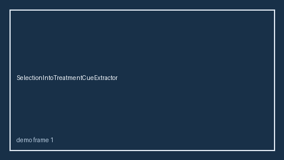

# SelectionIntoTreatmentCueExtractor Guide



Offline cue extractor.
Gap vs Elicit/Consensus/Connected Papers selection-into-treatment cue extractors. Distinct from `SelectionBiasCueExtractor` / `HealthyWorkerSurvivorCueExtractor`.

Stack: **GPT-5.5 / Claude Sonnet 4.6 / Gemini 3.x / Kimi K2**.

## Usage

```python
from retrieval.selection_into_treatment_cues import SelectionIntoTreatmentCueExtractor

rows = SelectionIntoTreatmentCueExtractor().extract(
    [{"paper_id": "p1", "abstract": "We discuss selection into treatment."}]
)
print(rows[0].flagged, rows[0].cues)
```

## Safety

Advisory only. No network I/O.
