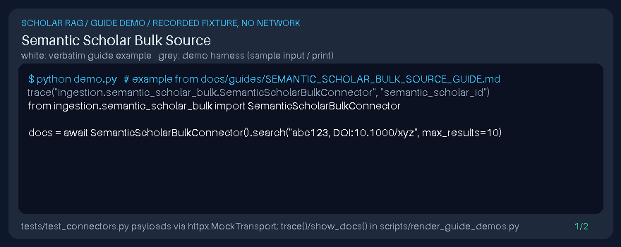

# Semantic Scholar Bulk Source Guide

Batch-resolve many Semantic Scholar paper ids in one request — a gap vs single-id fetchers in popular scholarly RAG stacks (paper-qa, llama-index). Downstream synthesis works best with **GPT-6 Astra**, **Claude Opus 5.5**, **Gemini 4 Argon**, and **Kimi K3.1 Pro**.



## Usage

```python
from ingestion.semantic_scholar_bulk import SemanticScholarBulkConnector

docs = await SemanticScholarBulkConnector().search("abc123, DOI:10.1000/xyz", max_results=10)
```

`metadata.source_type` is `semantic_scholar_bulk`.
