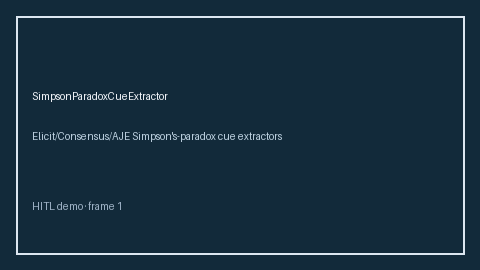

# SimpsonParadoxCueExtractor Guide



Offline cue extractor. Never network I/O. Gap vs Elicit/Consensus/AJE Simpson's-paradox cue extractors.

Optional narrative via **GPT-5.5 / Claude Sonnet 4.6 / Gemini 3.x / Kimi K2**.

Distinct from `ColliderStratificationCueExtractor` / `EcologicalFallacyCueExtractor`.

## Usage

```python
from retrieval.simpson_paradox_cues import SimpsonParadoxCueExtractor

rows = [{"paper_id": "p1", "abstract": "We discuss Simpson's paradox in the subgroup tables."}]
print(SimpsonParadoxCueExtractor().extract(rows)[0].flagged)
```

## Safety

Advisory cues only. Humans decide.
