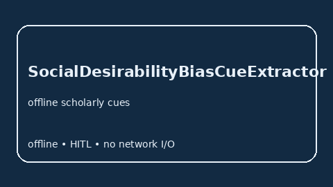

# SocialDesirabilityBiasCueExtractor Guide



Offline cue extractor for scholarly RAG pipelines.
Gap vs Elicit/Consensus/AJE social-desirability bias cue extractors. Distinct from `RecallBiasCueExtractor` / `InterviewerBiasCueExtractor`.

Optional polish via **GPT-5.5 / Claude Sonnet 4.6 / Gemini 3.x / Kimi K2**.

## Usage

```python
from retrieval.social_desirability_bias_cues import SocialDesirabilityBiasCueExtractor

rows = SocialDesirabilityBiasCueExtractor().extract(
    [{"paper_id": "p1", "abstract": "Mentions relevant bias cues."}]
)
print(rows[0].flagged, rows[0].cues)
```

## Safety

Advisory cues only. No network I/O. Humans decide.
