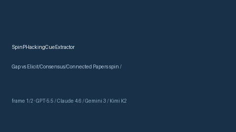

# SpinPHackingCueExtractor Guide



Offline cue extractor for scholarly evidence screening.
Gap vs Elicit/Consensus/Connected Papers spin / p-hacking / forking-paths cue extractors. Distinct from `NoveltyBiasCueExtractor` / `PublicationBiasCueExtractor`.

Optional polish via **GPT-5.5 / Claude Sonnet 4.6 / Gemini 3.x / Kimi K2**.

## Usage

```python
from retrieval.spin_p_hacking_cues import SpinPHackingCueExtractor

rows = SpinPHackingCueExtractor().extract(
    [{"paper_id": "p1", "abstract": "Authors show spin reporting and possible p-hacking concerns."}],
)
print(rows[0].flagged, rows[0].cues)
```

## Safety

Advisory cues only. No network I/O. Humans decide.
