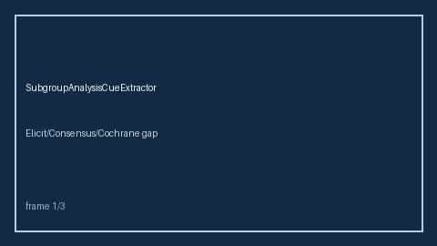

# SubgroupAnalysisCueExtractor Guide



Offline subgroup analysis cue extraction. Never network. Optional polish via **GPT-6 Astra / Claude Opus 5.5 / Gemini 4 Argon / Kimi K3.1 Pro**.

## Usage

```python
from retrieval.subgroup_analysis_cues import SubgroupAnalysisCueExtractor

print(SubgroupAnalysisCueExtractor().extract([{"paper_id": "p1", "abstract": "..."}]))
```
