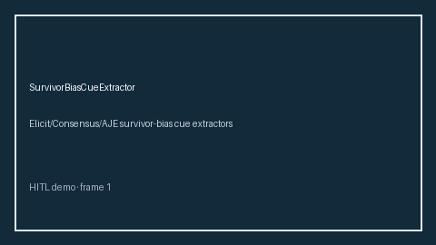

# SurvivorBiasCueExtractor Guide



Offline cue extractor. Never network I/O. Gap vs Elicit/Consensus/AJE survivor-bias cue extractors.

Optional narrative via **GPT-5.5 / Claude Sonnet 4.6 / Gemini 3.x / Kimi K2**.

Distinct from `SelectionBiasCueExtractor` / `HealthyWorkerEffectCueExtractor`.

## Usage

```python
from retrieval.survivor_bias_cues import SurvivorBiasCueExtractor

rows = [{"paper_id": "p1", "abstract": "We discuss survivor bias in the cohort."}]
print(SurvivorBiasCueExtractor().extract(rows)[0].flagged)
```

## Safety

Advisory cues only. Humans decide.
