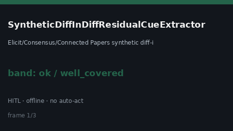

# SyntheticDiffInDiffResidualCueExtractor Guide



Offline residual cue extractor.
Gap vs Elicit/Consensus/Connected Papers synthetic diff-in-diff residual cue extractors. Distinct from `SyntheticControlCueExtractor` / `DifferenceInDifferencesCueExtractor`.

Stack: **GPT-6.1 / Claude Sonnet 5.5 / Gemini 3.x / Kimi K3**.

## Usage

```python
from retrieval.synthetic_diff_in_diff_residual_cues import SyntheticDiffInDiffResidualCueExtractor

rows = SyntheticDiffInDiffResidualCueExtractor().extract(
    [{"paper_id": "p1", "abstract": "We discuss synthetic diff in diff residual."}]
)
print(rows[0].flagged, rows[0].cues)
```

## Safety

Advisory only. No network I/O. Never auto-acts. Humans decide.
