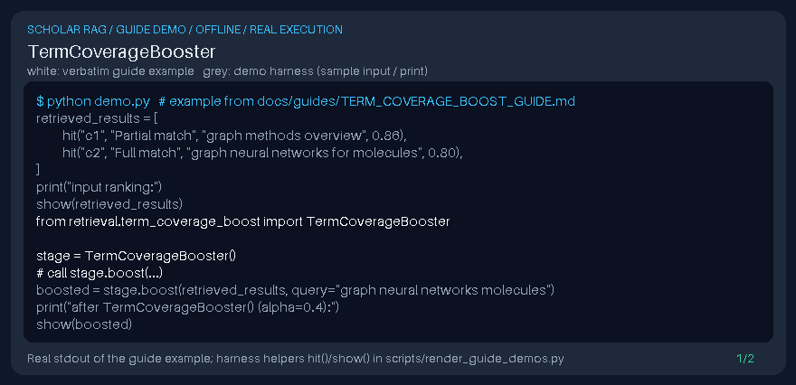

# TermCoverageBooster Guide



Gap fill vs Elasticsearch/Haystack coverage boosts distinct from symmetric Jaccard lexical overlap.

Works with GPT-6 Astra / Claude Opus 5.5 / Gemini 4 Argon / Kimi K3.1 Pro scholarly RAG pipelines.
Not a DOI connector.

## Usage

```python
from retrieval.term_coverage_boost import TermCoverageBooster

stage = TermCoverageBooster()
# call stage.boost(...)
```

See unit tests for edge cases.
