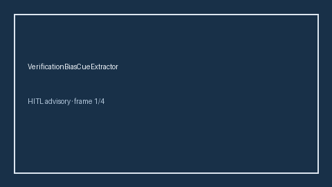

# VerificationBiasCueExtractor Guide



Offline deterministic cue extractor. Never network I/O. Gap vs Elicit/Consensus/AJE verification-bias cue extractors.

Optional later narrative via **GPT-5.5 / Claude Sonnet 4.6 / Gemini 3.x / Kimi K2**.

## Usage

```python
from retrieval.verification_bias_cues import VerificationBiasCueExtractor

cues = VerificationBiasCueExtractor().extract(
    [{"paper_id": "p1", "abstract": "Results may reflect verification bias in tertiary clinics."}]
)
print(cues[0].flagged, cues[0].cue_kind)
```
