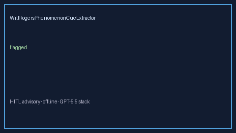

# WillRogersPhenomenonCueExtractor Guide



Offline cue extractor for deterministic title/abstract/methods patterns.
Gap vs Elicit/Consensus/Connected Papers Will-Rogers / stage-migration cue extractors. Distinct from `LeadTimeBiasCueExtractor` / `LengthBiasCueExtractor`.

Optional polish via **GPT-5.5 / Claude Sonnet 4.6 / Gemini 3.x / Kimi K2**.

## Usage

```python
from retrieval.will_rogers_phenomenon_cues import WillRogersPhenomenonCueExtractor

rows = WillRogersPhenomenonCueExtractor().extract(
    [{"paper_id": "p1", "abstract": "Authors describe will rogers phenomenon after restaging."}]
)
assert rows[0].flagged is True
```

## Safety

Advisory only. No network I/O. Humans decide.
