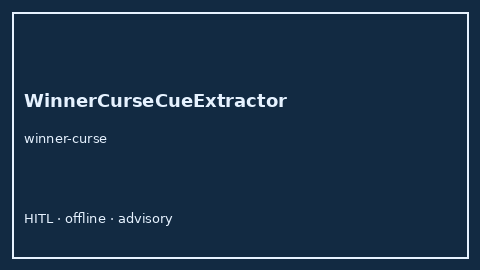

# WinnerCurseCueExtractor Guide



Offline advisory bias/method cue extractor.
Gap vs Elicit/Consensus/Connected Papers winner's-curse cue extractors. Distinct from `PublicationBiasCueExtractor` / `NoveltyBiasCueExtractor`.

Optional narrative via **GPT-5.5 / Claude Sonnet 4.6 / Gemini 3.x / Kimi K2**.

## Usage

```python
from retrieval.winner_curse_cues import WinnerCurseCueExtractor

rows = WinnerCurseCueExtractor().extract(
    [{"paper_id": "p1", "abstract": "We discuss winner curse."}]
)
print(rows[0].cues)
```

## Safety

Advisory only. No network I/O.
