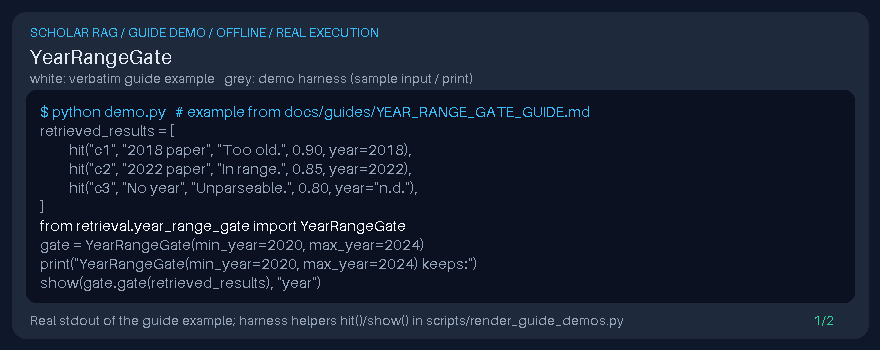

# YearRangeGate Guide



Local retrieval postprocessor for GPT-6 Astra / Claude Opus 5.5 / Gemini 4 Argon / Kimi K3.1 Pro pipelines (not a DOI connector).

Inspired by Haystack/LlamaIndex metadata year filters for temporal scoping of scholarly corpora.

## Usage

```python
from retrieval.year_range_gate import YearRangeGate
```

See unit tests for edge cases.
